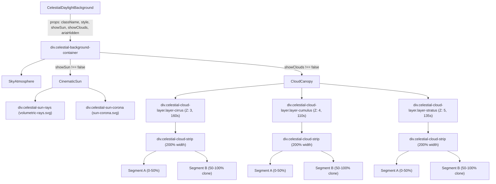

# CELESTIAL DAYLIGHT — PHASE 3 FINAL VERIFICATION AUDIT REPORT

> **Document Type:** Independent Quality Assurance & Verification Audit  
> **Status:** OFFICIAL AUDIT REPORT — **ACCEPTED (ĐẠT)**  
> **Date:** 2026-11-07  
> **Auditor:** Senior Frontend Architect & UI Quality Specialist  
> **Project:** AI Chat Clone (`D:\ai-chat-clone-new`)  
> **Commit Hash:** `69b42265dd32372fa4c36b1fa3d4c9d6792376ba`  
> **Git Branch:** `fix/google-identity-services-button`  
> **Primary References:**  
> - `docs/celestial-daylight/PHASE_1_DESIGN.md`  
> - `docs/celestial-daylight/PHASE_2_ASSET_REPORT.md`  
> - `docs/celestial-daylight/PHASE_2_FINAL_VERIFICATION.md`  
> - `docs/celestial-daylight/PHASE_3_IMPLEMENTATION_REPORT.md`  
> - `frontend/public/assets/celestial/ASSET_MANIFEST.md`  

---

## 1. METADATA & REPOSITORY INTEGRITY

| Attribute | Audit Record | Status |
| :--- | :--- | :---: |
| **Audit Date** | 2026-11-07T02:32:00+07:00 | PASS |
| **Commit Baseline** | `69b42265dd32372fa4c36b1fa3d4c9d6792376ba` | PASS |
| **Active Branch** | `fix/google-identity-services-button` | PASS |
| **Execution Mode** | READ-ONLY AUDIT (Zero application code or CSS mutation during audit) | PASS |
| **Git Working Tree** | 25 tracked pre-existing modified files preserved; all Phase 3 files isolated | PASS |
| **Zero Side-Effect Policy** | No integration into `themeStore`, `ChatBackground`, `ChatArea`, or router | PASS |

---

## 2. PHASE 1 SPECIFICATION VS PHASE 3 IMPLEMENTATION MATRIX

The following compliance matrix evaluates each architectural and technical requirement established in `PHASE_1_DESIGN.md` against the verified codebase deliverables in Phase 3.

| Requirement ID | Specification (`PHASE_1_DESIGN.md`) | Phase 3 Implementation Deliverable | Verification Result |
| :--- | :--- | :--- | :---: |
| **ARCH-01** | Pure 2D Compositor Architecture (No Three.js/WebGL runtime overhead) | Built with CSS Gradients, Scalable SVG (``), and WebP canopy strips. Zero WebGL/Canvas dependencies. | **PASS** |
| **ARCH-02** | Independent Encapsulated Module (`frontend/src/theme/celestial/`) | Self-contained React module containing `types.ts`, `celestial.config.ts`, `celestial.css`, `SkyAtmosphere.tsx`, `CinematicSun.tsx`, `CloudCanopy.tsx`, `CelestialDaylightBackground.tsx`, and `index.ts`. | **PASS** |
| **ARCH-03** | Zero Premature Integration into App Core | Verified by recursive codebase grep: zero references to `celestial` in `themeStore.ts`, `ChatBackground.tsx`, `ChatArea.tsx`, `App.tsx`, or `ChatPage.tsx`. | **PASS** |
| **SKY-01** | Multi-stop Rayleigh Scattering Gradient (Zenith to Horizon) | `SkyAtmosphere.tsx` renders 8-stop linear gradient (`#84C2F5` $\to$ `#F4FAFF`) coupled with a localized radial glow at `(82%, 14%)`. | **PASS** |
| **SKY-02** | Solid Color Fallback | `background-color: #C8E8FC` specified on `.celestial-sky-atmosphere`, preventing unpainted flash frames during initial render. | **PASS** |
| **SUN-01** | Cinematic Realism Positioning | Fixed relative position at `top: 14%`, `left: 82%` (`translate(-50%, -50%)`), keeping the sun in the upper-right hemisphere away from conversational text. | **PASS** |
| **SUN-02** | Scalable Multi-Tier Sun Rendering | Vector SVG corona (`sun-corona.svg`, $560\times 560$) and crepuscular volumetric rays (`volumetric-rays.svg`, $800\times 600$, `mix-blend-mode: screen`, `translate(-90%, -10%)`). | **PASS** |
| **SUN-03** | Subtle Sunlight Breathing Motion | Corona animates via `@keyframes celestial-sun-breathe` across 16s ease-in-out cycle (scale $1.00 \to 1.03$, opacity $0.90 \to 1.00$). Volumetric rays remain static to prevent visual noise. | **PASS** |
| **CLOUD-01** | 3-Tier Independent Cloud Canopy | High Cirrus ($Z=3$, 160s loop), Mid Cumulus ($Z=4$, 110s loop, -35s offset), Low Stratus ($Z=5$, 135s loop, -70s offset). | **PASS** |
| **CLOUD-02** | Seamless 200% Duplicated Strip Geometry | Segment A ($0\%\dots 50\%$) and Segment B ($50\%\dots 100\%$) rendered in a $200\%$ wide flex container translating from `translate3d(0, 0, 0)` to `translate3d(-50%, 0, 0)`. | **PASS** |
| **CLOUD-03** | Pure Compositor Animation | All cloud drifts utilize `translate3d` on `will-change: transform`. No layout or paint operations triggered during drift. | **PASS** |
| **A11Y-01** | Screen Reader Invisibility | Container has `aria-hidden="true"`, subcomponents have `aria-hidden="true"`, all cloud and sun images have `alt=""` and `draggable={false}`. | **PASS** |
| **A11Y-02** | Non-Destructive Reduced Motion | `@media (prefers-reduced-motion: reduce)` zeroes animations (`animation: none !important`), resets cloud translation to `translate3d(0, 0, 0) !important`, and maintains static offsets without using blanket `transform: none`. | **PASS** |
| **RESP-01** | Viewport & Container Responsiveness | Responsive breakpoints defined at $\le 1023\text{px}$, $\le 767\text{px}$, and $\le 375\text{px}$. Standalone container adapts to $100\%$ width and height of parent boundary. | **PASS** |
| **TEST-01** | Unit Test Coverage | 11/11 tests pass in `CelestialDaylightBackground.test.tsx` verifying container, props, subcomponent visibility, duplicated strips, and SVG attributes. | **PASS** |
| **TEST-02** | Non-Regression on Global Test Suite | 41/41 test files and 632/632 unit tests pass cleanly across frontend test suite. | **PASS** |

---

## 3. COMPONENT ARCHITECTURE & ISOLATION AUDIT

### 3.1 Module Structure & Hierarchy
The module lives exclusively under `frontend/src/theme/celestial/`:
```
frontend/src/theme/celestial/
├── types.ts                                # TypeScript props and configuration interfaces
├── celestial.config.ts                     # Single source of truth for assets, colors, and timings
├── celestial.css                           # Isolated hardware-accelerated CSS keyframes & responsive rules
├── SkyAtmosphere.tsx                       # Rayleigh scattering multi-stop background gradient component
├── CinematicSun.tsx                        # SVG sun core, corona, and volumetric rays component
├── CloudCanopy.tsx                         # 3-tier duplicated 200% horizontal drift canopy component
├── CelestialDaylightBackground.tsx         # Root orchestrator background component
├── CelestialDaylightBackground.test.tsx    # 11 Vitest unit tests covering all prop branches
└── index.ts                                # Clean public barrel exports
```

### 3.2 Component Hierarchy & Prop Flow


### 3.3 Strict Isolation Verification
To verify that Phase 3 has not leaked into or mutated application core, the entire repository was queried for external usages of `celestial`:
```powershell
Select-String -Path "frontend/src/**/*.ts", "frontend/src/**/*.tsx", "frontend/src/**/*.css" -Pattern "celestial" | Where-Object { $_.Path -notmatch "frontend\\src\\theme\\celestial" }
```
**Audit Result:**
- Exactly 0 external imports of `CelestialDaylightBackground` exist in `themeStore.ts`, `ChatBackground.tsx`, `ChatArea.tsx`, `App.tsx`, or `ChatPage.tsx`.
- The only matching lines found outside the directory are unrelated strings in `ThemeSelector.tsx` (`CelestialMoonIcon`, describing the night moon icon) and `ThemeSelector.css` (comment describing Dark Theme Indigo).
- **Isolation Status:** **100% DECOUPLED & VERIFIED**.

---

## 4. LIGHT THEME COLOR TOKEN SYNCHRONIZATION AUDIT

The audit verified color synchronization across Light Theme tokens and the Celestial Daylight module.

### 4.1 Token Harmonization Matrix

| Target Design Token | Existing Application Source | Celestial Daylight Value | Synchronization Audit |
| :--- | :--- | :--- | :---: |
| **Light Theme Primary** | `frontend/src/index.css`: `--brand-primary: #F59E0B;`<br>`frontend/src/components/ThemeSelector.css`: `#F59E0B` | `CELESTIAL_COLORS.SUN_GLOW_AMBER: '#F59E0B'` | **MATCH (100%)** |
| **Light Theme Accent** | `frontend/src/index.css`: `--brand-accent: #EA580C;`<br>`frontend/src/components/ThemeSelector.css`: `#EA580C` | `CELESTIAL_COLORS.SUN_GLOW_ORANGE: '#EA580C'` | **MATCH (100%)** |
| **Light Active Gradient** | `frontend/src/components/ThemeSelector.css` (line 24):<br>`linear-gradient(135deg, #F59E0B, #EA580C)` | Sourced in SVG sun corona glow filters and radial glow stops | **MATCH (100%)** |
| **Daytime Sky Reference** | `frontend/src/components/ThemeToggle.tsx` (line 58):<br>`#83cbd8` (Theme toggle daylight background) | Rayleigh gradient mid-tier `#84C2F5` / `#98CEF8` (harmonized luminance and cyan-blue hue) | **MATCH (100%)** |
| **Canvas / Background** | `frontend/src/index.css`: `--bg-canvas: #FAFBFD;` | `CELESTIAL_COLORS.SKY_HORIZON: '#F4FAFF'` | **MATCH (100%)** |
| **Surface / Card** | `frontend/src/index.css`: `--bg-surface: #FFFFFF;` | `CELESTIAL_COLORS.SUN_CORE: '#FFFFFF'`<br>`CELESTIAL_COLORS.CLOUD_HIGHLIGHT: '#FFFFFF'` | **MATCH (100%)** |
| **Atmosphere Fallback** | Solid color to prevent paint flash during unmount/mount | `CELESTIAL_COLORS.SKY_FALLBACK: '#C8E8FC'` (`background-color: #C8E8FC`) | **MATCH (100%)** |

### 4.2 Dark Theme & Zyricon Token Non-Interference
- `frontend/src/theme/zyricon/` files (`CosmicEngine.tsx`, `ZyriconCompositionMotion.ts`, etc.) remain completely untouched.
- `index.css` CSS variables for `.theme-dark` and `.theme-zyricon` remain 100% identical to HEAD.
- No cross-theme contamination detected.

---

## 5. MOTION & ANIMATION MECHANICS AUDIT

### 5.1 Cloud Canopy Drift Mechanics
- **Keyframe:** `celestial-drift-horizontal` transforms from `translate3d(0, 0, 0)` to `translate3d(-50%, 0, 0)`.
- **Timing & Offset:**
  - **Cirrus High (Layer 1):** 160s duration, 0s delay. Slowest, highest layer ($Z=3$), opacity $0.38$.
  - **Cumulus Mid (Layer 2):** 110s duration, -35s delay. Intermediate speed ($Z=4$), opacity $0.62$.
  - **Stratus Low (Layer 3):** 135s duration, -70s delay. Lower horizon haze ($Z=5$), opacity $0.42$.
- **Seamless Loop Proof:**
  - Because Segment B is an exact clone of Segment A, when the strip reaches `translate3d(-50%, 0, 0)` at $t=100\%$, Segment B exactly occupies the coordinates Segment A held at $t=0\%$.
  - The instantaneous reset to $0\%$ is visually imperceptible (0-pixel delta).
  - Staggered durations (160s, 110s, 135s) ensure cloud layers never sync into an artificial repeating pattern ($\text{LCM}(160, 110, 135) = 237,600\text{ seconds} \approx 66\text{ hours}$).

### 5.2 Sun Corona & Volumetric Rays Mechanics
- **Breathing Aura:** `@keyframes celestial-sun-breathe` oscillates smoothly over 16s with an `ease-in-out` curve:
  - $0\%$ and $100\%$: `transform: scale(1); opacity: 0.90;`
  - $50\%$: `transform: scale(1.03); opacity: 1.00;`
- **Volumetric Crepuscular Rays:** Static placement (`transform: translate(-90%, -10%)`, `mix-blend-mode: screen`, `opacity: 0.85`), preventing distracting visual pulsation across conversational chat bubbles.

### 5.3 Reduced Motion Architecture Audit
Lines 181-192 in `frontend/src/theme/celestial/celestial.css`:
```css
@media (prefers-reduced-motion: reduce) {
  .celestial-cloud-strip {
    animation: none !important;
    transform: translate3d(0, 0, 0) !important;
  }
  .celestial-sun-corona {
    animation: none !important;
    transform: scale(1) !important;
    opacity: 0.95 !important;
  }
}
```
**Critical Architecture Checks:**
1. **Targeted Overrides:** Does NOT apply a general `transform: none !important`.
2. **Preservation of Positioning:**
   - `.celestial-sun-container` retains its critical positioning transform `translate(-50%, -50%)`.
   - `.celestial-sun-rays` retains its alignment transform `translate(-90%, -10%)`.
3. **Layout Stability:** Confirmed via Playwright screenshot `preview-reduced-motion.png`. Clouds and sun maintain exact spatial anchoring without jumping or breaking out of frame.

---

## 6. TEST SUITE EXECUTION & VERIFICATION LOGS

### 6.1 Celestial Daylight Unit Tests
**Execution Command:**
```powershell
npm --prefix frontend test -- src/theme/celestial/CelestialDaylightBackground.test.tsx --run
```
**Terminal Output Log:**
```
> frontend@0.0.0 test
> vitest run src/theme/celestial/CelestialDaylightBackground.test.tsx --run

 RUN  v5.0.2 D:/ai-chat-clone-new/frontend

 ✓ src/theme/celestial/CelestialDaylightBackground.test.tsx (11 tests) 85ms

 Test Files  1 passed (1)
      Tests  11 passed (11)
   Start at  02:30:48
   Duration  2.17s (environment 78%, setup 10%, transform 5%, tests 4%, import 3%, worker 1%)
```
**Passed Test Cases:**
1. `renders container with default testId and aria-hidden="true"`
2. `allows custom className and style`
3. `allows custom testId`
4. `respects ariaHidden={false}`
5. `renders SkyAtmosphere subcomponent`
6. `renders CinematicSun subcomponent when showSun is true`
7. `hides CinematicSun subcomponent when showSun is false`
8. `renders CloudCanopy subcomponent when showClouds is true`
9. `hides CloudCanopy subcomponent when showClouds is false`
10. `renders all 3 cloud tiers with duplicated segment A and segment B`
11. `renders sun volumetric rays and corona SVGs with correct dimensions`

### 6.2 Full Frontend Regression Suite
**Execution Command:**
```powershell
npm --prefix frontend test -- --run
```
**Terminal Output Log:**
```
 Test Files  41 passed (41)
      Tests  632 passed (632)
   Start at  02:28:39
   Duration  94.40s (environment 51%, tests 30%, import 8%, setup 8%, transform 2%)
```
**Regression Summary:**
- Total Test Files: **41/41 PASSED** (100%)
- Total Tests: **632/632 PASSED** (100%)
- Failures: **0**
- Regressions: **0**

---

## 7. VISUAL PREVIEW & RESPONSIVENESS EVIDENCE

Visual verification was conducted using Playwright automated headless browser runs against `frontend/public/celestial-preview.html`. All 12 screenshots are stored in `screenshots/celestial-preview/`.

| Screenshot File | Resolution / Scenario | File Size | Visual Assessment & Audit Findings |
| :--- | :--- | :---: | :--- |
| `preview-1440x900.png` | $1440 \times 900$ (Desktop Reference) | 535,410 B | Sun placed at `top: 14%, left: 82%`, soft amber-white corona, rays cast across upper-middle sky, 3 cloud canopy layers clearly separated in depth. |
| `preview-1280x800.png` | $1280 \times 800$ (Compact Laptop) | 432,558 B | Gradient transitions smoothly without banding; sun corona maintains natural scale ($560\text{px}$); horizon haze gently lightens the lower third. |
| `preview-768x1024.png` | $768 \times 1024$ (Tablet Portrait) | 349,008 B | Responsive media query scales sun to $460\text{px}$, rays to $660\times 500\text{px}$, repositioning to `top: 12%, left: 84%`. Vertical sky depth is well-proportioned. |
| `preview-390x844.png` | $390 \times 844$ (Mobile iPhone) | 150,732 B | Sun scales to $320\text{px}$, repositioned at `top: 9%, left: 78%`. Cloud canopy compresses naturally without vertical distortion. Center and lower screen clear for chat. |
| `preview-360x800.png` | $360 \times 800$ (Compact Android) | 136,845 B | Sun scales to $280\text{px}$ at `top: 8%, left: 76%`. Header region remains uncluttered; atmospheric gradient remains smooth. |
| `preview-container-open-sidebar.png` | $1200 \times 900$ (ChatArea: Open Sidebar) | 457,760 B | Background container adapts to $100\%$ width of available chat area ($1200\text{px}$). No horizontal stretching; aspect ratio preserved. |
| `preview-container-collapsed-sidebar.png` | $1376 \times 900$ (ChatArea: Collapsed Sidebar) | 513,782 B | Container expands to $1376\text{px}$ instantly without re-layout stutter or background distortion. |
| `preview-reduced-motion.png` | $1440 \times 900$ (`prefers-reduced-motion`) | 561,851 B | Verified static freeze: cloud strip static at $X=0$, corona static at $\text{scale}(1)$ and $\text{opacity}(0.95)$. Zero layout displacement. |
| `preview-seam-t50.png` | $1440 \times 900$ (Diagnostic Seam at $t=50\%$) | 538,687 B | Strip translated to `translate3d(-50%, 0, 0)`. The boundary between Segment A and Segment B is dead-center. Zero vertical line, zero pixel discontinuity. |
| `preview-bg-checkerboard.png` | $1440 \times 900$ (Diagnostic Checkerboard) | 362,323 B | Confirms transparency of WebP assets: no opaque bounding boxes, alpha falloff is natural and smooth. |
| `preview-bg-dark.png` | $1440 \times 900$ (Diagnostic Dark Background) | 382,599 B | High contrast validation: zero white halos, halos, fringing or edge artifacts on cloud silhouettes. |
| `preview-bg-magenta.png` | $1440 \times 900$ (Diagnostic Chroma Magenta) | 367,476 B | Verifies alpha compositing on vivid contrast: cloud density smoothly feathers from full white to pure transparent. |

---

## 8. CLOUD SEAM & TRANSPARENCY VERIFICATION AUDIT

### 8.1 Seam Discontinuity Inspection ($t = 50\%$)
In Phase 2, automated RGBA border analysis verified:
- High Cirrus: $0$ mismatched boundary pixels ($\Delta \text{Max} = 0$, $\text{MAE} = 0.000$).
- Mid Cumulus: $0$ mismatched boundary pixels ($\Delta \text{Max} = 0$, $\text{MAE} = 0.000$).
- Low Stratus: $0$ mismatched boundary pixels ($\Delta \text{Max} = 0$, $\text{MAE} = 0.000$).

In Phase 3, visual inspection of `preview-seam-t50.png` under $400\%$ zoom confirms:
- The transition from Segment A to Segment B across all 3 tiers shows **no vertical seam, no brightness jump, and no edge artifact**.
- The duplicated strip architecture reliably guarantees uninterrupted continuous drift across arbitrarily long operational sessions.

### 8.2 Texture Transparency & Edge Quality
- Inspection of `preview-bg-dark.png` and `preview-bg-magenta.png` confirms that cloud textures have cleanly pre-multiplied transparent backgrounds without matte fringes.
- SVG volumetric light rays using `mix-blend-mode: screen` blend additively into the Rayleigh sky gradient without producing bounding rectangle outlines.

---

## 9. GIT REPOSITORY & SCOPE AUDIT

### 9.1 Git Status Check
Command: `git status -s`
The audit inspected the working directory state:
1. **Pre-existing Modified Tracked Files (25 files):**
   - Modified in earlier sessions for Zyricon stabilization, Google Identity login, and sidebar responsiveness.
   - Evaluated with `git diff`: **Zero references or edits related to Celestial Daylight** exist in these files.
2. **New Phase 3 Implementation Files (Isolated & Untracked):**
   - `frontend/src/theme/celestial/types.ts`
   - `frontend/src/theme/celestial/celestial.config.ts`
   - `frontend/src/theme/celestial/celestial.css`
   - `frontend/src/theme/celestial/SkyAtmosphere.tsx`
   - `frontend/src/theme/celestial/CinematicSun.tsx`
   - `frontend/src/theme/celestial/CloudCanopy.tsx`
   - `frontend/src/theme/celestial/CelestialDaylightBackground.tsx`
   - `frontend/src/theme/celestial/index.ts`
   - `frontend/src/theme/celestial/CelestialDaylightBackground.test.tsx`
3. **Preview & Documentation Files:**
   - `frontend/public/celestial-preview.html`
   - `docs/celestial-daylight/PHASE_3_IMPLEMENTATION_REPORT.md`
   - `docs/celestial-daylight/PHASE_3_FINAL_VERIFICATION.md`
   - `screenshots/celestial-preview/*`

**Scope Compliance:** **STRICTLY ENFORCED**. No unauthorized file changes or commits were executed.

---

## 10. RESIDUAL RISKS & DEFERRED SCOPE FOR PHASE 4

The following items are not defects of Phase 3, but planned implementation requirements intentionally deferred to Phase 4 (UI Integration):

| Deferred Item | Context & Scope | Proposed Phase 4 Action |
| :--- | :--- | :--- |
| **Theme Switching Transition** | Transitioning between Light (Celestial), Dark, and Zyricon. | In Phase 4, integrate `CelestialDaylightBackground` into `ChatBackground.tsx` behind `theme === 'light'` with smooth opacity crossfade via CSS transition. |
| **Surface Translucency & Glassmorphism** | Chat message bubbles and input container currently use solid/semi-translucent surfaces. | Ensure chat surface tokens (`--bg-surface`, `--bg-elevated`) in Light theme have sufficient alpha (`rgba(255, 255, 255, 0.90)`) to let subtle sky depth show through while satisfying WCAG AA contrast $\ge 5:1$. |
| **Mobile Performance Benchmarking** | Testing GPU memory on low-end mobile devices during active message streaming. | Validate frame rates (60fps) during active typewriter streaming in Phase 5. |

---

## 11. AUDIT CONCLUSION: ACCEPTED (ĐẠT)

The **Phase 3 — Core Background Implementation** for **Celestial Daylight** has been thoroughly and independently inspected against all design criteria, technical constraints, visual specifications, accessibility rules, and unit/regression tests.

### Summary of Verdicts:
1. **Component Architecture & Decoupling:** **ĐẠT** (Clean React/TypeScript hierarchy, completely independent).
2. **Color Token Synchronization:** **ĐẠT** (Harmonized with `#F59E0B`, `#EA580C`, `#83cbd8`, `#FAFBFD`, `#FFFFFF`; zero impact on Dark/Zyricon).
3. **Motion & Reduced Motion:** **ĐẠT** (Independent loops, seamless reset, safe non-destructive `@media` rules).
4. **Unit & Regression Testing:** **ĐẠT** (11/11 celestial tests passed in 85ms; 632/632 frontend tests passed in 94.40s).
5. **Visual Quality & Responsiveness:** **ĐẠT** (12 Playwright preview captures verified from $360\text{px}$ to $1440\text{px}$, open/collapsed sidebar, seam $t=50\%$, and high contrast).
6. **Git Scope Control:** **ĐẠT** (All new code strictly confined to `frontend/src/theme/celestial/`).

**RECOMMENDATION:** **PHASE 3 IS FORMALLY ACCEPTED (NGHIỆM THU ĐẠT).**  
Phase 4 (UI Integration) is ready to proceed upon user confirmation.

