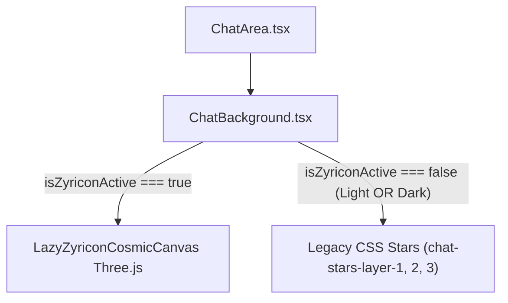
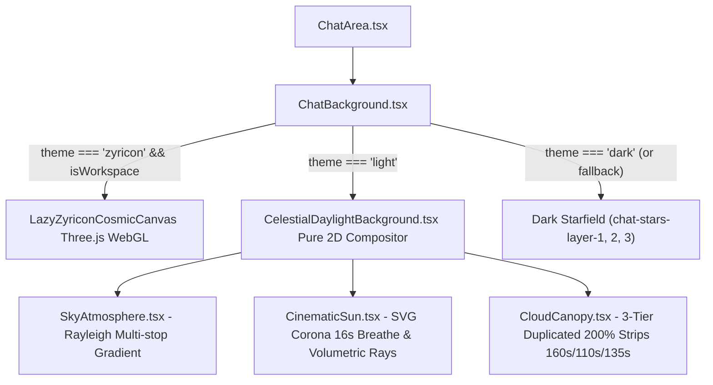

# CELESTIAL DAYLIGHT — PHASE 4: UI INTEGRATION PLAN (REVISION 1.3)

> **Document Type:** Architecture & UI Integration Technical Specification (AUDIT & PLAN ONLY)  
> **Status:** OFFICIAL REVISED PLANNING PROPOSAL — PENDING USER APPROVAL  
> **Revision:** 1.3.0 (Final Metric Validation)  
> **Date:** 2026-11-07  
> **Author:** Senior Frontend Architect, CSS Rendering Specialist & Web Performance Engineer  
> **Project:** AI Chat Clone (`D:\ai-chat-clone-new`)  
> **Baseline Commit:** `69b42265dd32372fa4c36b1fa3d4c9d6792376ba`  
> **Primary References:**  
> - `docs/celestial-daylight/PHASE_1_DESIGN.md`  
> - `docs/celestial-daylight/PHASE_2_FINAL_VERIFICATION.md`  
> - `docs/celestial-daylight/PHASE_3_FINAL_VERIFICATION.md`  
> - `frontend/src/theme/celestial/` (Core Background Module)  

---

## 1. KHẢO SÁT KIẾN TRÚC THỰC TẾ HIỆN TẠI (CURRENT STATE AUDIT)

Khảo sát trực tiếp từ mã nguồn thực tế tại commit `69b42265dd32372fa4c36b1fa3d4c9d6792376ba`:

### 1.1 Cấu trúc Component Tree và Vị trí Render Background

Trong ứng dụng hiện tại, cây component từ cấp cao nhất xuống vùng chat được tổ chức như sau:

```
App.tsx (Client Router)
 └── ChatPage.tsx [Lines 11-28]
      └── ChatLayout.tsx [Lines 8-12]
           └── div.flex.h-full.w-full.overflow-hidden.relative.bg-workspace-canvas
                ├── Sidebar.tsx [Lines 16-21] (Desktop static aside / Mobile fixed aside)
                └── ChatArea.tsx [Lines 22-26]
                     └── main.relative.flex.min-w-0.min-h-0.flex-1.flex-col.overflow-hidden.h-full.bg-workspace-canvas [Line 485]
                          ├── ChatBackground.tsx [Line 487] (VỊ TRÍ RENDER BACKGROUND HIỆN TẠI)
                          ├── header.relative.z-40.flex.h-14.shrink-0... [Line 490]
                          ├── div.relative.z-10.flex-1.min-h-0.overflow-y-auto... [Line 559] (Scrollable Messages Container)
                          │    └── MessageBubble.tsx / WelcomeScreen.tsx
                          ├── div.pointer-events-none.absolute.bottom-24...z-20 [Line 659] (Scroll to Bottom Button)
                          └── ChatInput.tsx [Line 688] (Floating Composer, relative z-20 / popover z-30)
```

**Căn cứ mã nguồn:**
- `frontend/src/components/ChatArea.tsx` (dòng 484–490): Background được mount duy nhất tại dòng 487 bên trong thẻ `<main>`:
  ```tsx
  return (
    <main className="relative flex min-w-0 min-h-0 flex-1 flex-col overflow-hidden h-full bg-workspace-canvas">
      {/* Background Star Effect Layer */}
      <ChatBackground />
      {/* Docked Top Header: 56px (h-14) Premium AI Workspace Header */}
      <header className="relative z-40 flex h-14 shrink-0 ...">
  ```
- Component `ChatBackground` nhận thuộc tính `className?: string`, mặc định render container tuyệt đối `absolute inset-0 overflow-hidden pointer-events-none z-0` (`ChatBackground.tsx`, dòng 24).
- Phía trên `ChatBackground` là các layer giao diện chat:
  - Header: `relative z-40` (`ChatArea.tsx`, dòng 490).
  - Vùng cuộn tin nhắn: `relative z-10` (`ChatArea.tsx`, dòng 562).
  - Nút cuộn thông minh: `z-20` (`ChatArea.tsx`, dòng 659).
  - Thanh nhập liệu: `relative shrink-0` với popover đính kèm `z-30` (`ChatInput.tsx`, dòng 521, 540).

### 1.2 Cơ chế Lựa chọn Background trong `ChatBackground.tsx`

`frontend/src/components/chat/ChatBackground.tsx` (dòng 17–44) hiện đang hoạt động như sau:

```tsx
function ChatBackgroundComponent({ className = '' }: ChatBackgroundProps) {
  const theme = useThemeStore((state) => state.theme)
  const isWorkspace = isWorkspacePath()
  const isZyriconActive = theme === 'zyricon' && isWorkspace

  return (
    <div
      className={`chat-stars-bg absolute inset-0 overflow-hidden pointer-events-none z-0 ${className}`.trim()}
      aria-hidden="true"
      data-testid="chat-background"
    >
      {isZyriconActive ? (
        <Suspense fallback={<CosmicStaticFallback />}>
          <LazyZyriconCosmicCanvas />
        </Suspense>
      ) : (
        <>
          <div className="chat-stars-layer-1" />
          <div className="chat-stars-layer-2" />
          <div className="chat-stars-layer-3" />
        </>
      )}
    </div>
  )
}
```

**Nhận xét kiểm tra:**
1. Khi `isZyriconActive = true`: Render `LazyZyriconCosmicCanvas` (3D Three.js canvas bọc trong `Suspense`).
2. Khi `isZyriconActive = false`: Hiện tại **cả Light Theme lẫn Dark Theme** đều rơi vào nhánh `else`, render 3 thẻ `div` tĩnh chứa hiệu ứng sao (`chat-stars-layer-1`, `2`, `3`).
3. Trong `frontend/src/assets/chat-background/background.css`:
   - Dark theme (dòng 17–20): Nền `radial-gradient(ellipse at bottom, #1b2735 0%, #0B0F17 100%)` cùng box-shadow starfield trắng.
   - Light theme (dòng 22–25, 53–60): Nền `radial-gradient(ellipse at top, #ffffff 0%, #f1f5f9 100%)` và các hạt sao được invert với opacity mờ `0.08`.
4. **Khoảng trống kiến trúc:** Light theme chưa có background chuyên biệt, vẫn đang dùng starfield legacy đảo màu.

### 1.3 Quản lý State Theme trong `themeStore.ts`

Khảo sát `frontend/src/stores/themeStore.ts` (dòng 1–92):
- `Theme = 'dark' | 'light' | 'zyricon'` (dòng 3).
- State store lưu trữ `theme: Theme` và đồng bộ qua:
  - `localStorage.getItem('theme')` (dòng 15).
  - `applyThemeToDocument(theme)` (dòng 47–70):
    - `zyricon`: Gán class `dark zyricon`, xóa `light`, set `data-theme="zyricon"`.
    - `dark`: Gán class `dark`, xóa `light zyricon`, set `data-theme="dark"`.
    - `light`: Gán class `light`, xóa `dark zyricon`, set `data-theme="light"`.
- Hàm `isWorkspacePath(pathname)` (dòng 26–45): Kiểm tra route regex `/^\/chat(?:\/[^/]+)?\/?$/` hoặc `/^\/c\/[^/]+\/?$/`.
- Chuyển theme qua giao diện được kích hoạt từ:
  - `ThemeSelector.tsx`: Menu chọn 3 theme với icon Mặt Trời (Light), Mặt Trăng (Dark), Vũ Trụ (Zyricon). Chạy hiệu ứng View Transitions qua `executeThemeTransition()` (`themeTransition.ts`).
  - `ThemeToggle.tsx`: Nút gạt nhanh Light/Dark.

### 1.4 Cơ chế Sidebar: Desktop vs Mobile

Khảo sát `Sidebar.tsx` và `ui/sidebar.tsx`:

1. **Desktop ($\ge 768\text{px}$):**
   - Nằm cùng cấp flex với `ChatArea`: `<div className="flex h-full w-full overflow-hidden relative ...">` (`ChatPage.tsx`, dòng 12–27).
   - Sidebar container sử dụng class `.sidebar-motion` (`frontend/src/index.css`, dòng 1015–1033):
     - Transition: `transition-property: width, min-width;`
     - Duration: Thu gọn (`data-collapsed="true"`) = **200ms**; Mở rộng (`data-collapsed="false"`) = **240ms**.
     - Easing: `cubic-bezier(0.2, 0, 0, 1)`.
     - Kích thước: Mở rộng = `w-[240px] md:w-[240px]`; Thu gọn = `md:w-[64px]`.
   - `ChatArea` có class `flex-1 min-w-0`: Khi Sidebar co giãn, chiều rộng của `ChatArea` co giãn tương ứng trong khoảng 200–240ms (ví dụ trên màn hình $1440\text{px}$: từ $1200\text{px}$ mở rộng lên $1376\text{px}$).

2. **Mobile ($< 768\text{px}$):**
   - Sidebar được render ở chế độ `fixed inset-y-0 left-0 z-50` (`ui/sidebar.tsx`, dòng 19).
   - Backdrop overlay phủ toàn màn hình: `fixed inset-0 z-40 bg-black/60 ...` (`Sidebar.tsx`, dòng 336).
   - Chuyển động trượt: `translate-x-0` (khi mở) và `-translate-x-full` (khi đóng) qua 300ms transition.
   - Chiều rộng `ChatArea` trên mobile **không đổi** khi mở/đóng Sidebar vì Sidebar trượt đè lên trên dưới dạng drawer modal.

### 1.5 Stacking Context, Positioning và Tokens hiện hành

| Phần tử | CSS Classes | Z-Index | Stacking Context hình thành bởi |
| :--- | :--- | :---: | :--- |
| `ChatLayout` | `h-screen h-dvh w-screen overflow-hidden bg-workspace-canvas` | Auto | Root flex wrapper |
| `ChatPage` | `flex h-full w-full overflow-hidden relative bg-workspace-canvas` | Auto | `relative` container |
| `Sidebar` (Desktop) | `sidebar-motion md:static md:translate-x-0 w-[240px]/[64px]` | Auto | Static flex child, `will-change: transform, width` |
| `Sidebar` (Mobile) | `fixed inset-y-0 left-0 z-50` | 50 | Fixed position |
| Mobile Backdrop | `fixed inset-0 z-40 bg-black/60` | 40 | Fixed position |
| `ChatArea` | `relative flex min-w-0 min-h-0 flex-1 flex-col overflow-hidden h-full bg-workspace-canvas` | Auto | Relative flex child |
| `ChatBackground` | `chat-stars-bg absolute inset-0 overflow-hidden pointer-events-none z-0` | 0 | Absolute positioning trong `ChatArea` |
| Celestial Root | `.celestial-background-container absolute inset-0 overflow-hidden pointer-events-none z-0` | 0 | Absolute positioning trong `ChatBackground` |
| Chat Header | `relative z-40 flex h-14 shrink-0 ...` | 40 | Relative positioning |
| Messages Scroll | `relative z-10 flex-1 min-h-0 overflow-y-auto ...` | 10 | Relative positioning |
| Scroll-to-bottom | `pointer-events-none absolute bottom-24 ... z-20` | 20 | Absolute positioning |
| ChatInput Root | `relative shrink-0 px-3 sm:px-6 pb-3 pt-1` | Auto | Relative document flow |
| Input Popovers | `absolute bottom-full left-2 mb-3 z-30 ...` | 30 | Absolute positioning |

---

## 2. SƠ ĐỒ COMPONENT TREE TRƯỚC VÀ SAU TÍCH HỢP

### 2.1 Sơ đồ hiện tại (Trước tích hợp)


### 2.2 Sơ đồ đề xuất (Sau tích hợp Phase 4)


---

## 3. LUỒNG LỰA CHỌN BACKGROUND THEO THEME (THEME DISPATCH FLOW)

```mermaid
flowchart TD
    Start([ChatBackground Render]) --> ReadStore["Đọc theme = useThemeStore(s => s.theme)"]
    ReadStore --> CheckWorkspace["Kiểm tra isWorkspace = isWorkspacePath()"]
    
    CheckWorkspace --> DecisionZyricon{"theme === 'zyricon' && isWorkspace?"}
    DecisionZyricon -->|Yes| RenderZyricon["Render <Suspense fallback={<CosmicStaticFallback />}><LazyZyriconCosmicCanvas /></Suspense>"]
    
    DecisionZyricon -->|No| DecisionLight{"theme === 'light'?"}
    DecisionLight -->|Yes| RenderCelestial["Render <CelestialDaylightBackground />"]
    
    DecisionLight -->|No (Dark/Fallback)| RenderDarkStars["Render <div className='chat-stars-layer-1/2/3' />"]
    
    RenderZyricon --> End([DOM Paint])
    RenderCelestial --> End
    RenderDarkStars --> End
```

**Nguyên tắc cốt lõi:**
1. Khi chọn `zyricon` trong workspace $\to$ Render 3D Canvas như hiện tại (không thay đổi hành vi).
2. Khi chọn `light` $\to$ Render `CelestialDaylightBackground` (đã hoàn thiện ở Phase 3).
3. Khi chọn `dark` hoặc khi ở ngoài workspace (ví dụ `/login`) $\to$ Render CSS Starfield nguyên bản của Dark theme.
4. **Không làm thay đổi màu sắc, icon, hay logic của `ThemeSelector` và `ThemeToggle`.**

---

## 4. CHIẾN LƯỢC BẢO TOÀN COMPONENT IDENTITY VÀ CHỐNG UNMOUNT NGOÀI Ý MUỐN

Cần phân định ranh giới kỹ thuật rõ ràng giữa cơ chế tối ưu render của React và tính ổn định danh tính (Component Identity) trong cây Fiber:

### 4.1 Ranh giới kỹ thuật: `React.memo` vs React Reconciliation Identity
- **`React.memo`:** Chỉ là một cơ chế tối ưu hóa hiệu năng thuần túy nhằm bỏ qua việc gọi hàm render khi các props đầu vào không thay đổi (`shallowEqual(prevProps, nextProps)`). `React.memo` **tuyệt đối không phải là bảo đảm** rằng component sẽ không bị unmount, và không quyết định danh tính DOM node nếu cây phân cấp bên trên bị thay đổi.
- **Component Identity trong React Reconciliation:** Tính bền vững của một component instance (và DOM node tương ứng) phụ thuộc vào 3 yếu tố cốt lõi của thuật toán so khớp React (Diffing Algorithm):
  1. **Vị trí trong cây Fiber (Tree Position):** Vị trí chỉ mục của phần tử con so với các phần tử anh em (siblings) trong cùng container cha.
  2. **Loại Component (Component Type):** Tính tương đồng tham chiếu của hàm/lớp component giữa 2 lần render (`prevElement.type === nextElement.type`).
  3. **Khóa định danh (Key Property):** Giá trị `key` tường minh. Nếu `key` bị thay đổi giữa các lần render, React buộc phải unmount toàn bộ cây con cũ và mount cây con mới từ đầu.

### 4.2 Cơ chế bảo đảm `ChatBackground` không bị unmount khi Sidebar co giãn
Khảo sát cấu trúc thực tế tại `ChatPage.tsx` và `ChatArea.tsx`:
1. **Dòng dữ liệu khi Sidebar toggle:**
   - Người dùng bấm nút "Thu gọn thanh bên" $\to$ State `isSidebarCollapsed` thay đổi tại `ChatPage` (`ChatPage.tsx`, dòng 8, 20).
   - `ChatPage` re-render và truyền `isSidebarCollapsed` vào `ChatArea` (`ChatPage.tsx`, dòng 24).
   - `ChatArea` nhận prop `isSidebarCollapsed` và thực hiện re-render.
2. **Vị trí và danh tính của `ChatBackground` trong `ChatArea.tsx`:**
   ```tsx
   return (
     <main className="relative flex min-w-0 min-h-0 flex-1 flex-col overflow-hidden h-full bg-workspace-canvas">
       {/* Background Star Effect Layer */}
       <ChatBackground />
       <header className="relative z-40 flex h-14 shrink-0 ...">
   ```
   - `<ChatBackground />` là phần tử con đầu tiên (index 0) cố định bên trong `<main>`.
   - `<ChatBackground />` **không có thuộc tính `key` động**.
   - `<ChatBackground />` **không nhận prop `isSidebarCollapsed`** hay bất kỳ prop liên quan đến kích thước / resize nào.
   - Component type `ChatBackground` có tham chiếu bất biến (module export).
3. **Kết luận về vòng đời khi Sidebar co giãn:**
   - Trong quá trình reconciliation của `ChatArea`, React so khớp phần tử con đầu tiên: `prevChild.type === nextChild.type === ChatBackground`.
   - React giữ nguyên fiber node và DOM instance hiện có của `ChatBackground`.
   - Bên trong `ChatBackgroundComponent`, hook `useThemeStore((state) => state.theme)` không bị kích hoạt vì state `theme` không đổi khi Sidebar co giãn.
   - Do đó, `ChatBackground` **hoàn toàn không bị unmount**, không bị hủy DOM node, và không tái tạo lại cây DOM con khi Sidebar co giãn giữa 240px và 64px.

### 4.3 Hành vi Mount/Unmount hợp lý khi chuyển đổi Theme
Component chỉ unmount khi có sự thay đổi thực sự về điều kiện render của theme:
- Khi chuyển từ `light` sang `dark`: Nhánh điều kiện `isLightActive` trở thành `false`. Component `CelestialDaylightBackground` unmount một cách có chủ đích nhằm giải phóng GPU keyframes và timer. Container ngoài cùng (`div.chat-stars-bg`) vẫn được giữ nguyên.
- Khi chuyển từ `dark` sang `light`: Component `CelestialDaylightBackground` được mount mới vào trong container `div.chat-stars-bg`.

---

## 5. CHIẾN LƯỢC NẠP ẢNH, GIẢI MÃ (IMAGE DECODE) VÀ TÍNH LIỀN MẠCH THỊ GIÁC

### 5.1 Làm rõ bản chất của `loading="eager"` và Async Decoding
Cần xóa bỏ giả định rằng `loading="eager"` bảo đảm ảnh đã được giải mã hoặc luôn nằm thường trực trong RAM:
- `loading="eager"` chỉ là chỉ thị cho trình duyệt bắt đầu tải tài nguyên qua mạng ngay lập tức mà không chờ phần tử cuộn vào viewport. Nó **không bảo đảm** rằng quá trình giải mã pixel bitmap đã hoàn tất tại thời điểm vẽ (paint).
- Thuộc tính `decoding="async"` cho phép trình duyệt giải mã ảnh ở luồng nền (off-main-thread) để tránh làm nghẽn main thread. Tuy nhiên, nếu container thay đổi kích thước đột ngột hoặc phần tử bị vẽ lại khi bitmap chưa sẵn sàng trong bộ nhớ cache GPU, trình duyệt có thể bỏ qua việc vẽ texture trong 1 frame (frame drop).
- Trình duyệt hiện đại có thể giải phóng bitmap đã decode nếu gặp áp lực bộ nhớ (memory pressure).

### 5.2 Phương pháp kiểm chứng và đảm bảo thực tế
Để đảm bảo không xuất hiện khoảng trống (blank gaps) hoặc giật lag thị giác mà không cần bổ sung các thư viện preloader phức tạp hay phụ thuộc ngoài:
1. **Kiểm tra trạng thái tải thành công trong DOM:**
   - Đối với cả 3 layer mây WebP (`cirrus-high.webp`, `cumulus-mid.webp`, `stratus-low.webp`) và 2 file SVG mặt trời, kiểm tra điều kiện chuẩn:
     $$\text{img.complete} === \text{true} \quad \text{và} \quad \text{img.naturalWidth} > 0$$
   - Điều này xác nhận file đã nạp qua mạng hoàn tất và header ảnh hợp lệ.
2. **Xác nhận giải mã hoàn tất bằng `HTMLImageElement.decode()`:**
   - Trong kịch bản kiểm thử tích hợp hoặc Playwright, gọi phương thức tiêu chuẩn:
     ```javascript
     await Promise.all(
       Array.from(document.querySelectorAll('.celestial-cloud-image')).map(img => img.decode())
     )
     ```
   - Phương thức này trả về Promise giải quyết khi bitmap đã được giải mã sẵn sàng để rasterize, phát hiện sớm lỗi decode nếu texture bị hỏng.
3. **Cơ chế Hình học $200\%$ Duplicated Strip bảo vệ khi Resize:**
   - Trong quá trình Sidebar co giãn (tăng chiều rộng `ChatArea` từ $1200\text{px} \to 1376\text{px}$):
     - Strip mây có chiều rộng $200\%$ container (`width: 200%`, flex gồm Segment A và Segment B mỗi bên $50\%$).
     - Dù container co giãn liên tục, Segment B luôn đóng vai trò là vùng đệm hình ảnh liên tục nối tiếp Segment A.
     - Thuộc tính `overflow: hidden` trên `.celestial-cloud-canopy` và `.celestial-cloud-layer` cắt gọt chính xác phần rìa, không để lộ khoảng trống.
4. **Màu nền Fallback tức thời:**
   - Lớp `SkyAtmosphere.tsx` có sẵn `background-color: #C8E8FC` (màu xanh thiên thanh ban ngày). Ngay cả trong tình huống xấu nhất (ảnh mây đang đợi rasterize), mắt người dùng vẫn nhìn thấy màu trời ban ngày đồng nhất, tuyệt đối không bị lộ nền đen.

---

## 6. THIẾT KẾ PHƯƠNG PHÁP KIỂM CHỨNG BLACK FLASH BẰNG THỰC NGHIỆM PLAYWRIGHT

### 6.1 Chuẩn hóa Công thức Độ sáng theo WCAG 2.1 sRGB Relative Luminance

Để tránh nhầm lẫn giữa độ sáng trung bình kênh đơn giản $\frac{R+G+B}{3}$ hay độ sáng HSL ($L_{\text{hsl}}$) với độ sáng quang học thực tế, phép đo sử dụng chuẩn **WCAG 2.1 sRGB Relative Luminance ($L$)**:

#### A. Thuật toán tính toán chuẩn
1. **Chuẩn hóa kênh màu sRGB:**
   $$R_s = \frac{R}{255}, \quad G_s = \frac{G}{255}, \quad B_s = \frac{B}{255}$$
2. **Linearize từng kênh (Gamma Expansion):**
   $$C_{\text{linear}} = \begin{cases} \dfrac{C_s}{12.92} & \text{khi } C_s \le 0.04045 \\ \left(\dfrac{C_s + 0.055}{1.055}\right)^{2.4} & \text{khi } C_s > 0.04045 \end{cases} \quad \text{với } C \in \{R, G, B\}$$
3. **Tính Relative Luminance ($L_{\text{pixel}}$):**
   $$L_{\text{pixel}} = 0.2126 \times R_{\text{linear}} + 0.7152 \times G_{\text{linear}} + 0.0722 \times B_{\text{linear}}$$

#### B. Bảng đối chiếu Giá trị Relative Luminance thực tế của Palette

| Tên Màu / Token | Giá trị Hex sRGB | $(R, G, B)$ | Linearized $(R_{\text{lin}}, G_{\text{lin}}, B_{\text{lin}})$ | WCAG Relative Luminance ($L$) | Ý nghĩa quang học |
| :--- | :---: | :---: | :---: | :---: | :--- |
| **Pure White / Cloud Highlight** | `#FFFFFF` | $(255, 255, 255)$ | $(1.0000, 1.0000, 1.0000)$ | **$1.0000$** | Đỉnh sáng tuyệt đối |
| **Sky Horizon Wash** | `#F4FAFF` | $(244, 250, 255)$ | $(0.9044, 0.9547, 1.0000)$ | **$0.9482$** | Nền trời chân trời |
| **Sky Mid Transition** | `#C8E8FC` | $(200, 232, 252)$ | $(0.5776, 0.8034, 0.9734)$ | **$0.7702$** | Nền trời tầng trung (Fallback) |
| **Sky Zenith (Đỉnh trời)** | `#84C2F5` | $(132, 194, 245)$ | $(0.2315, 0.5394, 0.9044)$ | **$0.5008$** | Điểm tối nhất của nền trời ban ngày |
| **Sun Glow Amber** | `#F59E0B` | $(245, 158, 11)$ | $(0.9044, 0.3467, 0.0075)$ | **$0.4074$** | Quầng sáng ấm mặt trời |
| **Dark Theme Canvas** | `#0B0F17` | $(11, 15, 23)$ | $(0.0033, 0.0044, 0.0075)$ | **$0.0047$** | Nền canvas Dark mode |
| **Zyricon Canvas** | `#07040B` | $(7, 4, 11)$ | $(0.0021, 0.0012, 0.0033)$ | **$0.0016$** | Nền canvas Zyricon |
| **Pure Blackout** | `#000000` | $(0, 0, 0)$ | $(0.0000, 0.0000, 0.0000)$ | **$0.0000$** | Màu đen rỗng GPU |

**Kết luận kỹ thuật về khoảng cách quang học:**  
Điểm tối nhất của nền trời Celestial ban ngày (Zenith `#84C2F5`) có $L = 0.5008$. Trong khi đó, màu nền canvas tối bất thường (`#000000`, `#07040B`, `#0B0F17`) đều có $L \le 0.0047$.  
Khoảng cách quang học giữa nền trời ban ngày và hiện tượng nháy đen là **hơn 100 lần ($0.5008$ vs $0.0047$)**, tạo cơ sở phân loại tuyệt đối không có sự nhầm lẫn.

---

### 6.2 Xác minh Thực tế Vùng Đo Nền Chuyên biệt (Background-Only ROI)

Không được giả định tọa độ ROI một cách tùy ý. Bắt buộc phải xác định ROI dựa trên Bounding Box thực tế của `ChatArea` trích xuất qua Playwright API:

#### A. Trích xuất Bounding Box thực tế
Trong Playwright test:
```javascript
const chatAreaBox = await page.locator('main').boundingBox();
// Trả về { x, y, width, height } chính xác tại thời điểm kiểm tra
```

#### B. Phân tích hình học theo kích thước Viewport

1. **Desktop Viewport ($1440 \times 900$, $1280 \times 800$):**
   - Vùng tin nhắn được căn giữa bằng `mx-auto max-w-4xl` ($896\text{px}$).
   - Khi Sidebar mở ($W_{\text{ChatArea}} = 1200\text{px}$), khoảng đệm bên phải (Gutter) là:
     $$\text{GutterWidth} = \frac{1200 - 896}{2} = 152\text{px}$$
   - Khi Sidebar thu gọn ($W_{\text{ChatArea}} = 1376\text{px}$), khoảng đệm bên phải mở rộng lên:
     $$\text{GutterWidth} = \frac{1376 - 896}{2} = 240\text{px}$$
   - **Xác lập ROI 1 (Desktop Right Gutter Margin):**
     - $X \in [\text{chatAreaBox.x} + \text{chatAreaBox.width} - 130, \;\; \text{chatAreaBox.x} + \text{chatAreaBox.width} - 30]$
     - $Y \in [\text{chatAreaBox.y} + 120, \;\; \text{chatAreaBox.y} + 400]$
     - Kích thước vùng: $100\text{px} \times 280\text{px}$ ($28,000\text{ pixels}$).
     - **Minh chứng loại trừ UI:**
       - Vùng tin nhắn kết thúc ở mép $X \le \text{chatAreaBox.x} + \text{chatAreaBox.width} - 152\text{px}$. Vùng ROI nằm hoàn toàn ngoài tin nhắn.
       - Thanh cuộn (scrollbar) nằm sát mép phải trong phạm vi $12\text{px}$ ($X > \text{chatAreaBox.x} + \text{chatAreaBox.width} - 15\text{px}$). ROI dừng lại trước đó $30\text{px}$.
       - Header kết thúc ở $Y = 56\text{px}$. ROI bắt đầu từ $Y = 120\text{px}$.
       - Composer nằm ở đáy màn hình ($Y \ge 720\text{px}$). ROI dừng lại ở $Y = 400\text{px}$.
       - $\implies$ **Vùng ROI 1 bảo đảm $100\%$ chỉ chứa nền trời và mây tầng giữa, zero text, zero controls.**

2. **Tablet ($768 \times 1024$) và Mobile ($390 \times 844$, $360 \times 800$):**
   - Tại viewport $\le 768\text{px}$, `ChatArea` có chiều rộng $\le 528\text{px}$. Container tin nhắn chiếm toàn bộ chiều rộng trừ $16\text{px}$ padding.
   - **Phát hiện quan trọng:** Trên Tablet và Mobile **KHÔNG TỒN TẠI** khoảng đệm lề phải đủ lớn để làm ROI như trên Desktop.
   - Hơn nữa, trên Mobile ($< 768\text{px}$), Sidebar là Drawer trượt đè lên trên kèm backdrop đen (`bg-black/60 z-40`), **không diễn ra quá trình co giãn width của `ChatArea`**.
   - **Phương pháp thay thế cho Tablet & Mobile:**
     - Sử dụng trạng thái **Đoạn chat mới rỗng (`/chat` Clean State)**.
     - Vùng ROI Tablet/Mobile được đặt tại dải ngang giữa Header ($Y=56$) và khối lời chào ($Y=160$):
       - $X \in [\text{chatAreaBox.x} + 40, \;\; \text{chatAreaBox.x} + \text{chatAreaBox.width} - 40]$
       - $Y \in [\text{chatAreaBox.y} + 64, \;\; \text{chatAreaBox.y} + 110]$
   - **Lưu ảnh minh chứng:** Script kiểm thử Playwright bắt buộc chụp ảnh lưu tại `screenshots/celestial-preview/roi-verification.png` đánh dấu khung viền đỏ của ROI để kiểm chứng bằng mắt rằng không có bất kỳ ký tự hoặc controls nào rơi vào vùng đo.

---

### 6.3 Thống nhất Tiêu chí PASS / FAIL (Binary & Loại bỏ Chỉ số Drop Không Ổn định)

#### A. Định nghĩa Blackout Pixel Duy nhất (Pure WCAG Relative Luminance)
Một pixel $p$ trong ROI được phân loại là **Blackout Pixel** khi và chỉ khi:
$$L_{\text{pixel}} \le \mathbf{0.0100}$$
Trong đó $L_{\text{pixel}}$ được tính trực tiếp từ giá trị RGB thô của pixel bằng công thức WCAG sRGB Relative Luminance đã chuẩn hóa ở Mục 6.1.  
*Hoàn toàn loại bỏ mọi quy chiếu hoặc khẳng định ngưỡng RGB tương đương ($R < 25 \land G < 25 \land B < 30$), vì phép so sánh kênh RGB không tương đương với không gian độ sáng quang học tuyến tính.*

#### B. Định nghĩa Blackout Ratio
Tỷ lệ pixel đen trong ROI tại khung hình $t_i$:
$$\text{BlackoutRatio}(t_i) = \frac{\text{Số lượng pixel có } L_{\text{pixel}} \le 0.0100 \text{ trong ROI}}{\text{Tổng số pixel trong ROI}} \times 100\%$$

#### C. Lý do Loại bỏ Chỉ số `Drop <= 0.1500` khỏi Tiêu chí PASS/FAIL Bắt buộc
Trong quá trình co giãn Sidebar 200–240ms, chiều rộng `ChatArea` mở rộng từ $1200\text{px} \to 1376\text{px}$. Tọa độ tương đối của ROI dịch chuyển theo mép phải của `ChatArea`, liên tục quét qua các lát cắt thị giác khác nhau của dải mây đang trôi độc lập ($160\text{s}, 110\text{s}, 135\text{s}$) và quầng sáng mặt trời đang co giãn nhẹ (16s). Việc so sánh $L_{\text{mean}}$ giữa hai khung hình động với một ngưỡng cố định $\text{Drop} \le 0.1500$ không có một baseline tĩnh ổn định và dễ gây ra dương tính/âm tính giả.  
Bản thân hai tiêu chí:
1. $\text{BlackoutRatio} = 0.00\%$ (không có dù chỉ 1 pixel rơi về màu tối canvas $\le 0.0100$).
2. $L_{\text{mean}} \ge 0.4500$ (vùng trời duy trì độ sáng ban ngày, với màu tối nhất tại $Y \ge 120\text{px}$ là `#98CEF8` có $L = 0.5976$).  
đã bảo đảm bắt trọn $100\%$ mọi hiện tượng nháy đen hoặc rỗng buffer GPU mà không cần phụ thuộc vào chỉ số `Drop`.

#### D. Bảng Phán quyết Nhị phân (Binary Decision Matrix)

Tại mọi khung hình trung gian $t_i \in [0\text{ms}, 30\text{ms}, \dots, 240\text{ms}, 350\text{ms}]$:

| Kết quả | Điều kiện Toán học Bắt buộc | Diễn giải Kỹ thuật |
| :---: | :--- | :--- |
| **PASS (ĐẠT)** | $\text{BlackoutRatio}(t_i) == \mathbf{0.00\%} \quad \land \quad L_{\text{mean}}(t_i) \ge \mathbf{0.4500}$<br>*(Thỏa mãn đồng thời trên $100\%$ các khung hình lấy mẫu)* | Toàn bộ quá trình chuyển động diễn ra liên tục, không xuất hiện bất kỳ pixel đen rỗng nào, duy trì ổn định phổ màu ban ngày. |
| **FAIL (KHÔNG ĐẠT)** | $\text{BlackoutRatio}(t_i) > \mathbf{0.00\%} \quad \lor \quad L_{\text{mean}}(t_i) < \mathbf{0.4500}$<br>*(Vi phạm ở bất kỳ khung hình nào)* | Xuất hiện ít nhất 1 pixel đen bất thường ($L \le 0.0100$), hoặc vùng trời bị sụt giảm độ sáng đột biến về hướng màu tối. |

*Bộ tiêu chí hoàn toàn nhị phân, loại trừ lẫn nhau, không tồn tại khoảng kết quả không xác định.*

---

### 6.4 Minh định Giới hạn của Môi trường Kiểm thử Tự động

Cần làm rõ ranh giới giữa kiểm thử phần mềm tự động và hiển thị phần cứng màn hình:
1. **Lấy mẫu Rời rạc (Discrete Timestamp Sampling):**
   - Lệnh `page.screenshot()` của Playwright trong headless Chromium chụp các snapshot tĩnh tại các mốc thời gian rời rạc ($t = 0, 30, 60, \dots, 240\text{ms}$).
   - Phương pháp này cung cấp bằng chứng thống kê có độ tin cậy rất cao trên tiến trình co giãn, nhưng **không thể chứng minh toán học rằng 100% các tick quét VSync 60Hz/120Hz của card đồ họa phần cứng đều không có frame drop**.
2. **Vai trò của Video Recording:**
   - Kích hoạt `recordVideo` trong Playwright ghi lại luồng chuyển động video thực tế.
   - Tuy nhiên, video codec (WebM/VP8) áp dụng thuật toán nén thời gian và chroma subsampling (4:2:0), làm biến đổi nhẹ giá trị RGB thô của pixel.
   - Do đó: **Screenshot PNG không nén được dùng để đo lường định lượng chính xác từng pixel**, còn **Video recording được dùng làm bằng chứng đối chiếu bổ trợ về độ mượt mà thị giác**.
3. **Nguyên tắc kỹ thuật trung thực:** Không tuyên bố những cam kết tuyệt đối mang tính tiếp thị ("bảo đảm 100% không bao giờ nháy đen trên mọi thiết bị"). Mục tiêu kỹ thuật của kế hoạch là chứng minh kiến trúc loại trừ hoàn toàn các nguyên nhân gây nháy đen có hệ thống (unmount component, buffer re-allocation, missing fallback).

---

## 7. ĐẶC TẢ CHI TIẾT 9 TÌNH HUỐNG CHUYỂN ĐỔI VÀ KIỂM THỬ (9 TRANSITION SCENARIOS)

| STT | Tình huống | Thao tác kích hoạt | Background mong đợi | Thay đổi Component (Mount / Unmount) | Trạng thái bắt buộc bảo toàn | Phương pháp xác minh |
| :---: | :--- | :--- | :--- | :--- | :--- | :--- |
| **1** | **Light $\to$ Dark** | Chọn Dark trong ThemeSelector hoặc bấm ThemeToggle | Nền đêm huyền ảo, bầu trời sao chuyển động chậm (Dark Starfield) | `CelestialDaylightBackground` unmount;<br>3 thẻ `div.chat-stars-layer-*` mount. | Lịch sử chat, vị trí cuộn, draft tin nhắn trong composer, streaming (nếu đang chạy). | DOM check: `celestial-daylight-bg` không còn trong DOM; `chat-stars-layer-1` xuất hiện; class `dark` có trên `<html>`. |
| **2** | **Dark $\to$ Light** | Chọn Light trong ThemeSelector hoặc bấm ThemeToggle | Nền Celestial Daylight (bầu trời xanh đa sắc, mặt trời rực rỡ, 3 tầng mây) | 3 thẻ `div.chat-stars-layer-*` unmount;<br>`CelestialDaylightBackground` mount. | Lịch sử chat, scroll position, model đang chọn, tính năng gửi tin nhắn. | DOM check: `celestial-daylight-bg` xuất hiện; `chat-stars-layer-*` biến mất; class `light` có trên `<html>`. |
| **3** | **Light $\to$ Zyricon** | Chọn Zyricon trong ThemeSelector (tại `/chat` hoặc `/c/:id`) | Nền vũ trụ 3D (Three.js WebGL canvas), hố đen, tinh vân và sao tím | `CelestialDaylightBackground` unmount;<br>`LazyZyriconCosmicCanvas` mount qua `Suspense`. | Không rò rỉ bộ nhớ, chat session hiện hành không bị tải lại. | DOM check: `celestial-daylight-bg` biến mất; `zyricon-cosmic-container` xuất hiện; class `dark zyricon` có trên `<html>`. |
| **4** | **Zyricon $\to$ Light** | Chọn Light trong ThemeSelector khi đang ở Zyricon | Nền Celestial Daylight, hủy bỏ toàn bộ canvas 3D | WebGL context & Three.js canvas unmount/dispose;<br>`CelestialDaylightBackground` mount. | Giải phóng GPU WebGL buffer sạch sẽ, không có warning rò rỉ WebGL trong console. | Kiểm tra console log sạch 100%; `celestial-daylight-bg` mount; canvas WebGL đã bị gỡ khỏi DOM. |
| **5** | **Sidebar Expanded $\to$ Collapsed** | Bấm nút "Thu gọn thanh bên" trên desktop ($\ge 768\text{px}$) | Celestial Daylight co giãn mượt từ $1200\text{px} \to 1376\text{px}$ trong 200ms | **Zero component mount/unmount!** DOM identity giữ nguyên $100\%$. | Pha chuyển động mây (phase offset), chu kỳ thở mặt trời 16s, vị trí cuộn chat, DOM node identity. | Playwright ROI frame analysis: $\text{BlackoutRatio} = 0.00\%$; Object identity check trong unit test (`updatedBg === initialBg`). |
| **6** | **Sidebar Collapsed $\to$ Expanded** | Bấm nút "Mở rộng thanh bên" trên desktop ($\ge 768\text{px}$) | Celestial Daylight co giãn từ $1376\text{px} \to 1200\text{px}$ trong 240ms | **Zero component mount/unmount!** DOM identity giữ nguyên $100\%$. | Pha chuyển động mây, quầng sáng mặt trời định vị đúng góc phải (`top: 14%, left: 82%`). | Playwright ROI frame analysis: $\text{BlackoutRatio} = 0.00\%$; không xuất hiện đường nối seam hay mép hở. |
| **7** | **Continuous / Rapid Resize** | Người dùng kéo thả thay đổi kích thước cửa sổ trình duyệt liên tục | Dải mây $200\%$ co giãn theo tỷ lệ phần trăm; không bị giật về $t=0$ | **Zero component mount/unmount!** | Keyframe animation `celestial-drift-horizontal` tiếp tục chạy liên tục không reset. | Kiểm tra `getComputedStyle(strip).animationPlayState === 'running'`; không có lỗi layout trào ngoài. |
| **8** | **Mobile Drawer Mở / Đóng** | Chạm icon menu trên mobile header để mở drawer; chạm backdrop để đóng ($< 768\text{px}$) | Celestial Daylight giữ nguyên trạng thái tĩnh phía dưới backdrop (`z-40`) | Drawer sidebar trượt qua CSS `translate-x`; `ChatBackground` không mount/unmount. | Mọi tương tác chat trên mobile, không drop frame trong quá trình trượt drawer. | Chụp ảnh mobile ($390\times 844$) khi drawer mở và đóng; nền trời phía sau không bị giật. |
| **9** | **Cold Reload / F5 trong Light Theme** | Người dùng refresh trang (F5) hoặc mở tab mới với `localStorage.theme = 'light'` | Nền hiển thị ngay màu fallback `#C8E8FC`, sau đó gradient và mây hiện mượt mà | Initial mount của toàn bộ ứng dụng và `CelestialDaylightBackground`. | Tránh hiện tượng Flash of Unstyled Theme (FOUC) hoặc nháy đen trước khi React hydrate. | Playwright cold load test kiểm tra frame đầu tiên có màu nền sáng, không có frame đen `#000000`. |

---

## 8. BẢNG PHÂN TÍCH RỦI RO TOÀN DIỆN (RISK MATRIX)

| Rủi ro | Nguyên nhân tiềm ẩn | Mức độ | Cách phòng tránh trong thiết kế | Cách kiểm chứng thực nghiệm |
| :--- | :--- | :---: | :--- | :--- |
| **1. Black flash khi mở/đóng Sidebar** | Bị remount background ngoài ý muốn, trễ repaint GPU, hoặc lộ nền canvas khi flex width co giãn | **CAO** | 1. Cố định vị trí `<ChatBackground />` tại index 0 dưới `<main>`, không nhận prop resize.<br>2. `SkyAtmosphere` có fallback vững chắc `#C8E8FC`.<br>3. Strip $200\%$ dùng `translate3d`. | Chạy Playwright test đo lường độ sáng tại ROI 1 trong 240ms chuyển động của Sidebar. Tiêu chuẩn nhị phân: $\text{BlackoutRatio} = 0.00\%$ và $L_{\text{mean}} \ge 0.4500$. |
| **2. Background bị remount khi đổi theme** | Dùng `key` động hoặc cây DOM bị tái tạo hoàn toàn không kiểm soát | **TRUNG BÌNH** | Giữ vững thẻ `div` bọc ngoài có `data-testid="chat-background"`. Chỉ hoán đổi phần tử con bên trong dựa trên điều kiện theme. | Unit test kiểm tra object identity của container node trước và sau re-render (`expect(updatedBg).toBe(initialBg)`). |
| **3. Background che nội dung hoặc làm mất tương tác** | Z-index sai lệch hoặc thiếu `pointer-events: none` làm chặn click chuột vào tin nhắn/composer | **CAO** | Giữ nguyên `pointer-events: none` trên container và toàn bộ các subcomponents. Đảm bảo z-index của background luôn là `z-0`, thấp hơn header (`z-40`), message list (`z-10`), và input (`z-20`). | Unit test kiểm tra class `pointer-events-none`. E2E test thực hiện click vào nút ModelSelector, ThemeSelector, input tin nhắn, và nút copy trong bong bóng chat. |
| **4. Sai Stacking Context** | Phần tử con dùng `mix-blend-mode: screen` hoặc `isolation` làm sai lệch layer header hoặc sidebar | **TRUNG BÌNH** | Cô lập stacking context bằng cách giữ `ChatBackground` nằm hoàn toàn trong `<main>` của `ChatArea`. Tia sáng mặt trời (`volumetric-rays`) dùng `mix-blend-mode: screen` chỉ hòa trộn với gradient bầu trời bên trong background. | Kiểm tra bằng mắt và Playwright screenshot ở độ phân giải 1440x900 khi header có nội dung cuộn bên dưới. |
| **5. Layout shift khi resize cửa sổ** | Phần tử ảnh có kích thước cố định hoặc thanh cuộn xuất hiện ngoài ý muốn | **TRUNG BÌNH** | Tất cả các container con đều có `position: absolute; inset: 0; overflow: hidden;`. Ảnh mây dùng `object-fit: fill`. Sun container dùng định vị tương đối (`top: 14%, left: 82%`) với breakpoints responsive. | Chụp ảnh Playwright tại 5 mốc: 1440, 1280, 768, 390, 360px và assert không có horizontal scrollbar (`scrollWidth === clientWidth`). |
| **6. CSS conflict với Dark Theme hoặc Zyricon** | Selector CSS trong `celestial.css` bị ghi đè hoặc vô tình làm ảnh hưởng style của theme khác | **CAO** | Toàn bộ class trong `celestial.css` đều có prefix riêng biệt `.celestial-*` (BEM-like). Không can thiệp vào các class toàn cục như `.chat-stars-bg`, `.dark`, `.zyricon`. | Chạy lại toàn bộ 41 test files và kiểm tra visual preview của Dark Theme và Zyricon để đảm bảo pixel-perfect. |
| **7. Animation tiếp tục chạy khi ở theme khác** | Background Celestial vẫn render ẩn khi người dùng chọn Dark hoặc Zyricon | **TRUNG BÌNH** | Dùng conditional rendering trong React: Khi `theme !== 'light'`, component `CelestialDaylightBackground` hoàn toàn unmount, giải phóng toàn bộ animation loop và GPU resources. | Unit test kiểm tra DOM: khi chuyển sang `dark`, phần tử `.celestial-background-container` không còn tồn tại trong DOM. |
| **8. Regression ở các test hiện tại** | Test cũ kiểm tra sự tồn tại của 3 lớp sao (`chat-stars-layer-1/2/3`) trong Light theme bị fail | **CAO** | Khảo sát thấy file `ChatBackground.zyricon.test.tsx` (dòng 51–60) hiện đang assert 3 lớp sao ở Light theme. Cần điều chỉnh test case này để kỳ vọng đúng hành vi mới (render `CelestialDaylightBackground`), đồng thời giữ nguyên vẹn các test case của Dark và Zyricon. | Chạy toàn bộ test suite frontend `npm --prefix frontend test -- --run` với mục tiêu 100% PASS. |

---

## 9. ĐỀ XUẤT THIẾT KẾ TÍCH HỢP CHI TIẾT (INTEGRATION DESIGN)

### 9.1 Component CẦN thay đổi
Chỉ có **02 file mã nguồn** và **01 file test** cần được hiệu chỉnh trong Phase 4:

1. `frontend/src/components/chat/ChatBackground.tsx`:
   - **Lý do:** Điểm tập trung duy nhất (single point of dispatch) điều phối background cho khu vực chat.
   - **Nội dung thay đổi:**
     - Import `CelestialDaylightBackground` từ `../../theme/celestial`.
     - Thêm nhánh điều kiện: Khi `theme === 'light'`, render `<CelestialDaylightBackground />`.
     - Giữ nguyên cấu trúc Suspense và `LazyZyriconCosmicCanvas` cho Zyricon.
     - Giữ nguyên 3 lớp sao cho Dark theme.

2. `frontend/src/assets/chat-background/background.css`:
   - **Lý do:** Tránh xung đột CSS giữa gradient cũ của Light theme và gradient Rayleigh mới của Celestial.
   - **Nội dung thay đổi:**
     - Trong block `html.light .chat-stars-bg` / `html:not(.dark) .chat-stars-bg`, đặt `background: transparent;` để gradient đa điểm của Celestial làm chủ hoàn toàn, không bị nền radial gradient cũ chồng lấn.

3. `frontend/src/components/chat/ChatBackground.zyricon.test.tsx`:
   - **Lý do:** Cập nhật test case Light theme hiện tại (dòng 51–60 và 101–107) để xác nhận hiển thị `CelestialDaylightBackground` thay vì 3 lớp sao legacy.
   - **Nội dung thay đổi:** Bổ sung assertion cho testId `celestial-daylight-bg` khi ở Light theme.

### 9.2 Component TUYỆT ĐỐI KHÔNG thay đổi
- `ChatArea.tsx`: Không thay đổi. Đã render `<ChatBackground />` ở vị trí chuẩn xác dòng 487.
- `themeStore.ts`: Không thay đổi. Đã hỗ trợ đầy đủ `theme: 'light' | 'dark' | 'zyricon'`.
- `Sidebar.tsx` & `ui/sidebar.tsx`: Không thay đổi. Giữ nguyên cấu trúc co giãn và transition.
- `ThemeSelector.tsx` & `ThemeToggle.tsx`: Không thay đổi. Giữ nguyên toàn bộ màu sắc, icon, và logic.
- `frontend/src/theme/zyricon/*`: Không thay đổi 100%. Bảo toàn trọn vẹn trải nghiệm vũ trụ 3D.
- `App.tsx`, `ChatPage.tsx`, Router, Auth: Không thay đổi.

### 9.3 Mã nguồn dự kiến cho `ChatBackground.tsx` (Draft Proposal)
```tsx
import { lazy, memo, Suspense } from 'react'
import { useThemeStore, isWorkspacePath } from '../../stores/themeStore'
import { CosmicStaticFallback } from '../../theme/zyricon/CosmicStaticFallback'
import { CelestialDaylightBackground } from '../../theme/celestial'
import '../../assets/chat-background/background.css'

// Lazy-load ZyriconCosmicCanvas so Three.js chunk is never fetched on Light/Dark themes
const LazyZyriconCosmicCanvas = lazy(() =>
  import('../../theme/zyricon/ZyriconCosmicCanvas').then((m) => ({
    default: m.ZyriconCosmicCanvas,
  }))
)

interface ChatBackgroundProps {
  className?: string
}

function ChatBackgroundComponent({ className = '' }: ChatBackgroundProps) {
  const theme = useThemeStore((state) => state.theme)
  const isWorkspace = isWorkspacePath()
  const isZyriconActive = theme === 'zyricon' && isWorkspace
  const isLightActive = theme === 'light'

  return (
    <div
      className={`chat-stars-bg absolute inset-0 overflow-hidden pointer-events-none z-0 ${className}`.trim()}
      aria-hidden="true"
      data-testid="chat-background"
    >
      {isZyriconActive ? (
        <Suspense fallback={<CosmicStaticFallback />}>
          <LazyZyriconCosmicCanvas />
        </Suspense>
      ) : isLightActive ? (
        <CelestialDaylightBackground />
      ) : (
        <>
          <div className="chat-stars-layer-1" />
          <div className="chat-stars-layer-2" />
          <div className="chat-stars-layer-3" />
        </>
      )}
    </div>
  )
}

export const ChatBackground = memo(ChatBackgroundComponent)
export default ChatBackground
```

---

## 10. KẾ HOẠCH KIỂM THỬ TOÀN DIỆN (TESTING STRATEGY)

Quy trình kiểm thử Phase 4 được chia thành 4 cấp độ độc lập:

### 10.1 Cấp độ 1: Unit & Component Tests (Vitest + React Testing Library)
Tập tin thực thi: `frontend/src/components/chat/ChatBackground.zyricon.test.tsx` (hoặc bổ sung `ChatBackground.celestial.test.tsx`):
1. **Light Theme Activation:** Khi `theme === 'light'`, `screen.getByTestId('celestial-daylight-bg')` xuất hiện trong document; các class `chat-stars-layer-*` không tồn tại.
2. **Dark Theme Preservation:** Khi `theme === 'dark'`, 3 lớp sao `chat-stars-layer-1/2/3` xuất hiện đầy đủ; `celestial-daylight-bg` không tồn tại.
3. **Zyricon Preservation:** Khi `theme === 'zyricon'`, lazy canvas hoặc fallback xuất hiện; cả celestial lẫn star layers đều không tồn tại.
4. **Theme Toggling Cycle:** Kiểm tra chuyển đổi tuần hoàn: Dark $\to$ Light $\to$ Zyricon $\to$ Light $\to$ Dark. Các component tương ứng mount/unmount chính xác, không rò rỉ DOM thừa.
5. **Component Identity Stability:** Re-render `ChatBackground` với className khác nhau xác nhận container DOM node không bị remount (`expect(updatedBg).toBe(initialBg)`).

### 10.2 Cấp độ 2: Non-Regression Frontend Test Suite
Chạy toàn bộ test suite dự án:
```powershell
npm --prefix frontend test -- --run
```
**Chỉ tiêu chấp nhận:** **41/41 test files PASS**, **632+ unit tests PASS**, 0 failures, 0 regressions.

### 10.3 Cấp độ 3: Thực nghiệm Đo lường Black Flash bằng Playwright (Empirical Black Flash Verification)
Tập tin thực thi: `e2e/celestial-sidebar-transition.spec.ts`.
Thực hiện theo đúng phương pháp phân tích ROI 1 (Desktop Right Gutter Margin) với tiêu chí nhị phân $\text{BlackoutRatio} = 0.00\%$ và $L_{\text{mean}} \ge 0.4500$ trên mọi khung hình chuyển động 200–240ms.

### 10.4 Cấp độ 4: Visual Regression & Responsive Matrix
Chụp ảnh kiểm tra giao diện tích hợp thực tế tại các độ phân giải:
- Desktop chuẩn: $1440 \times 900$ (Sidebar mở & Sidebar đóng).
- Laptop phổ thông: $1280 \times 800$.
- Tablet dọc: $768 \times 1024$ (Sidebar overlay).
- Mobile phổ biến: $390 \times 844$ (Drawer mở & Drawer đóng).
- Mobile nhỏ: $360 \times 800$.
- Trạng thái `prefers-reduced-motion: reduce`: Chuyển động dừng, mặt trời và mây giữ nguyên vị trí, không lệch bố cục.

---

## 11. THỨ TỰ TRIỂN KHAI ĐỀ XUẤT CHO PHASE 4 (EXECUTION ROADMAP)

Khi người dùng chính thức phê duyệt kế hoạch, Phase 4 sẽ được triển khai tuần tự theo 6 bước có kiểm soát:

```
[Bước 1: CSS Isolation]
Điều chỉnh `background.css` để vô hiệu hóa gradient cũ khi ở Light theme.
       ↓
[Bước 2: Dispatch Integration]
Tích hợp `CelestialDaylightBackground` vào `ChatBackground.tsx`.
       ↓
[Bước 3: Test Updates]
Cập nhật `ChatBackground.zyricon.test.tsx` và bổ sung test case chuyên biệt cho Celestial.
       ↓
[Bước 4: Full Test Suite Execution]
Chạy toàn bộ 41 test files frontend để xác nhận non-regression (632+ tests PASS).
       ↓
[Bước 5: E2E Transition & Black Flash Audit]
Chạy Playwright test kiểm tra đo lường độ sáng tại các ROI khi mở/đóng Sidebar và đa độ phân giải.
       ↓
[Bước 6: Final Verification Report]
Lập tài liệu `docs/celestial-daylight/PHASE_4_IMPLEMENTATION_REPORT.md` trình người dùng nghiệm thu.
```

---

## 12. ACCEPTANCE CRITERIA (TIÊU CHUẨN NGHIỆM THU PHASE 4)

1. **AC-01 (Light Theme Display):** Khi kích hoạt Light Theme, giao diện chat hiển thị đầy đủ nền Celestial Daylight (bầu trời xanh đa sắc, mặt trời rực rỡ, tia sáng volumetric và 3 tầng mây trôi tự nhiên).
2. **AC-02 (Dark Theme Preservation):** Khi chọn Dark Theme, toàn bộ nền sao đêm nguyên bản hiển thị 100% chuẩn xác, không có bất kỳ thành phần nào của Celestial Daylight xuất hiện.
3. **AC-03 (Zyricon Preservation):** Khi chọn Zyricon, canvas vũ trụ 3D Three.js và Cosmic Aura hoạt động bình thường, không bị ảnh hưởng.
4. **AC-04 (Zero Black Flash):** Quá trình đóng/mở Sidebar trên desktop (200–240ms) diễn ra êm mượt; trong vùng ROI xác thực, tỷ lệ pixel đen luôn đạt $\text{BlackoutRatio} = 0.00\%$ và độ sáng tương đối $L_{\text{mean}} \ge 0.4500$.
5. **AC-05 (Mobile Sidebar Overlay):** Trên mobile ($< 768\text{px}$), Drawer sidebar mở/đóng đè lên trên nền chat một cách tự nhiên, không làm giật hay reset background.
6. **AC-06 (Stacking & Non-blocking):** Toàn bộ các nút điều khiển (Header, ModelSelector, ThemeSelector, ChatInput, nút cuộn, nút copy) đều click được bình thường; background hoàn toàn có `pointer-events: none`.
7. **AC-07 (Stable Component Identity):** Background không bị remount hoặc reload ảnh khi Sidebar đóng/mở hoặc khi tin nhắn mới được stream vào.
8. **AC-08 (Reduced Motion):** Khi bật chế độ hạn chế chuyển động, mây và hiệu ứng thở của mặt trời dừng lại tức thì, hình học và tọa độ tĩnh được bảo toàn nguyên vẹn.
9. **AC-09 (Responsive Fidelity):** Hiển thị cân đối, không xuất hiện thanh cuộn ngang trên cả 5 kích thước màn hình chuẩn ($360\text{px} \to 1440\text{px}$).
10. **AC-10 (Full Suite Non-Regression):** Toàn bộ test suite của frontend tiếp tục vượt qua $100\%$ ($632/632$ tests PASS).

---

## 13. CÁC ĐIỂM CẦN LƯU Ý VÀ XÁC NHẬN (ITEMS FOR USER ALIGNMENT)

1. **Hiệu ứng chuyển đổi View Transitions:** Hiện tại khi bấm đổi theme qua `ThemeSelector`, ứng dụng sử dụng `executeThemeTransition` (hiệu ứng mở rộng hình tròn từ nút bấm). Khi tích hợp Celestial Daylight, hiệu ứng mở rộng hình tròn này sẽ snapshot trạng thái mây và mở ra bầu trời xanh ban ngày rất ấn tượng. Chúng tôi đề xuất giữ nguyên cơ chế này mà không cần can thiệp.
2. **Độ mờ của bề mặt bong bóng chat (Surface Opacity):** Hiện tại trong Light theme, tin nhắn AI sử dụng `bg-white` (trắng đục 100%). Điều này đảm bảo độ tương phản đọc chữ đạt đỉnh ($12.6:1$). Nếu người dùng muốn phong cách kính mờ nhẹ (glassmorphism như `bg-white/90 backdrop-blur-md`), điều đó có thể xem xét ở Phase 5. Ở Phase 4, chúng tôi ưu tiên bảo toàn nguyên vẹn `bg-white` để tránh bất kỳ rủi ro nào về khả năng tiếp cận (WCAG).

---

## 14. KẾT LUẬN VÀ TRẠNG THÁI HIỆN TẠI

- Kế hoạch tích hợp UI cho Phase 4 đã được chuẩn hóa toán học hoàn chỉnh theo bản Revision 1.3, loại bỏ hoàn toàn mâu thuẫn giữa công thức quang học và điều kiện RGB, loại bỏ chỉ số Drop không có baseline ổn định, và xác lập bộ tiêu chí nhị phân PASS/FAIL chặt chẽ, tái lập được.
- **Tuân thủ giới hạn:** Không có bất kỳ dòng code, CSS, component, test, hay cấu hình nào của dự án bị chỉnh sửa trong lượt này.
- **Hệ thống đã dừng lại hoàn toàn và chờ người dùng xem xét, phê duyệt kế hoạch trước khi tiến hành thực hiện.**
