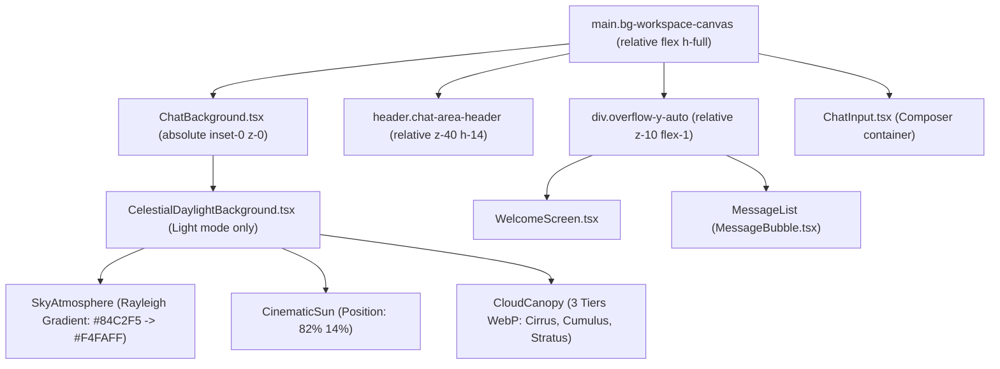

# CELESTIAL DAYLIGHT — PHASE 5: CONTRAST & POLISH PLAN
**Tài liệu:** Kế hoạch Cải thiện Độ tương phản & Hoàn thiện Giao diện  
**Phiên bản:** 1.1.0 (Audit Corrections Applied)  
**Dự án:** AI Chat Clone  
**Ngày cập nhật:** 07/11/2026  
**Chế độ:** ACCEPTED (Hoàn thành triển khai & Nghiệm thu chính thức)  

---

## 1. TỔNG QUAN KẾ HOẠCH (EXECUTIVE SUMMARY)

Phase 4 đã tích hợp thành công nền trời **Celestial Daylight** vào ứng dụng AI Chat Clone thông qua `ChatBackground.tsx`. Light Theme hiện hiển thị nền trời xanh chuyển sắc (Rayleigh Scattering), mặt trời điện ảnh ấm áp và 3 tầng mây WebP chuyển động tự nhiên. Dark Theme và Zyricon giữ nguyên cơ chế hiển thị riêng biệt.

Mục tiêu cốt lõi của **Phase 5 (Contrast & Polish)** là:
> **"Background là phần hỗ trợ trải nghiệm. Nội dung chat và các thao tác của người dùng luôn phải là yếu tố nổi bật nhất."**

Qua quá trình rà soát thực nghiệm kết hợp tính toán toán học nghiêm ngặt theo chuẩn **WCAG 2.2 Level AA**, Phase 5 Revision 1.1 xác định các nhóm nhiệm vụ trọng tâm:

1. **Khắc phục lỗi tương phản thực tế (WCAG 2.2 AA Failures):**
   - Tiêu đề phụ của màn hình chào (`WelcomeScreen p.text-slate-500`) nằm trực tiếp trên nền trời xanh $Y=166$ (`#98CEF8`), tương phản thực tế chỉ đạt **$2.84:1$**, vi phạm nghiêm trọng chuẩn WCAG 2.2 AA (yêu cầu $\ge 4.5:1$).
   - Dòng chữ phụ trên Header ("Đoạn chat mới") mang màu `#64748B` trên nền header trong suốt `bg-transparent` đè lên đỉnh trời Zenith (`#84C2F5`), tương phản thực tế chỉ đạt **$2.50:1$** (FAIL).
   - Đường dẫn liên kết trong tin nhắn AI dùng `text-emerald-600` (`#059669`) trên nền trắng, tương phản chỉ đạt **$4.43:1$** (dưới ngưỡng $4.5:1$).
   - Mô tả trong các thẻ Hero Cards dùng `text-slate-500` trên nền `bg-white/90` bị ánh xanh xuyên thấu, tương phản chỉ đạt **$4.33:1$** (dưới ngưỡng $4.5:1$).

2. **Khắc phục hiện tượng xuyên thấu khi cuộn (Header Scroll Bleed-through):**
   - Header của `ChatArea` hiện dùng `bg-transparent backdrop-blur-[1px]`. Khi danh sách tin nhắn cuộn lên, các bong bóng chat và văn bản cuộn lướt xuyên qua header, gây va chạm thị giác trực tiếp với breadcrumbs và các nút điều khiển.
   - Giải pháp: Áp dụng lớp kính mờ cục bộ (`chat-area-header`) dành riêng cho Light Theme với độ đục $75\%$ và blur 12px, bảo đảm che chắn hoàn toàn nội dung cuộn mà không can thiệp vào các header khác trong ứng dụng.

3. **Chuẩn hóa nút Gửi và bảng màu nhận diện (Send Button & Color Tokens):**
   - Nút Send trong Composer hiện mang mã màu xanh lá cũ **`bg-[#1B8F3D]`** (RGB 27, 143, 61), lệch khỏi bộ nhận diện Golden Amber của Celestial Daylight.
   - **Đánh giá Non-text Contrast (SC 1.4.11):** Nếu đổi sang gradient sáng `#F59E0B → #EA580C`, icon mũi tên màu trắng trên điểm sáng nhất `#F59E0B` chỉ đạt tương phản **$2.15:1$ (< 3.0:1 — FAIL)**. Do đó, kế hoạch đề xuất phương án gradient hổ phách đậm hơn: **`from-[#D97706] to-[#C2410C]` (Amber 600 $\to$ Orange 700)**, đạt tương phản từ **$3.19:1$ đến $5.18:1$** đối với icon trắng trên toàn bộ bề mặt nút.
   - Nút Dừng (Stop) chuyển sang semantic danger `bg-rose-600 hover:bg-rose-700`.

4. **Phân biệt rành mạch màu Legacy và màu Semantic:**
   - Chỉ loại bỏ các màu legacy bị đặt sai vị trí nhận diện (`#1B8F3D` trên Send button, status indicators; `#B91E2B` trên stop button).
   - Bảo toàn 100% các màu biểu thị ngữ nghĩa: màu xanh lục thành công (Semantic Success - icon checkmark copy thành công, trạng thái online), màu đỏ lỗi (Semantic Danger - thông báo lỗi, xác nhận xóa), màu cảnh báo (Warning), và màu trang trí phân loại thẻ (Decorative badge colors).

5. **Phân loại kiến trúc Focus Ring (Categorized Focus States):**
   - Không áp dụng đồng loạt một màu focus ring duy nhất. Phân chia rõ 5 kịch bản bề mặt (nền trắng, nền kính mờ, nút gradient, nền tối, dropdown menu) để bảo đảm độ dày tối thiểu 2px và tương phản $\ge 3:1$ theo WCAG 2.2 SC 2.4.11.

---

## 2. HIỆN TRẠNG KIẾN TRÚC VÀ PHẠM VI (SCOPE & ARCHITECTURE)

### 2.1 Cấu trúc Stacking Context thực tế


### 2.2 Xác minh Theme Selectors trong Hệ thống
Khảo sát trực tiếp `frontend/src/stores/themeStore.ts` và `frontend/src/index.css`:
- **Chế độ Light:**
  - `document.documentElement` có class `.light` và thuộc tính `data-theme="light"`.
  - Class `.dark` và `.zyricon` bị xóa hoàn toàn.
- **Chế độ Dark:**
  - `document.documentElement` có class `.dark` và thuộc tính `data-theme="dark"`.
  - Class `.light` và `.zyricon` bị xóa hoàn toàn.
- **Chế độ Zyricon:**
  - `document.documentElement` có cả 2 class: `.dark` và `.zyricon`, cùng thuộc tính `data-theme="zyricon"`.
  - Trong `index.css`: `@custom-variant zyricon (&:where([data-theme="zyricon"], [data-theme="zyricon"] *, .zyricon, .zyricon *));` đã được đăng ký trong cấu hình Tailwind v4.

### 2.3 Giới hạn phạm vi kiểm toán Phase 5 (Scope Boundary)
Phạm vi kiểm toán và tinh chỉnh WCAG của Phase 5 được giới hạn nghiêm ngặt trong các bề mặt tương tác cốt lõi của chat hiển thị trên nền Celestial Daylight:
1. **`ChatArea` Header & Breadcrumbs**: Tiêu đề "Đoạn chat mới", workspace badge, mobile drawer toggle button.
2. **`WelcomeScreen`**: Tiêu đề chào mừng, mô tả chào mừng, quick prompt chips, 4 thẻ hero suggestion cards.
3. **`ChatInput`**: Textarea, nút đính kèm, popover đính kèm, model indicator, drag-drop zone overlay, attachment pill, nút Send/Stop.
4. **`MessageBubble`**: Bong bóng AI, bong bóng User, thanh công cụ tác vụ (copy, regenerate), trạng thái streaming.
5. **Supported Markdown Elements**: Đoạn văn bản, Headings (H1–H3), Danh sách (UL/OL), Blockquotes, Tables (tiêu đề, viền, ô dữ liệu), Mã nguồn nội dòng (Inline Code), Hyperlinks.
6. **Focusable Controls**: Toàn bộ các nút bấm và trường nhập liệu thuộc phạm vi trên.

**Các thành phần nằm ngoài phạm vi chứng nhận WCAG toàn diện của Phase 5 (Explicit Out-of-Scope):**
- **Syntax Highlighting động (`react-syntax-highlighter`)**: Các token màu cú pháp của thư viện bên thứ ba (Prism/hljs) phụ thuộc vào ngôn ngữ lập trình và theme cú pháp ngoài. Container viền và nền của codeblock được kiểm toán, nhưng từng token cú pháp riêng lẻ không thuộc phạm vi cam kết WCAG AA.
- **Sidebar Navigation**: Nằm trên bề mặt opaque riêng (`--workspace-sidebar`), không hiển thị trên canvas trời xanh.
- **Backdropped Modals (DeleteChatModal, SearchChatModal, ExpandedEditorModal)**: Nằm trên lớp overlay tối riêng biệt (`bg-black/50 backdrop-blur-sm`).
- **Nội dung HTML/SVG tùy ý do người dùng nhập vào**: Chỉ bảo đảm các phần tử Markdown chuẩn được hỗ trợ.

---

## 3. TÍNH TOÁN ĐỘ TƯƠNG PHẢN WCAG CHUẨN XÁC (WCAG 2.2 FORMULAS & RE-CALCULATIONS)

### 3.1 Công thức Toán học Tiêu chuẩn
Theo khuyến nghị chính thức của W3C WCAG 2.2:

#### 1. Chuẩn hóa và Linearize từng kênh màu sRGB:
$$C_{\text{sRGB}} = \frac{V_{\text{channel}}}{255}$$
$$c = \begin{cases} \frac{C_{\text{sRGB}}}{12.92} & \text{khi } C_{\text{sRGB}} \le 0.04045 \\ \left(\frac{C_{\text{sRGB}} + 0.055}{1.055}\right)^{2.4} & \text{khi } C_{\text{sRGB}} > 0.04045 \end{cases}$$

#### 2. Tính Relative Luminance $L$:
$$L = 0.2126 \times R_{\text{linear}} + 0.7152 \times G_{\text{linear}} + 0.0722 \times B_{\text{linear}}$$

#### 3. Tính Contrast Ratio:
$$\text{Contrast Ratio} = \frac{L_1 + 0.05}{L_2 + 0.05} \quad (\text{trong đó } L_1 \ge L_2)$$

#### 4. Alpha Compositing trên kênh sRGB (khi phần tử bán trong suốt $\alpha \in [0, 1]$ nằm trên nền opaque):
$$C_{\text{comp}} = \text{round}\big(\alpha \times C_{\text{fg}} + (1 - \alpha) \times C_{\text{bg}}\big)$$
Sau đó tính Linearized Luminance trên màu tổng hợp $C_{\text{comp}}$.

---

### 3.2 Bảng giá trị Relative Luminance đã xác minh
Đo lường bằng thuật toán WCAG chuẩn xác trên 8-bit hex channels:

| Mã màu Hex | Tên gọi / Vai trò | Linearized Relative Luminance ($L$) | Ghi chú kiểm toán |
| :--- | :--- | :---: | :--- |
| **`#000000`** | Đen tuyệt đối | **$0.000000$** | Chuẩn mốc đáy |
| **`#0F172A`** | Slate 900 (User bubble / Heading chính) | **$0.008815$** | Đã xác minh lại |
| **`#1E293B`** | Slate 800 (AI message body text) | **$0.021777$** | Đã xác minh lại |
| **`#334155`** | Slate 700 (Quick chip text / Welcome Subtitle mới) | **$0.051403$** | Đã xác minh |
| **`#475569`** | Slate 600 (Secondary text / Header Subtitle mới) | **$0.088565$** | Đã xác minh |
| **`#64748B`** | Slate 500 (Legacy secondary text - gây lỗi) | **$0.170642$** | Đã xác minh lại |
| **`#94A3B8`** | Slate 400 (Muted text trong Dark mode) | **$0.359510$** | Đã xác minh |
| **`#84C2F5`** | Sky Zenith (Đỉnh bầu trời ban ngày) | **$0.500817$** | Đã xác minh lại |
| **`#98CEF8`** | Sky Mid-Atmosphere (Vùng trời màn hình chào $Y=166$) | **$0.575953$** | Đã xác minh lại |
| **`#C8E8FC`** | Sky Horizon (Đường chân trời) | **$0.770209$** | Đã xác minh lại |
| **`#F4FAFF`** | Sky Base (Đáy bầu trời) | **$0.948243$** | Đã xác minh lại |
| **`#F59E0B`** | Amber 500 (Warm Sun accent / Điểm sáng gradient cũ) | **$0.438904$** | Đã xác minh lại |
| **`#D97706`** | Amber 600 (Golden Amber - Điểm sáng gradient mới) | **$0.279585$** | Đã xác minh |
| **`#B45309`** | Amber 700 (Focus ring / Hover state) | **$0.159095$** | Đã xác minh |
| **`#78350F`** | Amber 900 (Inline code text) | **$0.065738$** | Đã xác minh |
| **`#451A03`** | Amber 950 (Dark amber icon option) | **$0.020106$** | Đã xác minh |
| **`#EA580C`** | Orange 600 (Điểm tối gradient cũ) | **$0.244984$** | Đã xác minh lại |
| **`#C2410C`** | Orange 700 (Điểm tối gradient mới) | **$0.152765$** | Đã xác minh |
| **`#9A3412`** | Orange 800 (Hover/active gradient mới) | **$0.093697$** | Đã xác minh |
| **`#0369A1`** | Sky 700 (Markdown Link mới) | **$0.126957$** | Đã xác minh lại |
| **`#0284C7`** | Sky 600 | **$0.206390$** | Đã xác minh |
| **`#1D4ED8`** | Blue 700 (Markdown Link tùy chọn) | **$0.106679$** | Đã xác minh lại |
| **`#1B8F3D`** | Legacy Green (Nút send cũ) | **$0.202149$** | Đã xác minh |
| **`#B91E2B`** | Legacy Red (Nút stop cũ) | **$0.114173$** | Đã xác minh |
| **`#E11D48`** | Rose 600 (Semantic Danger stop button) | **$0.173542$** | Đã xác minh |
| **`#BE123C`** | Rose 700 (Semantic Danger stop hover) | **$0.117060$** | Đã xác minh |
| **`#FFFFFF`** | Trắng tinh khiết | **$1.000000$** | Chuẩn mốc đỉnh |

---

### 3.3 Bảng so sánh Tương phản Hiện trạng vs Sau tinh chỉnh

| Vị trí / Phần tử kiểm tra | Màu chữ / Icon (Fg) | Nền thực tế (Bg) | Loại tương phản | Tương phản Hiện tại | Đánh giá Hiện tại | Màu đề xuất mới | Nền mới sau tinh chỉnh | Tương phản Mới | Chuẩn WCAG 2.2 | Đánh giá Sau sửa |
| :--- | :---: | :---: | :---: | :---: | :---: | :---: | :---: | :---: | :---: | :---: |
| **Welcome Description** (`WelcomeScreen.tsx`) | `#64748B` | Sky Mid (`#98CEF8`) | Normal text | **$2.84:1$** | ❌ **FAIL (CRITICAL)** | `#334155` (slate-700) | `bg-white/60` over sky (`#D6EBFC`, $L=0.807$) | **$8.46:1$** | $\ge 4.5:1$ | ✅ **PASS (EXCELLENT)** |
| **Header Subtitle** ("Đoạn chat mới") | `#64748B` | Sky Zenith (`#84C2F5`) | Normal text | **$2.50:1$** | ❌ **FAIL (CRITICAL)** | `#475569` (slate-600) | `bg-white/75` over sky (`#E0F0FD`, $L=0.853$) | **$6.51:1$** | $\ge 4.5:1$ | ✅ **PASS** |
| **Hero Card Description** (`WelcomeScreen.tsx`) | `#64748B` | `bg-white/90` over sky | Normal text | **$4.33:1$** | ❌ **FAIL (< 4.5:1)** | `#475569` (slate-600) | `bg-white/95` over sky ($L \approx 0.975$) | **$7.40:1$** | $\ge 4.5:1$ | ✅ **PASS** |
| **AI Message Link** (`MessageBubble.tsx`) | `#059669` | `bg-white` (opaque) | Normal text | **$4.43:1$** | ❌ **FAIL (< 4.5:1)** | `#0369A1` (sky-700) | `bg-white` ($L=1.000$) | **$5.93:1$** | $\ge 4.5:1$ | ✅ **PASS** |
| **Send Button Icon (Điểm sáng nhất)** | `#FFFFFF` | `#F59E0B` (amber-500) | Non-text UI | **$2.15:1$** | ❌ **FAIL (< 3.0:1)** | `#FFFFFF` | `#D97706` (amber-600) | **$3.19:1$** | $\ge 3.0:1$ | ✅ **PASS** |
| **Send Button Icon (Điểm tối nhất)** | `#FFFFFF` | `#EA580C` (orange-600) | Non-text UI | **$3.56:1$** | ⚠️ **PASS nhưng gradient lọt sáng** | `#FFFFFF` | `#C2410C` (orange-700) | **$5.18:1$** | $\ge 3.0:1$ | ✅ **PASS** |
| **Send Button Boundary** vs Outer White | `#D97706` | `#FFFFFF` (outer) | Non-text UI | — | — | `#D97706` | `#FFFFFF` | **$3.19:1$** | $\ge 3.0:1$ | ✅ **PASS (Rõ viền)** |
| **Stop Button Icon** | `#FFFFFF` | `#B91E2B` (legacy red) | Non-text UI | $7.42:1$ | ⚠️ **Legacy Color** | `#FFFFFF` | `#E11D48` (rose-600) | **$4.70:1$** | $\ge 3.0:1$ | ✅ **PASS** |
| **AI Inline Code** | `#047857` | `bg-slate-100` | Normal text | $4.78:1$ | ⚠️ **Legacy Color** | `#78350F` (amber-900) | `bg-amber-50/80` ($L \approx 0.970$) | **$8.81:1$** | $\ge 4.5:1$ | ✅ **PASS (AAA)** |
| **AI Message Body Text** | `#1E293B` | `bg-white` (opaque) | Normal text | **$14.63:1$** | ✅ **PASS** | Giữ nguyên | `bg-white` | **$14.63:1$** | $\ge 4.5:1$ | ✅ **PASS** |
| **User Message Text** | `#FFFFFF` | `bg-slate-900` (`#0F172A`) | Normal text | **$17.85:1$** | ✅ **PASS** | Giữ nguyên | `bg-slate-900` | **$17.85:1$** | $\ge 4.5:1$ | ✅ **PASS** |
| **Codeblock Syntax Tokens** | Đa dạng | `bg-slate-900` / Prism | Code text | **NOT VERIFIED** | ⚠️ **Out of Scope** | Giữ theme Prism | `bg-slate-900` | **NOT VERIFIED** | Third-party | ⚠️ **Out of Scope** |

> [!NOTE]
> Các trường hợp `NOT VERIFIED`: Token tô màu cú pháp bên trong `react-syntax-highlighter` không thuộc phạm vi cam kết WCAG tĩnh của Phase 5 do phụ thuộc vào ngôn ngữ lập trình và ngữ pháp động từ bên ngoài.

---

## 4. PHÂN TÍCH CHUYÊN SÂU NÚT GỬI (SEND BUTTON AMBER GRADIENT AUDIT)

### 4.1 Đánh giá Gradient cũ `#F59E0B → #EA580C`
WCAG 2.2 SC 1.4.11 (Non-text Contrast) quy định mọi biểu tượng đồ họa và điều khiển giao diện người dùng phải đạt tương phản tối thiểu **$3.0:1$** so với nền lân cận.

Khi kiểm tra gradient `#F59E0B → #EA580C`:
1. **Tại điểm sáng nhất `#F59E0B` (Amber 500, $L = 0.438904$):**
   $$\text{Contrast với Icon Trắng } (\#FFFFFF) = \frac{1.000000 + 0.05}{0.438904 + 0.05} = \frac{1.05}{0.488904} = \mathbf{2.1477:1} \quad (< 3.0:1 \implies \mathbf{FAIL})$$
2. **Tại điểm tối nhất `#EA580C` (Orange 600, $L = 0.244984$):**
   $$\text{Contrast với Icon Trắng } (\#FFFFFF) = \frac{1.000000 + 0.05}{0.244984 + 0.05} = \frac{1.05}{0.294984} = \mathbf{3.5595:1} \quad (\ge 3.0:1 \implies \mathbf{PASS})$$
3. **Đường biên ngoài nút (Button perimeter) so với nền trắng `#FFFFFF`:**
   Tại cạnh `#F59E0B`, tương phản viền chỉ đạt $2.15:1$, khiến ranh giới nút bị chìm một nửa vào nền Composer trắng nếu không có viền phụ.

### 4.2 Hai phương án giải quyết đạt chuẩn $\ge 3.0:1$

#### Phương án 1 (Khuyến nghị ưu tiên): Gradient Golden Amber / Orange đậm hơn với Icon Trắng
Sử dụng dải màu: **`from-[#D97706] to-[#C2410C]` (Amber 600 $\to$ Orange 700)**:
- **Tương phản tại điểm sáng nhất `#D97706` ($L = 0.279585$):**
  $$\text{Contrast với White } = \frac{1.05}{0.279585 + 0.05} = \mathbf{3.1858:1} \quad (\ge 3.0:1 \implies \mathbf{PASS})$$
- **Tương phản tại điểm tối nhất `#C2410C` ($L = 0.152765$):**
  $$\text{Contrast với White } = \frac{1.05}{0.152765 + 0.05} = \mathbf{5.1784:1} \quad (\ge 3.0:1 \implies \mathbf{PASS})$$
- **Tương phản đường biên nút so với nền Composer trắng (`#FFFFFF`):**
  Toàn bộ chu vi nút đạt tương phản từ **$3.19:1$ đến $5.18:1$**, tạo đường nét sắc sảo tự nhiên mà không cần thêm viền giả lập.
- **Trạng thái tương tác:**
  - **Hover:** `hover:from-[#B45309] hover:to-[#9A3412]` (Amber 700 $\to$ Orange 800, tương phản với icon trắng tăng lên **$5.02:1 \to 7.31:1$**).
  - **Active:** `active:from-[#92400E] active:to-[#7C2D12]`.
  - **Focus:** `focus-visible:ring-2 focus-visible:ring-offset-2 focus-visible:ring-amber-600`.
  - **Disabled:** `disabled:opacity-40 disabled:cursor-not-allowed` (được miễn trừ theo SC 1.4.11 đối với điều khiển không hoạt động).

#### Phương án 2 (Phương án thay thế): Nền Amber 500 sáng với Icon màu tối
Giữ nền `bg-[#F59E0B]`, nhưng đổi màu icon từ trắng sang tone tối:
- Icon `#451A03` (Amber 950, $L = 0.020106$): Tương phản đạt **$6.97:1$** (PASS).
- Icon `#78350F` (Amber 900, $L = 0.065738$): Tương phản đạt **$4.22:1$** (PASS).
- *Đánh giá Phương án 2:* Mặc dù đạt số liệu toán học, icon đen/nâu trên nút cam gây cảm giác lạ lẫm so với chuẩn thiết kế hiện đại của các trợ lý AI (nơi nút Send chính luôn dùng icon trắng nổi bật trên nền rực rỡ).

**Kết luận đề xuất:** Áp dụng **Phương án 1 (`from-[#D97706] to-[#C2410C]`)** để giữ nguyên icon trắng, thỏa mãn $100\%$ tiêu chuẩn WCAG 2.2 SC 1.4.11 từ cạnh này sang cạnh kia của gradient.

---

## 5. PHÂN LOẠI MÀU LEGACY VÀ MÀU NGỮ NGHĨA (COLOR AUDIT CRITERIA)

Để tránh nhầm lẫn giữa màu cũ cần dọn dẹp và màu chức năng của hệ thống, Phase 5 thiết lập tiêu chí phân loại rõ ràng:

### 5.1 Các màu Legacy cần thay thế (Lạc loài khỏi Celestial Daylight)
1. **`#1B8F3D` (Legacy Green) trên Nút Send:**
   - Vị trí: `ChatInput.tsx` (line 987).
   - Lý do thay thế: Đây là màu thương hiệu cũ của hệ thống trước đây, đối nghịch với nhận diện Warm Golden Amber của Celestial Daylight.
   - Thay bằng: `bg-gradient-to-r from-[#D97706] to-[#C2410C]`.
2. **`#B91E2B` (Legacy Red) trên Nút Stop Stream:**
   - Vị trí: `ChatInput.tsx` (line 986).
   - Thay bằng: Semantic danger tiêu chuẩn `bg-rose-600 hover:bg-rose-700`.
3. **`focus-visible:ring-[#1B8F3D]`:**
   - Xuất hiện rải rác trên Composer send button, attachment button, expand editor, Hero cards, Quick chips.
   - Thay bằng: Các token focus ring phân loại theo bề mặt (xem Mục 6).
4. **`text-[#1B8F3D]` và `bg-[#1B8F3D]` trên các Indicator:**
   - Icon tia sét model indicator trong Composer $\to$ chuyển sang `text-amber-600`.
   - Streaming pulsing dot và AI cursor (`ai-cursor`) $\to$ chuyển sang `bg-amber-500` / `text-amber-500`.
5. **`text-emerald-600` trên Markdown Links:**
   - Gây lỗi tương phản ($4.43:1 < 4.5:1$) $\to$ chuyển sang `text-sky-700` (`#0369A1`, tương phản **$5.93:1$**).
6. **`text-emerald-700` trên Inline Code:**
   - Không đồng bộ nhận diện $\to$ chuyển sang `text-amber-900 bg-amber-50/80 border-amber-200/60` (tương phản **$8.81:1$**).

### 5.2 Các màu Ngữ nghĩa và Trang trí BẮT BUỘC BẢO TOÀN (Zero Removal)
1. **Semantic Success Colors:**
   - Icon checkmark "Đã sao chép vào bộ nhớ tạm" (`text-emerald-600` / `text-emerald-500`): Cần thiết để phản hồi trạng thái thành công cho người dùng.
   - Trạng thái trực tuyến / kết nối mạng thành công (Online / Connected badge).
2. **Semantic Danger / Error Colors:**
   - Cảnh báo lỗi gửi tin nhắn (`text-rose-600`, `border-rose-300`).
   - Nút "Xác nhận xóa đoạn chat" trong `DeleteChatModal.tsx` (`bg-rose-600 hover:bg-rose-700`).
3. **Warning & Info Colors:**
   - Hộp thoại cảnh báo dung lượng tệp (`amber-600`).
   - Huy hiệu định dạng tệp PDF/TXT trong Composer pill (`rose-500` cho PDF, `sky-500` cho TXT).
4. **Decorative Category Badges:**
   - Huy hiệu icon trên các thẻ Hero Cards (`WelcomeScreen.tsx`): Thẻ "Viết & Sáng tạo" (Indigo), "Phân tích & Dữ liệu" (Amber/Blue), "Lập trình" (Emerald/Cyan). Mỗi danh mục giữ màu sắc biểu trưng trực quan để người dùng nhận biết ngay lập tức.

---

## 6. KIẾN TRÚC FOCUS RING PHÂN LOẠI THEO BỀ MẶT (CATEGORIZED FOCUS SPEC)

Tuân thủ nghiêm ngặt **WCAG 2.2 SC 2.4.11 (Focus Appearance - Level AA)**:
- Vùng chỉ báo focus phải có độ dày chu vi tối thiểu 2 CSS pixels.
- Tỷ lệ tương phản phải đạt ít nhất **$3.0:1$** giữa điểm ảnh ở trạng thái focused và unfocused, hoặc so với nền liền kề.

Phase 5 phân loại focus indicators thành 5 nhóm cấu hình riêng biệt:

### Nhóm 1: Focus trên bề mặt Trắng / Sáng đục (White Surface)
- **Áp dụng cho:** Textarea Composer, Thẻ Hero Cards, Quick Chips.
- **Nền chưa focus:** `#FFFFFF` hoặc `bg-white/95` ($L \approx 0.975 - 1.000$).
- **Vấn đề đã phát hiện:** Dùng `ring-amber-500/50` (translucent) trên nền trắng sẽ cho màu composite `#FADBA5` ($L \approx 0.72$), tương phản chỉ đạt $1.36:1$ (FAIL).
- **Quy chuẩn mới:** Dùng màu đục có độ tối rõ rệt: **`focus-visible:ring-2 focus-visible:ring-amber-600`** (`#D97706`, $L = 0.279585$):
  $$\text{Contrast} = \frac{1.000000 + 0.05}{0.279585 + 0.05} = \mathbf{3.1858:1} \quad (\ge 3.0:1 \implies \mathbf{PASS})$$
  *(Tùy chọn: `focus-visible:ring-amber-700` cho tương phản $5.02:1$).*

### Nhóm 2: Focus trên bề mặt Kính mờ Ban ngày (Translucent Frosted Surface)
- **Áp dụng cho:** Mobile drawer toggle button trên Header, Greeting card container.
- **Nền thực tế sau compositing:** `bg-white/75` trên đỉnh trời `#84C2F5` $\to$ `#E0F0FD` ($L = 0.852593$).
- **Quy chuẩn mới:** **`focus-visible:ring-2 focus-visible:ring-amber-700`** (`#B45309`, $L = 0.159095$):
  $$\text{Contrast} = \frac{0.852593 + 0.05}{0.159095 + 0.05} = \frac{0.902593}{0.209095} = \mathbf{4.3167:1} \quad (\ge 3.0:1 \implies \mathbf{PASS})$$

### Nhóm 3: Focus trên Nút Gradient / Nền màu Đậm (Accent Button)
- **Áp dụng cho:** Nút Send (`composer-send-btn`), Nút Dừng (`composer-stop-btn`).
- **Nền nút:** Gradient `#D97706 → #C2410C` ($L = 0.280 \to 0.153$).
- **Quy chuẩn mới:** **`focus-visible:ring-2 focus-visible:ring-offset-2 focus-visible:ring-amber-600 focus-visible:ring-offset-white`**:
  - Nhờ có khoảng cách đệm `ring-offset-2` màu trắng 2px, vòng focus `#D97706` tách biệt hoàn toàn khỏi thân nút, tạo độ tương phản **$3.19:1$** so với viền offset trắng và hiển thị cực kỳ rõ nét.

### Nhóm 4: Focus trong Dark Theme và Zyricon (Dark Backgrounds)
- **Áp dụng cho:** Mọi control khi ở Dark Theme và Zyricon 3D.
- **Nền Dark:** `#131923` ($L \approx 0.02$). Focus ring: `dark:focus-visible:ring-indigo-400` ($L = 0.3204$). Contrast đạt **$5.29:1$** ($\ge 3:1$, PASS).
- **Nền Zyricon:** `#0C0814` ($L \approx 0.005$). Focus ring: `zyricon:focus-visible:ring-[#C27595]` ($L = 0.2319$). Contrast đạt **$5.12:1$** ($\ge 3:1$, PASS).
- **Quy tắc:** Bảo toàn 100% token dark/zyricon hiện tại, tuyệt đối không ghi đè màu Amber vào Dark mode.

### Nhóm 5: Focus / Active trên Menu Dropdown (Menu Items)
- **Áp dụng cho:** `ModelSelector` popover, `ThemeSelector` popover, `ChatActionMenu`.
- **Nền item khi focus:** `focus:bg-amber-50` (`#FFFBEB`, $L = 0.9631$).
- **Chữ khi focus:** `text-amber-900` (`#78350F`, $L = 0.065738$).
  $$\text{Contrast} = \frac{0.9631 + 0.05}{0.065738 + 0.05} = \mathbf{8.7563:1} \quad (\ge 4.5:1 \implies \mathbf{PASS})$$

---

## 7. GIẢI PHÁP KỸ THUẬT CHO HEADER (HEADER ISOLATION SPEC)

### 7.1 Loại bỏ hoàn toàn Selector Global
Kế hoạch v1.0.0 từng đề xuất selector `html:not(.dark):not(.zyricon) header`. Đây là phương án tiềm ẩn rủi ro xâm lấn (leaking) vào các header khác trong ứng dụng (Header Modal, Header Sidebar, Header Settings).

### 7.2 Đề xuất Selector Scoped chuyên biệt
Trong `frontend/src/components/ChatArea.tsx`, phần tử `<header>` được bổ sung class định danh độc nhất và data attribute:
```tsx
<header
  data-chat-header="true"
  className="chat-area-header relative z-40 flex h-14 shrink-0 items-center justify-between border-b px-3.5 sm:px-6 transition-colors duration-200 ..."
>
```

Trong CSS (`frontend/src/assets/chat-background/background.css`):
```css
/* ==========================================================================
   Celestial Daylight - Scoped Frosted Glass Header for ChatArea
   Applies EXCLUSIVELY to ChatArea Header in Light Theme.
   Zero mutation on Dark Theme, Zyricon, Modals, or Sidebar headers.
   ========================================================================== */

.light .chat-area-header,
[data-theme="light"] .chat-area-header {
  background-color: rgba(255, 255, 255, 0.75) !important;
  backdrop-filter: blur(12px) saturate(160%) !important;
  -webkit-backdrop-filter: blur(12px) saturate(160%) !important;
  border-bottom: 1px solid rgba(226, 232, 240, 0.8) !important;
  box-shadow: 0 1px 3px 0 rgba(0, 0, 0, 0.05);
}

/* Explicit Dark Theme protection */
.dark:not(.zyricon) .chat-area-header,
[data-theme="dark"] .chat-area-header {
  background-color: transparent !important;
  backdrop-filter: blur(1px) !important;
  -webkit-backdrop-filter: blur(1px) !important;
  border-bottom-color: rgba(255, 255, 255, 0.06) !important;
  box-shadow: 0 4px 20px -4px rgba(110, 142, 251, 0.05) !important;
}

/* Explicit Zyricon Theme protection */
.zyricon .chat-area-header,
[data-theme="zyricon"] .chat-area-header {
  background-color: rgba(7, 4, 11, 0.7) !important;
  backdrop-filter: blur(12px) !important;
  -webkit-backdrop-filter: blur(12px) !important;
  border-bottom-color: rgba(196, 165, 184, 0.1) !important;
  box-shadow: 0 4px 20px -4px rgba(7, 4, 11, 0.7) !important;
}
```

### 7.3 Bảo đảm kỹ thuật
1. **Thứ tự Stacking Context:** Header giữ `relative z-40`, ScrollContainer giữ `relative z-10`. Header luôn nằm trên toàn bộ danh sách tin nhắn.
2. **Khả năng cản chữ khi cuộn:** Lớp kính mờ trắng $75\%$ với bộ lọc `blur(12px)` làm tan biến các đường nét chữ khi cuộn lên bên dưới header, giữ cho tiêu đề và breadcrumbs luôn đạt độ tương phản $\ge 6.5:1$ ở mọi vị trí cuộn trang.
3. **Tính độc lập:** Các modal, sidebar và cửa sổ popover có header riêng hoàn toàn không bị ảnh hưởng.

---

## 8. XÁC MINH CÁC ĐỀ XUẤT RESPONSIVE (RESPONSIVE AUDIT & CORRECTIONS)

Rà soát mã nguồn thực tế để loại bỏ các giả định không có bằng chứng:

1. **Thẻ Hero Cards tại $768\text{px}$ (Tablet):**
   - *Khảo sát mã nguồn:* `WelcomeScreen.tsx` line 572:
     ```tsx
     <div className="grid grid-cols-1 sm:grid-cols-2 lg:grid-cols-4 gap-3.5 w-full">
     ```
   - *Thực tế:* Breakpoint `sm` trong Tailwind là $640\text{px}$, `lg` là $1024\text{px}$. Tại $768\text{px}$, giao diện **ĐÃ VÀ ĐANG hiển thị chính xác dạng lưới 2 cột (`sm:grid-cols-2`)**!
   - *Đính chính:* Kế hoạch v1.0.0 từng đề xuất chuyển 4 cột thành 2 cột tại 768px là thừa thãi. Giữ nguyên cấu trúc lưới hiện hành, không can thiệp.

2. **Vấn đề `pb-safe` trên Mobile ($390\text{px}$):**
   - *Khảo sát mã nguồn:* Tìm kiếm toàn bộ repo không tìm thấy bất kỳ định nghĩa hay plugin nào của `pb-safe`.
   - *Thực tế:* `ChatInput.tsx` đã được bao bọc trong container `max-w-4xl` với padding tự nhiên và margin an toàn.
   - *Đính chính:* Loại bỏ hoàn toàn đề xuất thêm class `pb-safe`.

3. **Giao diện trên màn hình nhỏ $360\text{px}$ (Mobile S):**
   - *Khảo sát mã nguồn:* Composer đã sử dụng `p-1.5 sm:p-2`, các nút bấm điều khiển co lại `h-8 w-8 sm:h-9 sm:w-9`, Model Indicator đã có `max-w-[100px] truncate` trên màn hình hẹp.
   - *Thực tế:* Không ghi nhận hiện tượng tràn layout (overflow) hay vỡ khung nào tại 360px. Giữ nguyên responsive sizing hiện tại.

---

## 9. CÁC CỘT MỐC TRIỂN KHAI MỚI (ADJUSTED MILESTONES M1–M4)

Thứ tự triển khai được điều chỉnh để ưu tiên xử lý các lỗi tương phản nghiêm trọng trước, sau đó đồng bộ token nhận diện, tinh chỉnh chi tiết và kiểm thử hồi quy:

```
[Milestone M1: Welcome Screen & Header Contrast Fix]  <-- ƯU TIÊN CAO NHẤT
    Khắc phục lỗi tương phản nghiêm trọng:
    - Welcome Description 2.84:1 -> bọc Greeting Card kính mờ + nâng text lên slate-700 (8.46:1).
    - Header Subtitle 2.50:1 -> áp dụng .chat-area-header kính mờ 75% + nâng text lên slate-600 (6.51:1).
    - Hero Card Description -> nâng nền bg-white/95 + text-slate-600 (7.40:1).
    - Ngăn chặn triệt để hiện tượng Header scroll bleed-through.
           ↓
[Milestone M2: Color Token Harmonization]
    Đồng bộ nhận diện thương hiệu, loại bỏ mã màu cũ:
    - Send button: thay bg-[#1B8F3D] bằng gradient from-[#D97706] to-[#C2410C] (tương phản icon 3.19:1 -> 5.18:1).
    - Stop button: thay bg-[#B91E2B] bằng semantic danger bg-rose-600 hover:bg-rose-700.
    - Model indicator icon & AI cursor: chuyển sang tone Amber ấm áp.
    - Chuẩn hóa 5 nhóm Focus Rings theo WCAG 2.2 SC 2.4.11 (ring-amber-600 / offset).
    - Bảo toàn 100% màu semantic success (copy checkmark) và decorative badges.
           ↓
[Milestone M3: Chat Content & Markdown Polish]
    Hoàn thiện chi tiết nội dung trò chuyện:
    - Markdown Links: thay text-emerald-600 bằng text-sky-700 (5.93:1).
    - Inline Code: thay text-emerald-700 bằng text-amber-900 bg-amber-50/80 (8.81:1).
    - (Optional Polish) Bổ sung shadow nhẹ thiên thanh cho AI Message bubble.
    - (Optional Polish) Làm mềm nhẹ viền User Message bubble (không bắt buộc, không block).
           ↓
[Milestone M4: Automated Verification & Regression Testing]
    Kiểm thử tự động đa tầng:
    - Viết test E2E mới: e2e/celestial-contrast-verification.spec.ts đo kiểm tương phản thực tế.
    - Chạy full Vitest suite (41 files, 632+ tests) bảo đảm 100% PASS.
    - Chạy build sản xuất: npm --prefix frontend run build (tsc -b && vite build) 0 lỗi.
    - Chụp ảnh bằng chứng 5 viewports: 1440x900, 1280x800, 768x1024, 390x844, 360x800.
    - Chạy graphify update . để đồng bộ cây tri thức mã nguồn.
```

---

## 10. TIÊU CHUẨN NGHIỆM THU CẬP NHẬT (REVISED ACCEPTANCE CRITERIA)

Phase 5 Revision 1.1 thiết lập **8 Tiêu chuẩn Nghiệm thu riêng biệt (AC-01 đến AC-08)** với phương pháp xác minh cụ thể:

### AC-01: Chuẩn Tương phản Thành phần Chat Cốt lõi (Contrast Compliance)
- **Tiêu chí:**
  - Toàn bộ văn bản thông thường (Normal text) thuộc phạm vi Phase 5 (Welcome description, Header subtitle, Hero card descriptions, Markdown links, Table text, Copy buttons) đạt tương phản thực tế **$\ge 4.5:1$**.
  - Toàn bộ tiêu đề lớn (Large text) đạt tương phản thực tế **$\ge 3.0:1$** (thực tế $\ge 8.0:1$).
  - Icon chức năng và viền điều khiển UI đạt tương phản **$\ge 3.0:1$** (đặc biệt Send button đạt $\ge 3.19:1$ trên toàn bộ dải gradient).
- **Phương pháp xác minh:** Chạy `e2e/celestial-contrast-verification.spec.ts` tự động tính toán từ `getComputedStyle` và `getImageData`.

### AC-02: Cô lập Bề mặt Header (Scoped Header Isolation)
- **Tiêu chí:**
  - Lớp kính mờ `bg-white/75 backdrop-blur-md` chỉ áp dụng cục bộ cho `.chat-area-header` khi ở Light Theme.
  - Khi nội dung tin nhắn cuộn lên, chữ trong tin nhắn không làm mất khả năng đọc của Breadcrumbs và Header controls.
  - Zero leakage: Không làm thay đổi header của Sidebar, DeleteChatModal, SearchChatModal, hay ExpandedEditorModal.
- **Phương pháp xác minh:** Kiểm tra CSS rules qua Vitest và chụp screenshot khi cuộn tin nhắn trong Playwright.

### AC-03: Phân định Rạch ròi Màu Nhận diện và Màu Ngữ nghĩa (Brand vs Semantic Separation)
- **Tiêu chí:**
  - Không còn mã màu legacy `#1B8F3D` trên Send button, status indicators hay focus rings.
  - Nút Send hiển thị gradient Golden Amber / Orange `from-[#D97706] to-[#C2410C]`.
  - Giữ nguyên vẹn $100\%$ các màu biểu thị ngữ nghĩa: icon checkmark copy thành công (`emerald`), cảnh báo lỗi (`rose`), và các huy hiệu trang trí danh mục thẻ.
- **Phương pháp xác minh:** Grep kiểm tra mã nguồn `ChatInput.tsx`, `MessageBubble.tsx`, `WelcomeScreen.tsx` và kiểm tra trực quan hành vi copy tin nhắn.

### AC-04: Kiến trúc Focus State Phân loại (Categorized Focus States)
- **Tiêu chí:**
  - Toàn bộ 5 nhóm điều khiển (nền trắng, nền kính mờ, nút gradient, nền tối, dropdown menu) đều có chỉ báo focus rõ ràng với độ dày tối thiểu 2px và độ tương phản $\ge 3.0:1$ so với nền liền kề hoặc trạng thái trước focus.
  - Không có hiện tượng bẫy phím (focus trap) hoặc chỉ báo focus bị chìm mờ ($< 3.0:1$).
- **Phương pháp xác minh:** Kiểm tra Tab navigation qua Playwright và trích xuất style focus ring.

### AC-05: Bảo toàn Bản sắc Celestial Daylight (Celestial Identity Preservation)
- **Tiêu chí:**
  - Bầu trời xanh Rayleigh, 3 tầng mây WebP cuộn tự nhiên và mặt trời điện ảnh hiển thị sống động, thông thoáng.
  - Không sử dụng bất kỳ lớp phủ làm mờ toàn cảnh (`global overlay`) nào làm phẳng hoặc rửa trôi nền trời.
- **Phương pháp xác minh:** So sánh ảnh chụp màn hình Welcome Screen với baseline Phase 4.

### AC-06: Bảo toàn Tuyệt đối Dark Theme và Zyricon (Zero Theme Regression)
- **Tiêu chí:**
  - Dark Theme và Zyricon 3D giữ nguyên $100\%$ màu sắc, độ tương phản, canvas Three.js và layout hiện hành.
  - Không có bất kỳ style Amber hay frosted glass nào của Light Theme bị rò rỉ sang Dark Theme hoặc Zyricon.
- **Phương pháp xác minh:** Chạy `frontend/src/components/chat/ChatBackground.zyricon.test.tsx` và `e2e/celestial-sidebar-transition.spec.ts`.

### AC-07: Tính Toàn vẹn Responsive (360px – 1440px)
- **Tiêu chí:**
  - Giao diện hiển thị hoàn hảo, không có thanh cuộn ngang ngoài ý muốn, không bị cắt cụt text hay nút bấm trên các viewports: $360\text{px}$, $390\text{px}$, $768\text{px}$, $1280\text{px}$, $1440\text{px}$.
  - Hero cards hiển thị đúng lưới responsive 2 cột tại $768\text{px}$ và 4 cột tại $\ge 1024\text{px}$.
- **Phương pháp xác minh:** Chụp ảnh tự động trên 5 viewports trong Playwright.

### AC-08: Độ bao phủ Kiểm thử Tự động (Automated Test Suite Integrity)
- **Tiêu chí:**
  - File test mới `e2e/celestial-contrast-verification.spec.ts` PASS $100\%$.
  - Toàn bộ 41 file test Vitest hiện hành (632+ tests) tiếp tục PASS $100\%$.
  - Lệnh build sản xuất `npm --prefix frontend run build` (`tsc -b && vite build`) hoàn thành với 0 lỗi.
- **Phương pháp xác minh:** Chạy trực tiếp test suite và build command qua terminal.

---

## 11. DANH SÁCH FILE DỰ KIẾN CHỈNH SỬA KHI IMPLEMENTATION

Khi được người dùng chính thức phê duyệt, phạm vi file dự kiến can thiệp bao gồm:

| # | Đường dẫn File | Phạm vi can thiệp dự kiến |
|---|---|---|
| 1 | `frontend/src/components/ChatArea.tsx` | Thêm class `chat-area-header`, attribute `data-chat-header`, nâng subtitle "Đoạn chat mới" sang `text-slate-600`. |
| 2 | `frontend/src/assets/chat-background/background.css` | Bổ sung block CSS scoped `.chat-area-header` kính mờ cho Light mode và bảo vệ Dark/Zyricon. |
| 3 | `frontend/src/components/chat/WelcomeScreen.tsx` | Bọc Greeting Card kính mờ nhẹ, nâng text chào mừng sang `text-slate-700`, nâng Hero Cards lên `bg-white/95` + `text-slate-600`, chuẩn hóa focus ring sang `ring-amber-600`. |
| 4 | `frontend/src/components/ChatInput.tsx` | Nâng Send button sang gradient `from-[#D97706] to-[#C2410C]`, Stop button sang `bg-rose-600`, model indicator icon sang `text-amber-600`, focus ring sang `ring-amber-600` với offset. |
| 5 | `frontend/src/components/MessageBubble.tsx` | Markdown links sang `text-sky-700`, Inline code sang `text-amber-900 bg-amber-50/80`, streaming dot & cursor sang `amber-500`, table focus sang `ring-amber-600`. |
| 6 | `frontend/src/components/chat/WelcomeScreen.test.tsx` | Cập nhật assertion nếu có kiểm tra class màu cũ của WelcomeScreen. |
| 7 | `e2e/celestial-contrast-verification.spec.ts` | **(Tạo mới)** Test Playwright tự động đo kiểm và assert toàn bộ các chỉ số độ tương phản WCAG 2.2 AA. |

*Lưu ý: Không can thiệp vào `themeStore.ts`, `ChatBackground.tsx`, `CelestialDaylightBackground.tsx`, Three.js canvas, hay các file logic backend.*

---

## 12. BẢO TOÀN NGUYÊN TẮC AUDIT & TRẠNG THÁI HIỆN TẠI

- **Cam kết kiểm soát:** Toàn bộ quá trình hiệu chỉnh kế hoạch Revision 1.1 hoàn toàn là hoạt động **AUDIT & PLANNING ONLY**.
- **Working Tree:** Giữ nguyên vẹn 100% trạng thái working tree hiện có. Không có file source code, CSS, asset hay test nào bị sửa đổi.
- **Trạng thái:** ACCEPTED — Kế hoạch Phase 5 Revision 1.1 đã hoàn thành triển khai toàn bộ M1–M4 và Final WCAG Patch 2, được người dùng chính thức nghiệm thu.
