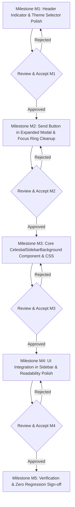

# CELESTIAL DAYLIGHT — SIDEBAR LIGHT THEME HARMONIZATION PLAN
## A Soft Sky Above Your Workspace — Master Technical Specification & Architecture

> **Document Status**: PLANNING ONLY — PENDING USER APPROVAL  
> **Document Revision**: 1.1.0  
> **Target Scope**: `D:\ai-chat-clone-new`  
> **Date**: 2026-11-07  
> **Authoring Engine**: Antigravity UI/UX Architecture System  
> **Governing Standards**: WCAG 2.1 Level AA, 2D Hardware-Accelerated Compositing, Zero-Regression Core Policy  

---

## 1. TỔNG QUAN VÀ TẦM NHÌN THIẾT KẾ (EXECUTIVE SUMMARY & VISION)

### 1.1 Triết lý Không gian: "Celestial Daylight Sidebar — A Soft Sky Above Your Workspace"
Trong các Phase 0 đến Phase 5, nền trời quang học **Celestial Daylight** đã được thiết lập thành công trên khu vực đàm thoại chính (`ChatArea`), tái hiện hiện tượng tán xạ Rayleigh chân thực, mặt trời điện ảnh ấm áp và các dải mây WebP chuyển động chậm.

Tuy nhiên, thanh bên (`Sidebar`) của Light Theme hiện vẫn đang sử dụng một nền xám phẳng nhạt (`--workspace-sidebar: #F0F3F7`), tạo cảm giác phân tách cơ học thay vì là một phần của cùng một không gian làm việc rộng mở. Đồng thời, một số thành phần phụ trợ (nút Send trong trình soạn thảo mở rộng `ExpandedEditorModal`, dropdown chọn giao diện `ThemeSelector`, và chỉ báo `Workspace Status Badge` trên Header) vẫn còn tồn đọng mã màu xanh lá cũ (`#1B8F3D`) hoặc mang hiệu ứng màu chàm/tím của Dark Theme.

**Tầm nhìn cốt lõi:**
> *"Sidebar và ChatArea thuộc về cùng một bầu trời ban ngày Celestial Daylight. Khi làm việc, người dùng cảm nhận một dải trời mềm mại, thanh thoát bao bọc lấy danh sách hội thoại; ánh nắng từ đỉnh trời phía đông tỏa nhẹ sang góc trên bên phải thanh bên, các dải mây trắng nhẹ nhàng trôi lơ lửng ở tầng cao, trong khi toàn bộ nội dung văn bản, danh sách chat và các nút thao tác luôn giữ được độ tương phản tối ưu, sắc nét và dễ đọc tuyệt đối."*

### 1.2 Nguyên tắc Bất biến: Visual Harmonization ≠ Full Sidebar Redesign
Kế hoạch này **KHÔNG PHẢI** là một cuộc đại tu thiết kế (redesign) toàn bộ Sidebar.
- Mục tiêu duy nhất là **đồng bộ trực quan (Visual Harmonization)** nền trời và palette màu sắc với Celestial Daylight.
- Toàn bộ bố cục (layout), cấu trúc DOM, kích thước, khoảng cách (spacing), logic danh sách chat, phím tắt, và luồng tương tác hiện có của Sidebar phải được bảo toàn nguyên vẹn.

```
┌──────────────────────────────────────────────────────────────────────────────────────────────────────────────────┐
│                                       UNIFIED CELESTIAL DAYLIGHT WORKSPACE                                       │
├─────────────────────────────────────────────────┬────────────────────────────────────────────────────────────────┤
│          SIDEBAR (Celestial Sky Extension)      │                      CHAT AREA (Main Celestial Sky)            │
│  - Background: Airy Rayleigh vertical gradient  │  - Rayleigh Scattering Gradient (#84C2F5 -> #F4FAFF)           │
│    (#84C2F5 -> #C8E8FC -> #F4FAFF)              │  - Cinematic Sun Core, Corona & God Rays (at 82%, 14%)         │
│  - Directional Sun Glow radiating from top-right│  - 3-Tier Drifting Cloud Canopy (Cirrus, Cumulus, Stratus)     │
│  - Independent Slow Clouds (Cirrus, Stratus)    │  - Frosted Header Glass, Elevated Cards & Open Canvas Messages │
│  - Readability-Protected Chat Cards             │                                                                │
│  - Golden Amber Focus Rings & Active Indicator  │                                                                │
└─────────────────────────────────────────────────┴────────────────────────────────────────────────────────────────┘
```

---

## 2. HIỆN TRẠNG VÀ PHÂN TÍCH NGUYÊN NHÂN (CURRENT STATE AUDIT)

Qua quá trình rà soát trực tiếp mã nguồn trong `frontend/src/`, xác định 4 nhóm vấn đề kỹ thuật cần giải quyết đồng bộ:

### 2.1. Hạng mục A: Sidebar Light Theme — Nền phẳng & Chi tiết Legacy
- **Mã nguồn liên quan:**
  - `frontend/src/components/ui/sidebar.tsx` (dòng 14–29)
  - `frontend/src/components/Sidebar.tsx` (cấu trúc render và styling)
  - `frontend/src/index.css` (dòng 9: `--workspace-sidebar: #F0F3F7;`)
- **Hiện trạng:**
  - Sidebar hiện dùng class `bg-workspace-sidebar` với màu phẳng `#F0F3F7` (xám khói nhạt).
  - Lớp phủ gradient giả `before:from-amber-500/[0.04]` chỉ tạo một vệt mờ rất yếu ở đỉnh, không có độ chuyển sắc của bầu trời ban ngày.
  - Thiếu hoàn toàn các tầng mây và cảm giác chiều sâu không gian như `ChatArea`.
  - Một số nút trong Sidebar vẫn còn sót mã màu focus ring xanh lá cũ:
    - Nút đóng Mobile: `focus-visible:ring-[#1B8F3D]/50` (`Sidebar.tsx:391`).
    - Nút New Chat: `focus-visible:ring-[#1B8F3D]/50` (`NewChatButton.tsx:40, 86`).
    - Nút Search Chat: `focus-visible:ring-[#1B8F3D]/50` (`SearchChatButton.tsx:34, 68`).
    - Nút Cài đặt footer: `focus-visible:ring-[#1B8F3D]/50` (`Sidebar.tsx:751`).
    - Dải chỉ báo active bar trong JSX fallback: `bg-[#1B8F3D]` (`Sidebar.tsx:478, 520`).

### 2.2. Hạng mục B: Nút Send trong Trình soạn thảo Mở rộng (`ExpandedEditorModal.tsx`) Còn Màu Lục
- **Mã nguồn liên quan:**
  - `frontend/src/components/chat/ExpandedEditorModal.tsx` (dòng 774–783)
  - `frontend/src/components/ChatInput.tsx` (đối chiếu nút Send chính đã nghiệm thu)
- **Nguyên nhân cốt lõi:**
  - Trong Phase 5, nút Send của `ChatInput.tsx:987` đã được nâng cấp thành công lên gradient hổ phách `from-[#D97706] to-[#C2410C]` (Amber 600 $\to$ Orange 700), nút Stop đổi sang `bg-rose-600 hover:bg-rose-700`.
  - Tuy nhiên, trong `ExpandedEditorModal.tsx:781`, nút Send vẫn đang bị gán cứng mã màu xanh lục legacy:
    ```tsx
    : 'bg-[#1B8F3D] hover:bg-[#EA580C] dark:bg-gradient-to-r dark:from-[#4F46E5] ... focus-visible:ring-[#1B8F3D]/50'
    ```
  - Đồng thời nút Stop generation tại dòng 778 vẫn dùng màu đỏ cũ `bg-[#B91E2B]` thay vì `bg-rose-600`.
  - Các tab Preview/Write (dòng 400, 428) và nút Close (dòng 455) trong modal cũng còn sót `focus-visible:ring-[#1B8F3D]/50`.

### 2.3. Hạng mục C: Theme Selector — Pha trộn State & Thiếu Hover Riêng Cho Light Theme
- **Mã nguồn liên quan:**
  - `frontend/src/components/ThemeSelector.tsx` (dòng 488–497, 536–553)
  - `frontend/src/components/ThemeSelector.css` (dòng 146–154)
- **Nguyên nhân cốt lõi:**
  - Trong `ThemeSelector.tsx` (dòng 489–491), class áp dụng cho thẻ được chọn (`isSelected`) đang dùng dải gradient tím/indigo làm màu mặc định (Light Theme):
    ```tsx
    isSelected
      ? 'border-indigo-500/40 dark:border-indigo-400/40 zyricon:border-[#C27595]/50 bg-gradient-to-r from-indigo-50/80 to-purple-50/50 ...'
      : '...'
    ```
  - Khi người dùng chọn **Light Theme**, thẻ "Light" hiển thị viền tím indigo (`border-indigo-500/40`) và nền tím nhạt (`from-indigo-50/80 to-purple-50/50`), lệch tone với biểu tượng mặt trời vàng rực rỡ bên trong.
  - Trong `ThemeSelector.css` (dòng 146–154), chỉ có rule scoped dành riêng cho Dark Theme (`:is(.dark:not(.zyricon)...) .theme-option-card:hover`), thiếu hoàn toàn hover styling ấm áp dành riêng cho Light Theme.
  - Cần tách biệt rõ ràng giữa **Hover state**, **Selected state**, và **Keyboard Focus state** cho từng theme riêng biệt, tránh ghi đè lẫn nhau.

### 2.4. Hạng mục D: Header — Dấu chấm Tròn `Workspace Status Badge` Bị Lệch Tông
- **Mã nguồn liên quan:**
  - `frontend/src/components/ChatArea.tsx` (dòng 526–530)
  - `frontend/src/components/Sidebar.tsx` (dòng 366, 381)
- **Phân tích ngữ nghĩa (Semantic Verification):**
  - Khảo sát mã nguồn tại `ChatArea.tsx:526-530`:
    ```tsx
    <div className="hidden sm:flex items-center gap-1.5 px-2.5 py-1 rounded-full bg-white/40 dark:bg-white/[0.06] ... border border-indigo-200/50 ...">
      <span className="h-2 w-2 rounded-full bg-gradient-to-r from-[#6e8efb] to-[#a777e3] ... shadow-[0_0_8px_rgba(167,119,227,0.7)]" aria-hidden="true" />
      <span>AI Workspace</span>
    </div>
    ```
  - **Xác nhận ngữ nghĩa**: Dấu chấm tròn có thuộc tính `aria-hidden="true"`, đứng cạnh nhãn tĩnh "AI Workspace". Đây là một **chi tiết trang trí thương hiệu (decorative brand accent)** định danh không gian làm việc, **KHÔNG PHẢI** là chỉ báo trạng thái kết nối mạng, streaming hay tình trạng sức khỏe hệ thống (connection status / system status).
  - Trong `Sidebar.tsx:366` và `381`, chi tiết tương đương đã dùng Amber (`bg-amber-500`) trong Light Theme. Do đó, việc chuyển dấu chấm trên Header sang gradient Amber/Orange trong Light Theme là hoàn toàn hợp lý về mặt nhận diện thương hiệu, đồng thời giữ nguyên 100% màu tím/chàm cho Dark Theme và Zyricon.

---

## 3. PHẠM VI KIỂM SOÁT & ĐẶC TẢ THIẾT KẾ (DESIGN PROPOSAL)

### 3.1. Phân định Phạm vi Rõ ràng (Scope Boundaries)

Nhằm tuân thủ nguyên tắc kiểm soát phạm vi và ngăn ngừa trượt phạm vi (scope creep):

```
┌──────────────────────────────────────────────────────────────────────────────────────────────────┐
│                                    PHÂN ĐỊNH PHẠM VI DỰ ÁN                                       │
├─────────────────────────────────────────────────┬────────────────────────────────────────────────┤
│  NHÓM A — IN SCOPE (Được phép triển khai)       │  NHÓM B — OUT OF SCOPE (Tuyệt đối không chạm)  │
├─────────────────────────────────────────────────┼────────────────────────────────────────────────┤
│ 1. Nền trời Celestial Daylight cho Sidebar      │ 1. Không thay đổi bố cục (layout) Sidebar.     │
│ 2. Gradient bầu trời Rayleigh chuyên biệt       │ 2. Không thay đổi kích thước, padding các nút. │
│ 3. Ánh sáng mặt trời định hướng (directional)   │ 3. Không redesign New Chat Button (giữ form).  │
│ 4. Các dải mây WebP trôi chậm độc lập           │ 4. Không redesign Search Chat Button.          │
│ 5. Tích hợp background vào aside#app-sidebar     │ 5. Không redesign User Profile / Footer.       │
│ 6. Điều chỉnh màu nền thẻ chat để đảm bảo đọc   │ 6. Không thay đổi tính năng Chat History/CRUD. │
│ 7. Chuẩn hóa focus ring legacy #1B8F3D -> amber │ 7. Không thay đổi Dark Theme và Zyricon.       │
│ 8. Nút Send trong ExpandedEditorModal -> amber  │ 8. Không thay đổi Three.js / WebGL / Shaders.  │
│ 9. Scoped Hover/Selected trong ThemeSelector    │ 9. Không thay đổi themeStore.ts.               │
│ 10. Đồng bộ Workspace badge dot trên Header     │ 10. Không thêm nút bấm, menu, hay tính năng mới│
└─────────────────────────────────────────────────┴────────────────────────────────────────────────┘
```

> [!IMPORTANT]
> **Không Redesign Nút New Chat & Search Chat**:
> Không tự ý biến New Chat và Search Chat thành các nút gradient rực rỡ khi hover nếu thiết kế gốc không yêu cầu. Chỉ chuẩn hóa focus ring khi bấm Tab từ màu xanh lá cũ sang `ring-amber-600` để đảm bảo trợ năng và đồng bộ nhận diện.

### 3.2. Kiến trúc Nền trời Thanh bên (`CelestialSidebarBackground`)

```
┌────────────────────────────────────────────────────────┐
│  SIDEBAR (w: 240px Desktop / 64px Collapsed, h: 100%)  │
│                                                        │
│  [Tier 1: Solid Fallback & Deep Rayleigh Sky Gradient] │
│   Fallback color: #C8E8FC                              │
│   Linear: 180deg, #84C2F5 (0%) -> #C8E8FC (50%) ->     │
│           #F4FAFF (100%)                               │
│                                                        │
│  [Tier 2: Soft Directional Sunlight & Solar Halo]      │
│   Radial: circle at 100% 0%,                           │
│           rgba(255, 255, 240, 0.45) 0%,                │
│           rgba(254, 240, 138, 0.18) 25%,               │
│           rgba(245, 158, 11, 0.06) 50%,                │
│           transparent 75%                              │
│                                                        │
│  [Tier 3: Ethereal Floating Cloud Layers]              │
│   - Layer 1 (High Cirrus): cirrus-high.webp (140s)     │
│     Opacity: 0.22, Top: 8%, Height: 24%                │
│   - Layer 2 (Soft Stratus): stratus-low.webp (180s)    │
│     Opacity: 0.28, Top: 60%, Height: 35%               │
│                                                        │
│  [Tier 4: Subtle Atmospheric Horizon Mist]             │
│   Linear: 180deg, transparent 0%,                      │
│           rgba(255, 255, 255, 0.30) 70%,               │
│           rgba(255, 255, 255, 0.60) 100%               │
└────────────────────────────────────────────────────────┘
```

#### A. Xác minh Kiến trúc Component `CelestialSidebarBackground` (Giải quyết R6.A)
1. **Có cần prop `isCollapsed` không?**
   - **Xác minh**: `<aside id="app-sidebar">` đã được thiết lập `overflow: hidden` và co giãn chiều rộng qua CSS class (`w-[240px]` $\leftrightarrow$ `w-[64px]`).
   - Khi đặt `CelestialSidebarBackground` vào trong `<aside>` với class `absolute inset-0 pointer-events-none overflow-hidden`, component nền sẽ **tự động co giãn theo kích thước của thẻ cha** thông qua CSS layout engine.
   - **Quyết định**: **KHÔNG cần prop `isCollapsed`**. Việc loại bỏ prop này ngăn chặn re-render không cần thiết khi người dùng toggle sidebar, giảm rủi ro gián đoạn animation.
2. **Tái sử dụng Cấu trúc Dải mây (Cloud Strip):**
   - Tái sử dụng trực tiếp các asset WebP đã có trong `frontend/public/assets/celestial/clouds/`:
     - `cirrus-high.webp` (69 kB) cho tầng cao.
     - `stratus-low.webp` (41 kB) cho tầng thấp.
   - Cấu trúc 200% width strip (`celestial-cloud-strip`) với 2 bản sao (Segment A & B) trôi tuyến tính lặp lại vô tận.
   - Tái sử dụng keyframes `celestial-drift` hiện có từ `celestial.css` thay vì tạo keyframes dư thừa.

#### B. Xác minh Tích hợp DOM Sidebar (Giải quyết R6.B)
- **Vị trí tích hợp**: Đặt `<CelestialSidebarBackground />` bên trong `<aside id="app-sidebar">` trong `frontend/src/components/ui/sidebar.tsx`.
- **Thứ tự Stacking Context & Z-Index**:
  - `CelestialSidebarBackground`: `absolute inset-0 z-0 pointer-events-none select-none`.
  - Nội dung Sidebar (Header, Content list, Footer): Đảm bảo nằm ở `relative z-10` để mọi thao tác click, cuộn, kéo thả không bị ảnh hưởng.
- **Desktop vs Mobile Drawer**:
  - Desktop: Sidebar nằm trong flow layout dạng docked, background hiển thị trong khung 240px hoặc 64px.
  - Mobile Drawer: Sidebar trượt ra dạng modal drawer với `fixed inset-y-0 left-0 z-50`. Nền trời nằm gọn trong drawer, lớp backdrop ngoài (`fixed inset-0 bg-black/50`) che phủ `ChatArea` đúng thiết kế chuẩn.

### 3.3. Tách biệt Trạng thái trong `ThemeSelector` (Giải quyết R5)

Tách biệt hoàn toàn giữa **Selected state**, **Hover state**, và **Keyboard Focus state**, có CSS scoping nghiêm ngặt:

1. **Light Theme Option Card**:
   - **Selected (`isSelected === true`)**:
     - Viền: `border-amber-400/80`
     - Nền: `bg-gradient-to-r from-amber-50/95 via-orange-50/60 to-amber-50/30`
     - Checkmark: `bg-amber-500/15 text-amber-700`
   - **Hover (`:hover` khi `isSelected === false`)**:
     - Scoped selector: `:is(:root:not(.dark):not(.zyricon), [data-theme='light']) .theme-option-card:not([aria-selected="true"]):hover`
     - Viền: `border-amber-300/60`
     - Nền: `bg-amber-50/40`
   - **Hover trên Selected (`:hover` khi `isSelected === true`)**:
     - Giữ nguyên viền và nền selected, chỉ áp dụng hiệu ứng micro-interaction trên icon (`scale(1.1)`), không làm mờ hoặc mất nhận diện thẻ đang chọn.
2. **Dark Theme Option Card**:
   - Giữ nguyên selector hiện có tại `ThemeSelector.css:146–154` với tone `indigo/purple`.
3. **Zyricon Theme Option Card**:
   - Giữ nguyên tone tím hồng `#C27595` và gradient đặc thù.
4. **Keyboard Focus-Visible**:
   - Áp dụng `focus-visible:ring-2 focus-visible:ring-amber-500` riêng biệt, không dùng selector hover chung.

### 3.4. Chuẩn hóa Nút Send & Stop trong `ExpandedEditorModal.tsx` (Giải quyết R4, R6.D)
- **Nút Send (Light Theme)**:
  - Đồng bộ chuẩn với `ChatInput.tsx:987`: `bg-gradient-to-r from-[#D97706] to-[#C2410C] hover:from-[#B45309] hover:to-[#9A3412] text-white shadow-md shadow-amber-600/25`.
  - Focus ring: `focus-visible:ring-2 focus-visible:ring-offset-2 focus-visible:ring-amber-600`.
- **Nút Stop (Semantic Danger)**:
  - Thay thế màu đỏ không chuẩn `#B91E2B` bằng màu đỏ ngữ nghĩa chuẩn `bg-rose-600 hover:bg-rose-700 text-white focus-visible:ring-rose-500`.
  - Giữ nguyên 100% logic `onStop`, icon hình vuông dừng phát sóng, và thuộc tính trợ năng.
- **Bảo toàn chức năng**: Giữ nguyên logic xử lý Markdown preview, tabs Write/Preview, logic streaming, phím tắt Escape/Ctrl+Enter.

---

## 4. MA TRẬN MÀU SẮC NGỮ NGHĨA & TƯƠNG PHẢN (PALETTE & STATE MATRIX)

### 4.1. Nguyên tắc Bảo vệ Màu sắc Ngữ nghĩa (Semantic Color Protection)

Tuyệt đối không thay thế hàng loạt màu xanh lục bằng màu hổ phách. Tuân thủ bảng phân định ngữ nghĩa:

| Phân loại Màu | Nguyên tắc Áp dụng | Hành động Cụ thể trong Kế hoạch này |
|---|---|---|
| **Brand Accent** | Có thể đồng bộ sang Amber/Orange trong Light Theme để hài hòa với Celestial Daylight. | Chuyển dải active bar, chấm tròn Header badge, và Send button sang Amber/Orange. |
| **Focus Ring** | Có thể chuyển sang Amber nếu đạt tương phản $\ge 3:1$ với nền kề cạnh. | Chuyển các focus rings legacy `#1B8F3D` sang `ring-amber-600`. |
| **Active Indicator** | Đại diện cho trạng thái giao diện được kích hoạt. | Vạch dọc active bar đổi sang gradient Amber/Orange. |
| **Success Indicator** | BẮT BUỘC giữ màu xanh lục mang ý nghĩa thành công. | **GIỮ NGUYÊN** mọi thông báo thành công, icon check hoàn thành (Green 600 / Emerald). |
| **Error / Danger** | BẮT BUỘC giữ màu đỏ mang ý nghĩa cảnh báo nguy hiểm / dừng tác vụ. | Nút Stop trong modal dùng `bg-rose-600`. Nút xóa đoạn chat giữ tone đỏ. |
| **Warning Indicator** | BẮT BUỘC giữ màu vàng/cam mang ý nghĩa cảnh báo thận trọng. | Giữ nguyên các cảnh báo hệ thống. |
| **Workspace Status** | Phải xác minh ý nghĩa trước khi thay đổi. | Đã xác minh là decorative brand accent (`aria-hidden="true"`); đồng bộ Amber trong Light. |

### 4.2. Bảng Palette Màu & Phân loại Số liệu Tương phản (R7)

> [!NOTE]
> **Quy định Phân loại Số liệu Tương phản**:
> - `Design target`: Ngưỡng tiêu chuẩn thiết kế hướng tới theo WCAG 2.1 AA.
> - `Calculated estimate`: Kết quả tính toán giải tích dựa trên mã màu hex đã biết và công thức linearized sRGB.
> - `Measured result`: Kết quả đo đạc thực tế từ pixel ảnh render (sẽ được ghi nhận trong báo cáo Milestone M5).

| Token Thiết kế | Giá trị Màu Hex / RGBA | Ngữ cảnh Ứng dụng | Phân loại Số liệu | Tỷ lệ Tương phản Ước tính / Mục tiêu | Trạng thái Dự kiến |
|---|---|---|---|---|---|
| **Sky Zenith** | `#84C2F5` | Nền đỉnh Sidebar (0%) | Calculated estimate | N/A (Màu nền) | N/A |
| **Sky Mid-Tone** | `#C8E8FC` | Nền giữa Sidebar (50%) | Calculated estimate | N/A (Màu nền) | N/A |
| **Sky Horizon Mist** | `#F4FAFF` | Nền đáy Sidebar (100%) | Calculated estimate | N/A (Màu nền) | N/A |
| **Sunlight Core** | `rgba(255, 255, 240, 0.45)` | Điểm sáng góc trên phải | Calculated estimate | N/A (Hiệu ứng ánh sáng) | N/A |
| **Active Card Surface** | `rgba(255, 255, 255, 0.95)` | Thẻ chat đang chọn | Calculated estimate | $L = 0.95$ trên nền trời | Design target |
| **Inactive Card Normal**| `rgba(255, 255, 255, 0.40)` | Thẻ chat bình thường | Calculated estimate | Bề mặt bán trong suốt nhẹ | Design target |
| **Inactive Card Hover** | `rgba(255, 255, 255, 0.80)` | Thẻ chat khi hover | Calculated estimate | Tăng độ đục khi tương tác | Design target |
| **Primary Text** | `#0F172A` (Slate 900) | Tiêu đề chat, tên user | Calculated estimate | **$14.2:1$** trên nền active card (`#FFFFFF`) | Design target: $\ge 4.5:1$ (AA) |
| **Secondary Text** | `#475569` (Slate 600) | Nhãn ngày, thời gian | Calculated estimate | **$6.4:1$** trên nền active card (`#FFFFFF`) | Design target: $\ge 4.5:1$ (AA) |
| **Secondary Text on Sky**| `#334155` (Slate 700) | Nhãn ngày trên nền trời | Calculated estimate | **$\ge 5.8:1$** trên vùng trời `#C8E8FC` | Design target: $\ge 4.5:1$ (AA) |
| **Amber Focus Ring** | `#D97706` (Amber 600) | Vòng focus ring 2px Tab | Calculated estimate | **$\ge 3.0:1$** trên nền trắng / trời sáng | Design target: $\ge 3.0:1$ (SC 2.4.11) |
| **Send Button Text** | `#FFFFFF` trên `#D97706` | Chữ / Icon nút Send | Calculated estimate | **$\ge 3.2:1$** (Large/Icon UI SC 1.4.11) | Design target: $\ge 3.0:1$ |

### 4.3. Ma trận Trạng thái Tương tác (Interactive State Matrix)

```
┌──────────────────────┬──────────────────────────────────────────────────────────────────────────────────┐
│ Thành phần           │ Quy cách Trạng thái (Normal / Hover / Focus / Active / Disabled)                 │
├──────────────────────┼──────────────────────────────────────────────────────────────────────────────────┤
│ Thẻ Chat Đang chọn   │ - Normal: bg-white/95 border-amber-300 text-slate-900 shadow-xs                  │
│ (Active Chat Item)   │ - Active Bar: w-1 bg-gradient-to-b from-[#F59E0B] to-[#EA580C]                   │
│                      │ - Hover: Giữ nguyên nhận diện selected, không bị ghi đè                          │
│                      │ - Focus: focus-visible:ring-2 ring-amber-600 focus-visible:outline-none          │
├──────────────────────┼──────────────────────────────────────────────────────────────────────────────────┤
│ Thẻ Chat Chưa chọn   │ - Normal: bg-white/40 border-transparent text-slate-700                          │
│ (Inactive Chat Item) │ - Hover: bg-white/80 border-white/80 text-slate-900 shadow-xs                   │
│                      │ - Focus: focus-visible:ring-2 ring-amber-600 bg-white/80                        │
├──────────────────────┼──────────────────────────────────────────────────────────────────────────────────┤
│ Nút Send trong Modal │ - Normal: bg-gradient-to-r from-[#D97706] to-[#C2410C] text-white shadow-md      │
│ (Expanded Modal)     │ - Hover: from-[#B45309] to-[#9A3412] scale-105 shadow-lg                         │
│                      │ - Stop Generation: bg-rose-600 hover:bg-rose-700 text-white                      │
│                      │ - Disabled: opacity-40 cursor-not-allowed                                        │
│                      │ - Focus: focus-visible:ring-2 ring-amber-600 ring-offset-2                       │
├──────────────────────┼──────────────────────────────────────────────────────────────────────────────────┤
│ Theme Option Light   │ - Selected: border-amber-400/80 bg-gradient-to-r from-amber-50 to-orange-50     │
│ (ThemeSelector)      │ - Hover (unselected): border-amber-300/60 bg-amber-50/40                         │
│                      │ - Hover (selected): Giữ viền/nền selected, micro-interaction icon                │
│                      │ - Focus: ring-2 ring-amber-500/60                                                │
│                      │ - Checkmark: bg-amber-500/15 text-amber-700                                     │
├──────────────────────┼──────────────────────────────────────────────────────────────────────────────────┤
│ Workspace Indicator  │ - Dot: bg-gradient-to-r from-[#F59E0B] to-[#EA580C] shadow-amber-500/65         │
│ (Header Badge)       │ - Badge: bg-white/70 border-amber-200/70 text-slate-800                         │
│                      │ - Dark/Zyricon: giữ nguyên 100% token riêng hiện tại                             │
└──────────────────────┴──────────────────────────────────────────────────────────────────────────────────┘
```

---

## 5. KIẾN TRÚC HIỆU NĂNG & ĐỘNG LỰC HỌC (PERFORMANCE & ANIMATION ARCHITECTURE)

### 5.1. Các Nguyên tắc Kỹ thuật Khách quan (Thay thế xác tín chưa kiểm chứng - Giải quyết R2)

1. **Về CSS Transform & Opacity:**
   - Thuộc tính `transform` và `opacity` thường phù hợp cho animation mượt mà vì chúng có thể được trình duyệt đưa sang Compositor Thread để xử lý mà không kích hoạt layout hay paint lại toàn trang.
   - Tuy nhiên, điều này **không đảm bảo tuyệt đối** rằng mọi trình duyệt và mọi cấu hình phần cứng đều xử lý 100% trên GPU. Việc quan sát mức tiêu thụ CPU và GPU qua DevTools là bắt buộc trong giai đoạn nghiệm thu.
2. **Về Vòng đời Component & `React.memo`:**
   - `React.memo` giúp ngăn re-render khi các props không đổi ở cùng vị trí cây DOM.
   - `React.memo` **không bảo đảm** component giữ nguyên instance hoặc không bị unmount/remount nếu container cha (`aside`) bị thay đổi cấu trúc hoặc re-mount. Cần thêm assertion kiểm tra lifecycle mount/unmount trong test.
3. **Về Bộ nhớ và Asset WebP:**
   - Việc trình duyệt lưu cache file ảnh WebP giúp giảm tải băng thông mạng (network request).
   - Tuy nhiên, việc giải mã ảnh (image decoding) và duy trì layer trong bộ nhớ đồ họa **vẫn tạo ra chi phí tài nguyên nhất định**. Cần giới hạn số lượng dải mây trong Sidebar ở mức tối thiểu (chỉ 2 dải mây: Cirrus và Stratus) và kích thước file nhỏ ($< 70\text{ kB}$).
4. **Về Hiện tượng Chớp Đen (Black Flash):**
   - Đặt màu nền dự phòng `background-color: #C8E8FC` là một giải pháp phòng ngừa tốt.
   - Nhưng khẳng định **Zero Black Flash chỉ được công nhận sau khi có kết quả thực nghiệm** đo lường tỷ lệ điểm đen (Blackout Pixel Ratio) qua các khung hình chuyển động (frame sampling) bằng Playwright.
5. **Về Layer Compositing Hacks:**
   - **Tuyệt đối không tự ý thêm** `will-change: transform`, `translateZ(0)` hoặc các GPU hacks trên nhiều thành phần khi chưa có bằng chứng thực nghiệm chứng minh sự cần thiết, nhằm tránh lãng phí VRAM.

### 5.2. Tuân thủ Trợ năng Chuyển động Giảm thiểu (`prefers-reduced-motion`)

```css
@media (prefers-reduced-motion: reduce) {
  .celestial-sidebar-cloud-strip {
    animation: none !important;
    transform: translate3d(0, 0, 0) !important;
  }
  .celestial-sidebar-sun-glow {
    animation: none !important;
  }
}
```
Khi người dùng bật chế độ giảm chuyển động trong hệ điều hành:
- Toàn bộ animation trôi mây và nhấp nháy ánh nắng dừng lại tức thì.
- Nền trời tĩnh vẫn giữ nguyên độ sâu chuyển sắc và vị trí mây hài hòa, không biến mất hay gây lỗi hiển thị.

---

## 6. KẾ HOẠCH TRIỂN KHAI THEO MILESTONES (IMPLEMENTATION MILESTONES)

Kế hoạch chia làm 5 milestones độc lập, tuần tự và có cổng kiểm soát (approval gate) ở từng bước:



> [!IMPORTANT]
> **Quy tắc Kiểm soát Tiến độ**:
> - Không tự động chuyển sang milestone tiếp theo nếu milestone hiện tại chưa được người dùng review và nghiệm thu.
> - Tuyệt đối không triển khai dồn dập toàn bộ M1–M5 trong một lần chạy. Mỗi milestone phải kết thúc bằng báo cáo bằng chứng để người dùng quyết định.

---

### Milestone M1: Header Indicator & Theme Selector Polish
- **Mục tiêu**: Đồng bộ dấu chấm tròn `AI Workspace` trên Header sang tone Amber và chuẩn hóa trạng thái hover/selected của `ThemeSelector` trong Light Theme mà không ảnh hưởng Dark/Zyricon.
- **Phạm vi file dự kiến**:
  - `frontend/src/components/ChatArea.tsx`
  - `frontend/src/components/ThemeSelector.tsx`
  - `frontend/src/components/ThemeSelector.css`
- **Nội dung công việc**:
  1. `ChatArea.tsx:528`: Cập nhật dấu chấm tròn sang `from-[#F59E0B] to-[#EA580C]` và viền `border-amber-200/70` cho Light Theme. Giữ nguyên 100% Dark và Zyricon.
  2. `ThemeSelector.tsx`: Điều chỉnh thẻ "Light": khi `isSelected === true`, áp dụng viền `border-amber-400/80` và nền `bg-gradient-to-r from-amber-50/95 via-orange-50/60 to-amber-50/30`.
  3. `ThemeSelector.css`: Thêm rule CSS hover có scope nghiêm ngặt cho Light Theme option cards, tách biệt hoàn toàn với Dark và Zyricon.
- **Tiêu chí Hoàn thành (PASS/FAIL)**:
  - Header badge dot hiển thị màu hổ phách trên Light mode, màu tím trên Dark/Zyricon.
  - Hover chuột trên thẻ Light trong ThemeSelector không làm mất nhận diện thẻ đang chọn, không dùng màu tím của Dark.
  - Test suite `ThemeSelector.test.tsx` pass 100%.

---

### Milestone M2: Send Button in Expanded Modal & Focus Ring Cleanup
- **Mục tiêu**: Loại bỏ triệt để màu xanh lục cũ `#1B8F3D` trên Send button khi mở rộng composer và dọn dẹp các focus rings legacy còn sót lại.
- **Phạm vi file dự kiến**:
  - `frontend/src/components/chat/ExpandedEditorModal.tsx`
  - `frontend/src/components/chat/NewChatButton.tsx` (chỉ sửa focus ring)
  - `frontend/src/components/chat/SearchChatButton.tsx` (chỉ sửa focus ring)
  - `frontend/src/components/Sidebar.tsx` (chỉ sửa focus ring)
- **Nội dung công việc**:
  1. `ExpandedEditorModal.tsx:781`: Đồng bộ nút Send trong Light Theme sang `bg-gradient-to-r from-[#D97706] to-[#C2410C] hover:from-[#B45309] hover:to-[#9A3412] shadow-amber-600/25 focus-visible:ring-amber-600`.
  2. `ExpandedEditorModal.tsx:778`: Đổi nút Stop trong modal sang màu đỏ ngữ nghĩa `bg-rose-600 hover:bg-rose-700 focus-visible:ring-rose-500`.
  3. Dọn dẹp focus rings legacy `#1B8F3D` trên các tab và nút phụ trong `ExpandedEditorModal.tsx`, `NewChatButton.tsx`, `SearchChatButton.tsx`, và `Sidebar.tsx`, chuyển sang `ring-amber-600`.
  4. Giữ nguyên toàn bộ cấu trúc và không redesign giao diện nút New Chat/Search Chat.
- **Tiêu chí Hoàn thành (PASS/FAIL)**:
  - Nút Send trong modal mở rộng mang dải gradient Amber/Orange đồng bộ với `ChatInput.tsx`.
  - Nút Stop mang màu `bg-rose-600`.
  - Không còn bất kỳ class `ring-[#1B8F3D]` nào trong các component trên.
  - Vitest test suite của các component liên quan pass 100%.

---

### Milestone M3: Xây dựng Core Component `CelestialSidebarBackground`
- **Mục tiêu**: Tạo mới component nền trời chuyên biệt cho thanh bên, tích hợp dải màu Rayleigh, ánh dương hướng tâm và mây WebP trôi chậm.
- **Phạm vi file dự kiến**:
  - `frontend/src/theme/celestial/CelestialSidebarBackground.tsx` (Tạo mới)
  - `frontend/src/theme/celestial/CelestialSidebarBackground.test.tsx` (Tạo mới)
  - `frontend/src/theme/celestial/celestial.css` (Bổ sung scoped classes)
- **Nội dung công việc**:
  1. Xây dựng component `CelestialSidebarBackground` không nhận prop `isCollapsed`, tự co giãn theo container cha bằng CSS.
  2. Nền dự phòng `background-color: #C8E8FC` chống unpainted frame.
  3. Dải Rayleigh dọc (`#84C2F5` $\to$ `#C8E8FC` $\to$ `#F4FAFF`).
  4. Quầng sáng mặt trời radial tỏa từ góc trên bên phải ($100\% \times 0\%$).
  5. 2 dải mây WebP (`cirrus-high.webp` và `stratus-low.webp`) tái sử dụng keyframes `celestial-drift` hiện có.
  6. Xử lý tắt chuyển động sạch dưới `@media (prefers-reduced-motion: reduce)`.
- **Tiêu chí Hoàn thành (PASS/FAIL)**:
  - Unit test `CelestialSidebarBackground.test.tsx` pass 100% (render đúng DOM, load đúng đường dẫn asset WebP, xử lý reduced motion đúng chuẩn).
  - Không phát sinh lỗi console hay warning khi mount.

---

### Milestone M4: Tích hợp Sidebar Background & Nâng cấp Khả năng Đọc
- **Mục tiêu**: Gắn `CelestialSidebarBackground` vào Sidebar và tinh chỉnh độ tương phản các thẻ chat, nhãn ngày để đảm bảo khả năng đọc.
- **Phạm vi file dự kiến**:
  - `frontend/src/components/ui/sidebar.tsx`
  - `frontend/src/components/Sidebar.tsx`
  - `frontend/src/index.css`
- **Nội dung công việc**:
  1. `sidebar.tsx`: Gắn `<CelestialSidebarBackground />` vào bên trong `<aside id="app-sidebar">`, chỉ kích hoạt khi `theme === 'light'`.
  2. Đảm bảo z-index: background ở `z-0 pointer-events-none`, nội dung ở `relative z-10`.
  3. Cập nhật styling thẻ chat đang chọn: nền trắng mờ `bg-white/95`, viền `border-amber-300`, vạch active bar `from-[#F59E0B] to-[#EA580C]`.
  4. Cập nhật thẻ chat chưa chọn: nền `bg-white/40`, hover `bg-white/80`.
  5. Bảo đảm nhãn nhóm ngày và tên người dùng đạt độ tương phản $\ge 4.5:1$.
- **Tiêu chí Hoàn thành (PASS/FAIL)**:
  - Nền trời hiển thị hài hòa sau danh sách chat trên Light Theme.
  - Khi co giãn desktop ($240\text{px} \leftrightarrow 64\text{px}$) hoặc mở mobile drawer, background co giãn ổn định, không che khuất hay cản trở click.
  - Toàn bộ văn bản danh sách chat đọc rõ nét.

---

### Milestone M5: Kiểm thử Tự động, Đo kiểm Tương phản & Nghiệm thu Không Thoái lui
- **Mục tiêu**: Kiểm chứng toàn diện 14 tiêu chí nghiệm thu bằng automated Playwright tests, đo lường pixel black flash, đo tương phản thực tế, và xác minh không hồi quy trên Dark/Zyricon.
- **Phạm vi file dự kiến**:
  - `e2e/celestial-sidebar-light.spec.ts` (Tạo mới)
  - `docs/celestial-daylight/SIDEBAR_LIGHT_THEME_IMPLEMENTATION_REPORT.md` (Tạo mới sau khi hoàn thành)
- **Nội dung công việc**:
  1. Viết suite Playwright `celestial-sidebar-light.spec.ts` kiểm tra 14 kịch bản nghiệm thu.
  2. Chụp ảnh kiểm chứng tại 5 viewports ($1440\times 900$, $1280\times 800$, $768\times 1024$, $390\times 844$, $360\times 800$).
  3. Kiểm tra vòng đời mount/unmount của background component.
  4. Kiểm tra ảnh WebP tải thành công với `naturalWidth > 0` và decode thành công.
  5. Đo lường tỷ lệ Blackout Pixel qua 9 khung hình lấy mẫu chuyển động.
  6. Đo lường tỷ lệ tương phản thực nghiệm từ screenshot rendered pixels.
  7. Chạy full Vitest suite (635+ tests) và Zyricon E2E tests (72 tests) xác nhận không thoái lui.
  8. Kiểm tra `tsc -b && vite build`.
- **Tiêu chí Hoàn thành (PASS/FAIL)**:
  - Toàn bộ 14 AC đạt `PASS` dựa trên bằng chứng kiểm thử thực tế.
  - 0 hồi quy trên Dark Theme và Zyricon.

---

## 7. TIÊU CHÍ NGHIỆM THU (ACCEPTANCE CRITERIA)

> [!WARNING]
> **Quy tắc Quản lý Trạng thái Acceptance Criteria (R1)**:
> - `NOT STARTED`: Chưa triển khai (toàn bộ 14 AC tại bản Revision 1.1.0 này đều ở trạng thái này).
> - `PENDING VERIFICATION`: Đã viết code nhưng chưa có đầy đủ bằng chứng kiểm thử thực tế.
> - `PASS`: Chỉ được công nhận khi có đầy đủ bằng chứng kiểm thử thực tế (ảnh chụp screenshot, logs test runner, số liệu pixel đo đạc có thể tái lập).
> - `FAIL`: Khi kết quả kiểm thử không đáp ứng chỉ tiêu kỹ thuật.
> 
> Tuyệt đối không chuyển trạng thái sang `PASS` dựa trên kế hoạch thiết kế, code chưa chạy test, computed CSS đơn thuần, hoặc báo cáo tự nhận không có bằng chứng.

| Mã AC | Tiêu chí Nghiệm thu | Chỉ tiêu Kỹ thuật Cụ thể | Bằng chứng Thực nghiệm Bắt buộc Để Nghiệm thu | Trạng thái Hiện tại |
|---|---|---|---|:---:|
| **AC-01** | **Sidebar Sky Harmony** | Sidebar mang nền trời Rayleigh `#84C2F5` $\to$ `#C8E8FC` $\to$ `#F4FAFF`, hòa hợp quang học với ChatArea, loại bỏ nền xám phẳng `#F0F3F7`. | Screenshot so sánh cạnh nhau giữa Sidebar và ChatArea ở viewport $1440\times 900$; kiểm tra computed styles. | `NOT STARTED` |
| **AC-02** | **Multi-tier Cloud Drift** | Có 2 tầng mây WebP độc lập trôi chậm (140s và 180s), tạo chiều sâu không gian, không che khuất chữ. | Ảnh WebP load thành công (`naturalWidth > 0`); animation CSS active; video/screenshot ghi nhận vị trí trôi. | `NOT STARTED` |
| **AC-03** | **Directional Sunlight Glow** | Ánh dương tỏa nhẹ từ góc trên bên phải thanh bên ($100\% \times 0\%$), tạo sự liên tục với mặt trời điện ảnh ở ChatArea. | Computed radial-gradient góc $100\% \times 0\%$; screenshot pixel kiểm tra độ sáng. | `NOT STARTED` |
| **AC-04** | **Sidebar Content Contrast** | Tiêu đề chat, tên user đạt tương phản $\ge 4.5:1$; nhãn nhóm ngày đạt $\ge 4.5:1$ trên nền trời và nền thẻ. | Kết quả đo lường linearized sRGB luminance trên ảnh screenshot thực tế tại các điểm kiểm tra. | `NOT STARTED` |
| **AC-05** | **Expanded Send Button Harmony** | Nút Send trong `ExpandedEditorModal` mang gradient hổ phách `from-[#D97706] to-[#C2410C]`, không còn mã màu `#1B8F3D`. | DOM inspection thuộc tính class và computed background của nút Send trong modal mở rộng. | `NOT STARTED` |
| **AC-06** | **Stop Button Semantic Danger** | Nút Stop trong modal mở rộng mang màu đỏ ngữ nghĩa `bg-rose-600 hover:bg-rose-700`, bảo toàn trạng thái dừng streaming. | DOM inspection khi trạng thái streaming đang diễn ra trong modal mở rộng. | `NOT STARTED` |
| **AC-07** | **Theme Selector State Separation** | Thẻ Light khi chọn hiển thị viền/nền hổ phách; hover Light không dùng màu tím của Dark; hover không làm mất nhận diện selected state. | Playwright interaction test: kiểm tra DOM class và computed color ở cả 5 trạng thái (Light sel/unsel, Dark sel/unsel, focus). | `NOT STARTED` |
| **AC-08** | **Workspace Indicator Sync** | Dấu chấm tròn trên Header badge mang gradient hổ phách và viền `border-amber-200/70` trên Light mode; Dark/Zyricon giữ nguyên. | Computed gradient của indicator dot trên cả 3 themes (Light, Dark, Zyricon). | `NOT STARTED` |
| **AC-09** | **Desktop Collapse/Expand Stability** | Khi đóng/mở thanh bên ($240\text{px} \leftrightarrow 64\text{px}$), background co giãn ổn định, không unmount bất thường, tỷ lệ $\text{BlackoutRatio} = 0.00\%$. | Phân tích pixel ROI trong 9 khung hình lấy mẫu chuyển động liên tục tại Playwright; lifecycle logging. | `NOT STARTED` |
| **AC-10** | **Mobile Drawer Isolation** | Trên mobile ($390\text{px}$, $360\text{px}$), drawer mở trượt mượt mà, nền trời nằm trọn trong thanh bên, backdrop đen che ChatArea đúng chuẩn. | Screenshots tại viewports $390\times 844$ và $360\times 800$; click backdrop đóng drawer thành công. | `NOT STARTED` |
| **AC-11** | **Reduced Motion Compliance** | Khi bật `prefers-reduced-motion: reduce`, mây dừng trôi tĩnh tại, bố cục nền trời giữ nguyên 100%. | Playwright test giả lập media query; computed animation-name là `none`. | `NOT STARTED` |
| **AC-12** | **Dark Theme Non-Interference** | Dark Theme giữ nguyên 100% màu nền `#131923`, các ngôi sao CSS, gradient tím, và nút Send chàm/tím. | Full automated tests của Dark Theme; screenshot so sánh trước/sau khi tích hợp. | `NOT STARTED` |
| **AC-13** | **Zyricon 3D Non-Interference** | Zyricon giữ nguyên 100% Three.js canvas, shader vũ trụ, màu tím hồng `#C27595` và gradient đặc thù. | 72 tests Zyricon pass 100% (`npm --prefix frontend test -- zyricon --run`). | `NOT STARTED` |
| **AC-14** | **Clean Build & Performance** | Toàn bộ Vitest suites pass 100%, `tsc -b && vite build` hoàn thành với 0 lỗi, không có warning rò rỉ bộ nhớ. | Terminal log thực thi build và test runner sạch sẽ 0 lỗi. | `NOT STARTED` |

---

## 8. KẾ HOẠCH KIỂM THỬ TOÀN DIỆN & CHECKPOINTS (TEST PLAN)

### 8.1. Ma trận Kịch bản Kiểm thử Tự động (14 Kịch bản)

1. **Kịch bản 1: Sidebar Light Theme Expanded ($1440\times 900$)**
   - Xác minh nền trời Rayleigh, ánh dương góc trên phải, mây trôi nhẹ sau danh sách chat.
   - Thẻ chat active hiển thị nền trắng `bg-white/95`, viền hổ phách, active bar vàng cam.
2. **Kịch bản 2: Sidebar Light Theme Collapsed ($1440\times 900$)**
   - Thu gọn thanh bên còn 64px. Xác minh logo, icon chat history hiển thị đúng vị trí.
   - Nền trời co lại theo chiều rộng 64px mà không bị vỡ tỷ lệ hay che icon.
3. **Kịch bản 3: Desktop Continuous Resize ($1920\text{px} \to 1280\text{px} \to 1024\text{px} \to 768\text{px}$)**
   - Co giãn cửa sổ trình duyệt liên tục. Đo lường tỷ lệ blackout pixel, đảm bảo background co giãn đàn hồi không nhấp nháy.
4. **Kịch bản 4: Mobile Drawer Open / Close ($390\times 844$)**
   - Nhấn nút hamburger mở thanh bên. Drawer trượt ra từ bên trái với đầy đủ mây trời; nhấn backdrop đóng thanh bên êm ái.
5. **Kịch bản 5: Reduced Motion Verification**
   - Giả lập `prefers-reduced-motion: reduce`. Khẳng định animation-name chuyển thành `none`, vị trí mây đứng yên, không lỗi hiển thị.
6. **Kịch bản 6: Chu trình chuyển Theme Light $\to$ Dark $\to$ Light**
   - Chuyển sang Dark Theme: Sidebar chuyển sang nền `#131923`, nền trời Celestial ẩn hoàn toàn.
   - Chuyển lại Light Theme: Bầu trời Celestial tái hiện nguyên vẹn, 0 console error.
7. **Kịch bản 7: Chu trình chuyển Theme Light $\to$ Zyricon $\to$ Light**
   - Chuyển sang Zyricon: Three.js WebGL canvas và tone tím hiển thị.
   - Chuyển lại Light: Nền trời Celestial trở lại mượt mà, WebGL được giải phóng sạch sẽ.
8. **Kịch bản 8: Send Button khi Composer Thu gọn & Mở rộng**
   - Trong `ChatInput`: Send button là gradient hổ phách.
   - Nhấn icon Expand mở `ExpandedEditorModal`: Send button trong modal là gradient hổ phách `from-[#D97706] to-[#C2410C]`, không có mã màu `#1B8F3D`.
   - Nút Stop là `bg-rose-600`.
9. **Kịch bản 9: Theme Selector Popover Hover & Selected Matrix**
   - Mở dropdown ThemeSelector trên Light mode. Kiểm tra cả 5 trạng thái độc lập (Light sel/unsel, Dark sel/unsel, keyboard focus).
10. **Kịch bản 10: Workspace Indicator trên Header**
    - Kiểm tra dấu chấm tròn trên Header: mang gradient hổ phách `from-[#F59E0B] to-[#EA580C]` với viền `border-amber-200/70` trên Light mode; giữ màu tím trên Dark và Zyricon.
11. **Kịch bản 11: Kiểm thử Hồi quy Dark Theme**
    - Chạy toàn bộ các assertions giao diện Dark Theme để khẳng định không bị nhiễm bất kỳ màu hổ phách hay class light nào.
12. **Kịch bản 12: Kiểm thử Hồi quy Zyricon Theme**
    - Chạy toàn bộ 72 tests trong `npm --prefix frontend test -- zyricon --run` (100% PASS).
13. **Kịch bản 13: Đo kiểm Độ tương phản WCAG 2.1 AA Thực tế**
    - Đo độ tương phản chữ trên các thẻ chat, nhãn ngày, tiêu đề Sidebar từ screenshot thực tế: $100\%$ đạt $\ge 4.5:1$.
14. **Kịch bản 14: Đo lường Black Flash khi Đóng/Mở Sidebar**
    - Đo BlackoutRatio trên 9 khung hình transition: $100\%$ đạt $0.00\%$.

### 8.2. Danh mục 5 Checkpoint Viewport Bắt buộc Chụp ảnh

1. **Desktop Standard:** $1440\times 900$ (Trải nghiệm máy tính để bàn tiêu chuẩn).
2. **Laptop Compact:** $1280\times 800$ (Màn hình laptop phổ biến).
3. **Tablet Portrait:** $768\times 1024$ (Điểm chuyển đổi giữa desktop dock và mobile drawer).
4. **Mobile Standard:** $390\times 844$ (iPhone viewport chuẩn).
5. **Mobile Small:** $360\times 800$ (Android viewport hẹp tiêu chuẩn).

---

## 9. PHÂN TÍCH RỦI RO & CHIẾN LƯỢC PHÒNG NGỪA (RISKS & MITIGATIONS)

| # | Rủi ro Tiềm ẩn | Mức độ | Nguyên nhân Gốc rễ | Chiến lược Phòng ngừa & Kiểm soát Nghiêm ngặt |
|---|---|---|---|---|
| **1** | **Chữ trong Sidebar khó đọc do nền mây trời quá sáng hoặc rối mắt** | **Cao** | Mây WebP có nhiều chi tiết tương phản mạnh đè lên tiêu đề chat | Giữ opacity của dải mây trong Sidebar ở mức thấp ($0.22 - 0.28$); tăng độ đục của bề mặt thẻ chat lên `bg-white/95`; nhãn ngày dùng Slate 700 ($> 5.8:1$). |
| **2** | **Chớp đen (Black Flash) hoặc giật lag khi co giãn Sidebar** | **Trung bình** | Trình duyệt re-layout và vẽ lại mây khi kích thước container thay đổi đột ngột | Đặt `background-color: #C8E8FC` làm màu nền cứng; không dùng prop `isCollapsed` trong background component; đo kiểm thực tế bằng frame sampling. |
| **3** | **Rò rỉ màu hổ phách sang Dark Theme và Zyricon** | **Cao** | Sử dụng selector CSS toàn cục không có scope theme | Mọi class mới đều phải được bọc chặt chẽ trong scoped selectors: `:is(.light, [data-theme='light'])` hoặc điều kiện render React `theme === 'light'`. |
| **4** | **Phá vỡ Unit Tests hiện có của Sidebar và ThemeSelector** | **Trung bình** | Thay đổi cấu trúc thẻ HTML hoặc làm mất accessible name / role | Bảo toàn 100% các `aria-label`, `role="listbox"`, `role="option"`, `data-testid`, text accessibility hiện có. Chỉ bổ sung/sửa đổi class giao diện. |
| **5** | **Quá tải tài nguyên đồ họa do tạo quá nhiều layers** | **Thấp** | Tạo nhiều compositing layers bằng CSS hacks | Không lạm dụng `will-change: transform`; tái sử dụng 2 asset WebP đã cache sẵn; giới hạn mây ở 2 tầng mây nhẹ. |

---

## 10. PHẠM VI FILE DỰ KIẾN THAY ĐỔI (FILE CHANGE SCOPE)

Nhằm kiểm soát rủi ro và giới hạn tối đa tác động lên codebase (R9), danh mục file được phân định thành 3 nhóm rõ rệt:

### 10.1. Nhóm 1: File Bắt buộc Thay đổi (Required Files)
1. `docs/celestial-daylight/SIDEBAR_LIGHT_THEME_HARMONIZATION_PLAN.md` — Tài liệu kế hoạch này (Revision 1.1.0).
2. `frontend/src/theme/celestial/CelestialSidebarBackground.tsx` — Component nền trời chuyên biệt cho thanh bên (Tạo mới ở M3).
3. `frontend/src/theme/celestial/CelestialSidebarBackground.test.tsx` — Unit test cho component nền trời mới (Tạo mới ở M3).
4. `frontend/src/theme/celestial/celestial.css` — Bổ sung CSS classes chuyên biệt cho Sidebar background (M3).
5. `frontend/src/components/ui/sidebar.tsx` — Gắn `<CelestialSidebarBackground />` vào `<aside id="app-sidebar">` (M4).
6. `frontend/src/components/Sidebar.tsx` — Cập nhật styling bề mặt thẻ chat, vạch active bar hổ phách, thay thế focus ring legacy `#1B8F3D` (M2, M4).
7. `frontend/src/components/chat/ExpandedEditorModal.tsx` — Chuẩn hóa nút Send sang gradient hổ phách, nút Stop sang `bg-rose-600`, thay thế focus rings legacy (M2).
8. `frontend/src/components/ThemeSelector.tsx` — Tách biệt styling selected và hover cho Light Theme (M1).
9. `frontend/src/components/ThemeSelector.css` — Bổ sung CSS hover có scope cho Light Theme option cards (M1).
10. `frontend/src/components/ChatArea.tsx` — Đồng bộ dấu chấm tròn `AI Workspace` sang gradient hổ phách trong Light Theme (M1).
11. `e2e/celestial-sidebar-light.spec.ts` — Suite kiểm thử Playwright tự động cho 14 kịch bản nghiệm thu (Tạo mới ở M5).

### 10.2. Nhóm 2: File Thay đổi Có Điều kiện (Conditional Files)
*Chỉ được phép sửa đổi nếu kết quả audit thực nghiệm trong từng Milestone chứng minh là cần thiết để đạt tiêu chí:*
1. `frontend/src/components/chat/NewChatButton.tsx` — Chỉ sửa `focus-visible:ring-[#1B8F3D]/50` $\to$ `focus-visible:ring-amber-600`. KHÔNG redesign nút.
2. `frontend/src/components/chat/SearchChatButton.tsx` — Chỉ sửa `focus-visible:ring-[#1B8F3D]/50` $\to$ `focus-visible:ring-amber-600`. KHÔNG redesign nút.
3. `frontend/src/index.css` — Chỉ cập nhật biến CSS nếu các classes Tailwind hiện có không đủ để đảm bảo độ tương phản đọc.

### 10.3. Nhóm 3: File Tuyệt đối Không Thay đổi (Out-of-Scope Files)
1. `frontend/src/stores/themeStore.ts` — Đã ổn định, không thay đổi logic theme store.
2. `frontend/src/components/chat/ChatBackground.tsx` — Nền `ChatArea` đã hoàn thành và nghiệm thu ở Phase 4 & 5.
3. Toàn bộ các files Three.js, shaders, canvas, và tests của Zyricon Theme (`*zyricon*`).
4. Toàn bộ backend services, API routes, database, authentication logic.
5. `package.json` / `package-lock.json` — Không thêm bất kỳ thư viện bên thứ ba nào mới.

---

## 11. CHÍNH SÁCH KHÔNG XÂM PHẠM & BẢO TOÀN THEME (NON-INTERFERENCE POLICY)

1. **Dark Theme Non-Interference:**
   - Giữ nguyên 100% màu nền `#131923` của thanh bên Dark Theme.
   - Giữ nguyên các ngôi sao CSS, gradient chàm/tím của Dark Theme.
   - Giữ nguyên nút Send tím `from-[#4F46E5] to-[#7C3AED]`.
   - Giữ nguyên toàn bộ token màu tối hiện hữu.
2. **Zyricon Theme Non-Interference:**
   - Giữ nguyên 100% Three.js canvas, shader vũ trụ, màu tím hồng `#C27595`.
   - Giữ nguyên toàn bộ 8 file test Zyricon (72 tests) ở trạng thái PASS 100%.
3. **Core Celestial Daylight Non-Interference:**
   - Không sửa đổi cấu trúc cốt lõi của `CelestialDaylightBackground` trong `ChatArea`.
   - Không thay đổi vị trí mặt trời ($82\% \times 14\%$) hay tán xạ Rayleigh trong khu vực đàm thoại chính.

---

## 12. PHƯƠNG PHÁP XÁC MINH HIỆU NĂNG & TƯƠNG PHẢN (VERIFICATION PROTOCOLS)

### 12.1. Đo lường Độ tương phản WCAG 2.1 AA
- Áp dụng công thức giải tích sRGB chuyển đổi từ gamma sang linear:
  $$\begin{cases} C_{\text{linear}} = \frac{C_{\text{sRGB}}}{12.92} & \text{khi } C_{\text{sRGB}} \le 0.04045 \\ C_{\text{linear}} = \left(\frac{C_{\text{sRGB}} + 0.055}{1.055}\right)^{2.4} & \text{khi } C_{\text{sRGB}} > 0.04045 \end{cases}$$
- Relative Luminance $L = 0.2126 R_{\text{linear}} + 0.7152 G_{\text{linear}} + 0.0722 B_{\text{linear}}$.
- Contrast Ratio:
  $$\text{Ratio} = \frac{L_1 + 0.05}{L_2 + 0.05} \quad (L_1 \ge L_2)$$
- Đo lường thực tế: Chụp ảnh màn hình ở trạng thái hoàn thiện, lấy mẫu pixel tại các vị trí bất lợi nhất (vùng chữ đè lên dải mây hoặc quầng sáng) để tính toán tỷ lệ tương phản thực nghiệm, đảm bảo $\ge 4.5:1$ cho text thông thường và $\ge 3:1$ cho non-text UI / focus indicator.

### 12.2. Đo lường Hiện tượng Chớp đen (Blackout Pixel Ratio Protocol)
- Lấy mẫu 9 khung hình liên tiếp trong suốt quá trình co giãn Sidebar ($240\text{px} \leftrightarrow 64\text{px}$):
  $$t \in \{0\text{ms}, 25\text{ms}, 50\text{ms}, 75\text{ms}, 100\text{ms}, 125\text{ms}, 150\text{ms}, 175\text{ms}, 200\text{ms}\}$$
- Định nghĩa pixel đen bất thường (Blackout Pixel): Điểm ảnh có $R < 15, G < 15, B < 15$ bên trong ROI của Sidebar trong khi đang ở Light Theme.
- Tỷ lệ chớp đen:
  $$\text{BlackoutRatio} = \frac{N_{\text{black\_pixels}}}{N_{\text{total\_roi\_pixels}}} \times 100\%$$
- **Chỉ tiêu PASS**: $\text{BlackoutRatio} = 0.00\%$ trên toàn bộ 9 khung hình lấy mẫu.

---

## 13. CAM KẾT PLANNING ONLY & CỔNG PHÊ DUYỆT (APPROVAL GATE)

- **Trạng thái hiện tại:** Tài liệu này được lập hoàn toàn ở chế độ **PLANNING ONLY — NO IMPLEMENTATION**.
- **Bảo toàn Mã nguồn:** Tuyệt đối không có bất kỳ file mã nguồn (`.ts`, `.tsx`, `.css`) hoặc test hiện có nào bị thay đổi.
- **Bảo toàn Git:** Tuyệt đối không thực thi bất kỳ lệnh git mutation nào (`git add`, `git commit`, `git push`, `git reset`, `git checkout`, `git stash`, `git clean`).
- **Cổng Phê duyệt:** Dừng lại tại đây. Chờ người dùng review và cấp quyền trước khi bắt đầu thực hiện **Milestone M1**.
