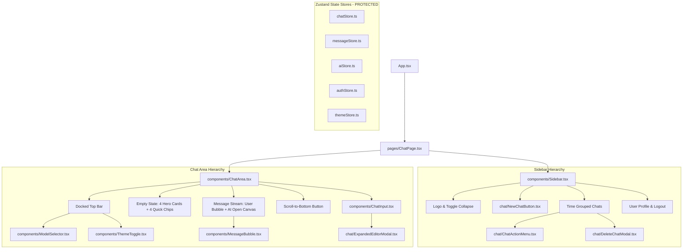

# UI/UX Redesign Plan — Premium AI Workspace
## AI Chat Clone | Master Implementation Plan (Approved Decisions Incorporated)

> **Document Status**: APPROVED DESIGN DECISIONS INCORPORATED — READY FOR REVIEW  
> **Target Scope**: `D:\ai-chat-clone-new`  
> **Design Framework**: UI/UX Pro Max Intelligence System (`.agents/skills/ui-ux-pro-max`)  
> **Approved Approach**: Option B — Significant Visual Redesign with Strict Functional Parity  
> **Execution Phase**: Planning Only (Zero code changes, zero package installations, zero commits/pushes)

---

## 1. Executive Summary & Ma trận Quyết định Đã Duyệt

Kế hoạch tái thiết kế toàn diện giao diện AI Chat Clone theo triết lý **Premium AI Workspace**:
- **Trọng tâm cốt lõi**: Đặt trải nghiệm đàm thoại làm trung tâm tuyệt đối; giảm tải nhận thức (cognitive load); phân cấp thị giác rõ ràng giữa Navigation, Conversation Stream, và Input Composer.
- **Thẩm mỹ chủ đạo**: Precision Minimalist & High-Utility Developer Workspace (tương tự Linear, Raycast, Claude Artifacts, Vercel AI Playground). Loại bỏ các hiệu ứng trang trí thừa thãi, đốm glow mờ gây xao nhãng.
- **Hai quyết định thiết kế đã được người dùng chính thức phê duyệt**:
  1. **Suggested Prompts: Phương án 2 — 4 thẻ lớn nổi bật + 4 chip gợi ý nhanh**, bảo toàn đầy đủ 8 nội dung prompt gốc hiện có.
  2. **AI Messages: Phương án 1 — Open Canvas**, giải phóng tin nhắn AI khỏi khung viền hộp kín, tạo trải nghiệm đọc tài liệu thoáng đãng tự nhiên.

### Ma trận Quyết định (Decision Matrix)

| Hạng mục | Quyết định | Trạng thái |
|---|---|---|
| **Suggested Prompts** | 4 card lớn + 4 chip | **Đã duyệt** |
| **AI message layout** | Open Canvas | **Đã duyệt** |
| **Design tokens** | Theo kế hoạch hiện tại, xác minh qua preview | **Cần kiểm chứng** |
| **Responsive behavior** | 375 / 768 / 1024 / 1440px | **Bắt buộc xác minh** |
| **Bảo toàn chức năng** | Không thay đổi logic hiện có ngoài phạm vi được duyệt | **Bắt buộc** |
| **Commit/push** | Không thực hiện trong giai đoạn này | **Cấm** |

---

## 2. Baseline Assessment & Hai Quyết định Đã Duyệt

```
┌─────────────────────────────────────────────────────────────────────────────┐
│                             CHAT WORKSPACE LAYOUT                           │
├───────────────┬─────────────────────────────────────────────────────────────┤
│               │ HEADER: [Hamburger] [Workspace Badge] [Breadcrumb] [Model] [Theme]
│               ├─────────────────────────────────────────────────────────────┤
│               │                                                             │
│    SIDEBAR    │ WELCOME SCREEN (Phương án 2 ĐÃ DUYỆT):                      │
│               │  - Header & Greeting cân đối ở trung tâm thị giác           │
│ - Brand Logo  │  - 4 Thẻ lớn nổi bật (Lập trình, Sáng tạo, Dữ liệu, Ý tưởng)│
│ - New Chat    │  - 4 Chip gợi ý nhanh bên dưới (Khoa học, Thuật toán,...)  │
│ - Date Groups │  - Xóa bỏ hoàn toàn khoảng trống thừa vô nghĩa              │
│ - User Footer │                                                             │
│               │ MESSAGE STREAM (Open Canvas ĐÃ DUYỆT):                      │
│               │  - User Message: Bong bóng nổi bật, căn phải                │
│               │  - AI Message: Open Canvas (không khung viền hộp bao bọc)   │
│               │  - Code block: Surface riêng sắc nét, copy, syntax highlight│
│               ├─────────────────────────────────────────────────────────────┤
│               │ COMPOSER:                                                   │
│               │  - Control Island: [+] [Textarea] [Expand] [Send/Stop]      │
│               │  - Status line tích hợp gọn gàng trong composer             │
└───────────────┴─────────────────────────────────────────────────────────────┘
```

### 2.1. Quyết định 1: Suggested Prompts — 4 Thẻ Lớn + 4 Chip Gợi Ý Nhanh

#### Cấu trúc thiết kế đã duyệt:
- **4 Thẻ Lớn (Hero Cards)**: Đóng vai trò là điểm nhấn thị giác chính của Welcome Screen, đại diện cho 4 nhóm tác vụ cốt lõi:
  1. *Lập trình & Kỹ thuật*: "Viết mã Python so sánh hai chuỗi" (Icon: `code`, Thẻ màu tím/xanh ngọc subtle).
  2. *Sáng tạo & Viết lách*: "Sáng tạo câu chuyện ngắn về robot" (Icon: `feather`, Thẻ màu hổ phách/cam subtle).
  3. *Phân tích Dữ liệu*: "Phân tích dữ liệu với Pandas" (Icon: `cpu`, Thẻ màu đỏ hồng/rose subtle).
  4. *Ý tưởng & Năng suất*: "Lên ý tưởng bài thuyết trình" (Icon: `book`, Thẻ màu cam/vàng subtle).
- **4 Chip Gợi Ý Nhanh (Quick Chips)**: Đặt ngay phía dưới 4 thẻ lớn, thiết kế tinh gọn dạng pill không cạnh tranh thị giác:
  1. *Khoa học & Khái niệm*: "Giải thích cơ học lượng tử đơn giản" (Icon: `compass`).
  2. *Thuật toán & Tối ưu*: "Tối ưu hóa thuật toán tìm kiếm" (Icon: `sparkles`).
  3. *Hệ thống & Phần cứng*: "So sánh RAM và bộ nhớ đệm CPU" (Icon: `server`).
  4. *Giải thuật logic*: "Kiểm tra chuỗi Palindrome" (Icon: `globe`).
- **Nguyên tắc bảo toàn**:
  - Giữ nguyên 100% cả 8 nội dung prompt gốc hiện có trong `ChatArea.tsx`.
  - Không tự ý thêm prompt mới hoặc xóa prompt cũ.
  - Khi click vào bất kỳ card hay chip nào, kích hoạt đúng sự kiện `ai-chat-prompt-select` để tự động điền vào Composer.

#### Tiêu chí nghiệm thu trực quan cho Suggested Prompts:
- 4 card lớn phải là điểm nhấn thị giác rõ ràng của Welcome Screen.
- 4 chip dễ nhận biết, gọn gàng, không cạnh tranh thị giác với card lớn.
- Người dùng phân biệt được card và chip ngay từ cái nhìn đầu tiên.
- Khu vực chào mừng được cân đối theo chiều dọc, xóa bỏ khoảng trống thừa giữa nội dung và composer.
- Không có card hoặc chip nào bị cắt, tràn hay chồng lấn ở các viewport 375px, 768px, 1024px và 1440px.
- Cả 8 gợi ý đều kích hoạt đúng hành vi gửi/chọn prompt.

---

### 2.2. Quyết định 2: AI Messages — Open Canvas Architecture

#### Cấu trúc thiết kế đã duyệt:
- **Nội dung AI hiển thị trên Canvas Mở (Open Canvas)**:
  - Loại bỏ hoàn toàn chiếc khung viền hộp kín bao quanh toàn bộ message AI (`border rounded-2xl bg-white dark:bg-[#121824]/90`).
  - Nội dung tin nhắn AI chảy tự nhiên trực tiếp trên nền canvas của workspace, tạo cảm giác đọc một tài liệu số tinh tế, sang trọng (tương tự trải nghiệm Claude / ChatGPT Canvas).
  - Phân biệt với tin nhắn User (vẫn là bong bóng bo góc có nền nổi bật căn phải) bằng cấu trúc lề phẳng bên trái, khoảng cách rộng rãi và phân cấp typography.
- **Nhận diện AI & Message Controls**:
  - Header tin nhắn AI nhỏ gọn gồm Avatar AI nhận diện thương hiệu và nhãn vai trò "AI".
  - Thanh công cụ hành động (Copy nội dung, Regenerate) hiển thị tinh tế ở cuối tin nhắn, opacity chuyển từ 80% lên 100% khi hover vào cụm tin nhắn.
- **Code Block & Markdown Components**:
  - Code blocks bên trong AI message vẫn sử dụng surface riêng biệt (`rounded-xl border border-slate-200 dark:border-white/10 bg-slate-900/95 dark:bg-[#0d131d]`) để đảm bảo độ tương phản đọc code tuyệt đối. Quyết định Open Canvas không làm mất nền hay viền của các khối code.
  - Header của code block tích hợp nhãn ngôn ngữ lập trình rõ nét và nút Copy code riêng biệt.
  - Inline code (`<code>`) có background padding nhẹ để phân biệt rõ với văn bản thông thường.

#### Logic bắt buộc bảo toàn cho AI Messages:
- Logic Typewriter queue và con trỏ gõ chữ `▌` (`.ai-cursor`) trong `renderChildrenWithCursor`.
- Trạng thái streaming và chỉ báo "AI đang trả lời..." kèm pulse indicator.
- Markdown rendering (tables, lists, blockquotes, links, images).
- Nút Copy tin nhắn và nút Regenerate (chỉ xuất hiện ở tin nhắn assistant cuối cùng).
- Error handling, tự động cuộn (auto-scroll) và Smart Scroll button ("Cuộn xuống tin nhắn mới nhất" / "Tin nhắn mới").
- Tuyệt đối không thay đổi API, Zustand store contracts, message schema hay logic streaming.

#### Tiêu chí nghiệm thu trực quan cho AI Messages:
- Tin nhắn AI trông như nội dung tài liệu mở trên canvas, không còn cảm giác bị đóng gói trong một chiếc hộp chật chội.
- Phân cấp rõ ràng giữa nội dung chính, heading markdown, code block và các nút thao tác.
- Đoạn code dài có thanh cuộn ngang nội bộ, không làm tràn viewport.
- Nội dung Markdown đạt độ tương phản chuẩn WCAG AA trong cả Light và Dark mode.
- Trạng thái streaming hiển thị mượt mà, không gây nhảy layout (layout shift) giật cục.
- Tin nhắn người dùng (căn phải, bo tròn, nền elevated) và tin nhắn AI (căn trái, open canvas) phân biệt tức thì.

---

## 3. Kiến trúc Hiện tại & Sơ đồ Component



---

## 4. Định hướng Thiết kế & Hệ thống Token (Design Direction & Tokens)

### 4.1. Color Tokens (CSS Custom Properties)

#### Dark Theme
- **Canvas Base**: `#0B0F17` (Nền chính của toàn bộ workspace và AI Open Canvas).
- **Sidebar Background**: `#131923` (Phân định bằng border 1px tinh tế).
- **Surface Elevated (User Bubble, Code Blocks, Composer, Dropdowns)**: `#1A2230`.
- **Surface Hover**: `#222C3D`.
- **Surface Active**: `#2A374C`.
- **Border Subtle**: `rgba(255, 255, 255, 0.08)`.
- **Border Focused**: `rgba(27, 143, 61, 0.5)`.
- **Text Primary**: `#F8FAFC`.
- **Text Secondary**: `#94A3B8`.
- **Text Muted**: `#64748B`.
- **Brand Primary Green**: `#1B8F3D` (Active indicator, Send, Streaming Pulse).
- **Brand Danger Red**: `#B91E2B` (Nút dừng khẩn cấp, Xóa hội thoại, Destructive actions).

#### Light Theme
- **Canvas Base**: `#F8FAFC`.
- **Sidebar Background**: `#FFFFFF`.
- **Surface Elevated**: `#FFFFFF`.
- **Surface Hover**: `#F1F5F9`.
- **Surface Active**: `#E2E8F0`.
- **Border Subtle**: `#E2E8F0`.
- **Border Focused**: `rgba(27, 143, 61, 0.6)`.
- **Text Primary**: `#0F172A`.
- **Text Secondary**: `#475569`.
- **Text Muted**: `#94A3B8`.
- **Brand Primary Green**: `#1B8F3D` (Hover: `#167632`).
- **Brand Danger Red**: `#B91E2B` (Hover: `#9E1924`).

### 4.2. Typography Scale
Dựa trên font **Inter** kết hợp System Monospace cho Code blocks:
- **Hero Title**: `26px` (1.625rem), Weight 700, Tracking `-0.025em`, Leading `1.25`.
- **Section / Label Uppercase**: `11px` (0.6875rem), Weight 600, Tracking `0.06em`, `uppercase`.
- **Header Title**: `14px` (0.875rem), Weight 600, Tracking `-0.01em`.
- **Message Content**: `14px` (0.875rem), Weight 400, Leading `1.65` (chuẩn công thái học cho đọc lâu).
- **Code Block**: `13px` (0.8125rem), Font Mono (`ui-monospace, SFMono-Regular, Menlo, Consolas`).
- **Metadata / Subtext**: `12px` (0.75rem), Weight 400, Leading `1.4`.

### 4.3. Spacing, Radius & Elevation
- **Border Radius**:
  - `rounded-lg`: `8px` (Nút nhỏ, action menu item, prompt chips).
  - `rounded-xl`: `12px` (4 hero prompt cards, dropdown menu, avatar container, code block container).
  - `rounded-2xl`: `16px` (User message bubble, Composer container, Modal dialog).
  - `rounded-full`: Nút icon tròn (Send, Stop, Attach, Scroll to bottom).
- **Elevation Shadows**:
  - Light mode: `0 4px 20px -2px rgba(15, 23, 42, 0.06)`.
  - Dark mode: `0 8px 24px -4px rgba(0, 0, 0, 0.45)`.
- **Motion**: 150ms – 200ms `cubic-bezier(0.16, 1, 0.3, 1)`, tôn trọng hoàn toàn `@media (prefers-reduced-motion: reduce)`.

---

## 5. Ma trận Thay đổi Thị giác vs. Logic Bắt Buộc Bảo Toàn

| Thành phần UI | Thay đổi Thị giác Đã Duyệt (Nhóm A) | Logic Nghiệp vụ Phải Bảo toàn 100% (Nhóm B) |
|---|---|---|
| **Welcome Screen** | 4 card lớn nổi bật + 4 chip gợi ý nhanh bên dưới; căn chỉnh trọng tâm giữa trang. | 100% cả 8 nội dung prompt gốc; sự kiện `ai-chat-prompt-select`; text accessible cho test. |
| **AI Message** | **Open Canvas**: Loại bỏ khung viền hộp kín ngoài cùng, hiển thị thoáng đãng trên nền canvas. | Con trỏ gõ chữ `▌`, Typewriter queue, Markdown rendering, Copy tin nhắn, Regenerate, Auto-scroll. |
| **Code Block** | Surface riêng có border subtle; header ngôn ngữ + nút copy code; theme sắc nét cho cả Light/Dark. | Cú pháp highlight Prism, hàm `handleCodeCopy()`, xử lý chuỗi code. |
| **User Message** | Bong bóng căn phải, bo góc mềm, nền elevated tương phản cao, typography đồng bộ. | Render tệp đính kèm (`attachments`), vai trò `role: 'user'`. |
| **Layout & Canvas** | Tối ưu docked layout, làm phẳng viền, dọn dẹp các đốm glow mờ gây xao nhãng. | Giữ nguyên responsive props `onOpenMobileSidebar`, `isSidebarCollapsed`. |
| **Sidebar** | Nâng cấp nút "Đoạn chat mới" nổi bật, tinh chỉnh typography nhóm ngày, active highlight, hover mượt. | Giữ nguyên logic `createChat()`, `handleSelectChat()`, `groupChatsByDate()`, `scrollIntoView` của active chat. |
| **Header** | Chiều cao chuẩn 52px-56px, tinh gọn breadcrumbs, căn chỉnh Model Selector và Theme Toggle. | Giữ nguyên tiêu đề chat lấy từ `currentChat.title`, phím bấm mở mobile sidebar. |
| **Model Selector** | Menu dropdown hiển thị badge phân loại, thông tin model rõ nét, hover state sang trọng. | Danh sách models động từ backend (`getAIModels()`), logic chọn model `setSelectedModelId()`, vô hiệu hóa model khi `available === false`. |
| **Composer** | Bề mặt control island cao cấp, viền focus glow, tích hợp chỉ báo model và file preview vào một thanh liền mạch. | Logic gửi tin nhắn `streamMessage()`, tạo chat mới tự động nếu chưa có ID, `handleStopAction()`, phím tắt Enter / Shift+Enter. |

---

## 6. Lộ trình Triển khai theo 9 Milestones Độc Lập

### Milestone 0 — Audit, Baseline & Visual Acceptance Criteria
- **Mục tiêu**: Thiết lập bộ dữ liệu kiểm chứng trực quan và kỹ thuật trước khi can thiệp code.
- **Phạm vi**:
  - Ghi nhận trạng thái `git status` và bảo vệ working tree hiện có.
  - Chạy toàn bộ test suites (`backend` và `frontend`) và linter để xác nhận baseline xanh 100%.
  - Ghi nhận snapshot baseline của giao diện hiện tại ở cả Light và Dark mode.
- **Tiêu chí nghiệm thu**: Báo cáo đầy đủ hiện trạng, không sửa bất kỳ dòng code nào.

### Milestone 1 — Workspace Layout & Design System Foundation
- **Mục tiêu**: Chuẩn hóa toàn bộ design tokens trong `frontend/src/index.css` và định hình layout docked workspace trong `ChatLayout.tsx` & `ChatPage.tsx`.
- **Phạm vi**:
  - Định nghĩa biến CSS `:root` và `.dark` chuẩn mực.
  - Chuẩn hóa quy tắc tương thích Tailwind CSS v4 (`@custom-variant dark`).
  - Tinh giản background và hiệu ứng làm mờ để đạt hiệu năng render tối đa.
- **Tiêu chí nghiệm thu**: Layout hiển thị liền mạch, không bị đứt đoạn hay xuất hiện viền thừa; build và test layout pass 100%.

### Milestone 2 — Sidebar & Conversation Navigation
- **Mục tiêu**: Nâng cấp toàn diện Sidebar thành thanh điều hướng đẳng cấp chuyên nghiệp.
- **Phạm vi**:
  - `NewChatButton.tsx`: Tạo điểm nhấn thị giác cho hành động tạo chat mới.
  - `Sidebar.tsx`: Hoàn thiện nhóm ngày, active indicator với accent green `#1B8F3D`, typography nhãn nhóm sắc nét.
  - Inline Rename Input và Context Menu (`ChatActionMenu.tsx`).
  - Footer thông tin người dùng và nút Đăng xuất.
- **Tiêu chí nghiệm thu**: `Sidebar.test.tsx` (22 tests) và `NewChatButton.test.tsx` (3 tests) pass 100%; thao tác đổi tên, xóa chat, chuyển chat hoạt động trơn tru.

### Milestone 3 — Header, Model Selector & Theme Toggle
- **Mục tiêu**: Tối ưu hóa thanh điều hướng trên cùng và trải nghiệm chọn AI model.
- **Phạm vi**:
  - `ChatArea.tsx` (phần Header): Tinh gọn breadcrumb, căn chỉnh tỷ lệ các nút điều khiển.
  - `ModelSelector.tsx`: Dropdown menu với visual meta phong phú, badge phân loại, trạng thái disabled rõ ràng, hỗ trợ bàn phím (Esc, Tab).
  - `ThemeToggle.tsx`: Đồng bộ kích thước và icon transition.
- **Tiêu chí nghiệm thu**: Model Selector luôn nhìn thấy và chọn được model trên mọi màn hình; `ModelSelector.test.tsx` và `ThemeToggle.test.tsx` pass 100%.

### Milestone 4 — Welcome Screen & Suggested Prompts (Đã duyệt: 4 Card + 4 Chip)
- **Mục tiêu**: Tái thiết kế màn hình rỗng (Empty State) theo thiết kế 4 Hero Cards + 4 Quick Chips đã được duyệt.
- **Phạm vi**:
  - Tái cấu trúc Hero Greeting: Biểu tượng AI tinh tế, lời chào người dùng cá nhân hóa, typography hiện đại.
  - Triển khai **4 Hero Cards** nổi bật đại diện cho 4 tác vụ: Coding, Writing, Data, Ideas.
  - Triển khai **4 Quick Chips** gọn gàng bên dưới: Science, Search, Systems, Strings.
  - Khắc phục triệt để tình trạng khoảng trống thừa thãi bên dưới thẻ.
- **Tiêu chí nghiệm thu**: Cả 4 card và 4 chip hiển thị cân đối, không cắt/tràn ở mọi viewport; click kích hoạt đúng prompt; `ChatArea.test.tsx` pass 100%.

### Milestone 5 — Message Experience & Content Stream (Đã duyệt: Open Canvas)
- **Mục tiêu**: Tối ưu hóa trải nghiệm đàm thoại với kiến trúc Open Canvas cho AI Message.
- **Phạm vi**:
  - `MessageBubble.tsx`: Loại bỏ khung viền bao quanh toàn bộ tin nhắn AI, hiển thị dạng Open Canvas mở rộng.
  - Code Block: Cung cấp surface riêng biệt, thanh tiêu đề ngôn ngữ và nút Copy code; tương thích màu sắc cả Light và Dark mode.
  - Bong bóng tin nhắn người dùng giữ nền elevated căn phải.
  - Bảo toàn 100% logic typewriter queue và con trỏ gõ chữ `▌`.
- **Tiêu chí nghiệm thu**: `MessageBubble.test.tsx` (19 tests) pass 100%; tin nhắn AI thoáng đãng, dễ đọc; streaming mượt mà không nhảy layout.

### Milestone 6 — Composer & Attachment Experience
- **Mục tiêu**: Nâng cấp khu vực nhập liệu thành công cụ soạn thảo trung tâm cao cấp.
- **Phạm vi**:
  - `ChatInput.tsx`: Khung điều khiển bo góc liền mạch, viền chuyển đổi êm dịu khi focus textarea.
  - Tích hợp nút Đính kèm, Textarea tự mở rộng, Nút Expand và Nút Send/Stop thành hàng điều khiển công thái học.
  - Hiển thị pill tệp đính kèm với nút xóa nhanh và tooltip dung lượng.
  - Tích hợp chỉ báo model vào thanh điều khiển composer, giải phóng dòng footer rời rạc.
  - Đồng bộ `ExpandedEditorModal.tsx` và `DeleteChatModal.tsx`.
- **Tiêu chí nghiệm thu**: `ChatInput.test.tsx` (15 tests) pass 100%; các phím tắt Enter / Shift+Enter / Ctrl+Enter hoạt động chuẩn mực.

### Milestone 7 — Responsive, Accessibility & Visual Polish
- **Mục tiêu**: Đảm bảo trải nghiệm hoàn hảo trên mọi kích thước màn hình và đạt tiêu chuẩn trợ năng WCAG.
- **Phạm vi**:
  - Kiểm tra hiển thị tại các breakpoint: 375px (Mobile), 768px (Tablet), 1024px (Laptop), 1440px (Desktop).
  - Tỷ lệ tương phản chữ đạt tối thiểu 4.5:1 (WCAG AA).
  - Focus ring rõ ràng khi điều hướng bằng bàn phím (Tab).
  - Tôn trọng thuộc tính `prefers-reduced-motion`.
- **Tiêu chí nghiệm thu**: Không có lỗi tràn viền ngang (horizontal overflow); không mất nút điều khiển quan trọng trên mobile.

### Milestone 8 — Final Regression & Delivery
- **Mục tiêu**: Nghiệm thu toàn diện trước khi bàn giao.
- **Phạm vi**:
  - Chạy toàn bộ 22 test suites (203+ tests) trong Vitest.
  - Chạy `npm run lint` (oxlint) đạt 0 errors.
  - Chạy `npm run build` (TypeScript + Vite) thành công.
  - Kiểm tra đối chiếu diff cuối cùng.
  - Không commit, không push.
- **Tiêu chí nghiệm thu**: Báo cáo tổng kết đầy đủ bằng chứng kiểm thử và tài liệu bàn giao.

---

## 7. Quy trình Bắt buộc Cho Từng Milestone (10 Bước Nghiêm Ngặt)

Mỗi milestone phải tuân thủ nghiêm ngặt quy trình 10 bước sau:

1. **Ghi nhận screenshot baseline** trước khi thực hiện bất kỳ thay đổi nào.
2. **Chạy ứng dụng trong browser preview thực tế** (cổng Vite 5174 hoặc tương ứng).
3. **Kiểm tra cả hai trạng thái**: empty state (chưa có tin nhắn) và một cuộc trò chuyện có nội dung thực tế.
4. **Kiểm tra cả hai theme**: Light mode và Dark mode.
5. **Kiểm tra đầy đủ các viewport**: 375px (Mobile), 768px (Tablet), 1024px (Laptop), và 1440px (Desktop).
6. **Chụp screenshot sau triển khai** tại đúng viewport và trạng thái giao diện tương ứng.
7. **So sánh trực tiếp trước/sau**, chỉ rõ những điểm khác biệt thực tế đã đạt được.
8. **Xác minh các chức năng liên quan** bằng thao tác click, gõ phím trực tiếp trên trình duyệt.
9. **Chạy bộ kiểm thử tự động**: test suites liên quan, `npm run lint` và `npm run build`.
10. **Báo cáo rõ tiêu chí đạt/chưa đạt và dừng lại** để người dùng xem xét, phê duyệt trước khi chuyển sang milestone tiếp theo.

> **QUY TẮC CỐT LÕI**: Tuyệt đối không được coi việc test pass hoặc build thành công là bằng chứng duy nhất để nghiệm thu giao diện. Nếu môi trường không thể mở browser automation, phải nêu rõ giới hạn kỹ thuật và hướng dẫn người dùng mở preview cục bộ để xác nhận trực quan.

---

## 8. Kế hoạch Thay đổi Chi tiết theo Từng Tệp (File-Level Change Plan)

| Tệp mục tiêu | Trách nhiệm hiện tại | Thay đổi dự kiến | Rủi ro & Chiến lược phòng ngừa |
|---|---|---|---|
| `frontend/src/index.css` | Quản lý CSS tokens và global styles | Bổ sung các biến `--workspace-*`, tối ưu animations, tinh chỉnh markdown styles | Rủi ro chọi màu Tailwind v4; kiểm tra bằng build và linter |
| `frontend/src/pages/ChatPage.tsx` | Layout gốc chứa Sidebar và ChatArea | Căn chỉnh layout docked workspace phẳng | Rủi ro vỡ cấu trúc responsive mobile; kiểm tra breakpoint 375px |
| `frontend/src/components/ui/sidebar.tsx` | Primitive components cho sidebar | Tinh chỉnh padding, hover surface, border tokens | Giữ nguyên prop interfaces để không ảnh hưởng test |
| `frontend/src/components/Sidebar.tsx` | Quản lý danh sách chat, CRUD, user footer | Tối ưu visual hierarchy, active indicator, action menu | Giữ nguyên ID, aria-label, hàm gọi service |
| `frontend/src/components/chat/NewChatButton.tsx` | Nút tạo chat mới | Thiết kế nút primary elevated nổi bật | Giữ nguyên text "Đoạn chat mới" cho test |
| `frontend/src/components/ChatArea.tsx` | Điều phối Header, Welcome, Messages, Composer | Triển khai 4 Hero Cards + 4 Quick Chips; docked header | Giữ nguyên `currentChatId` handling, event listeners, accessible text |
| `frontend/src/components/ModelSelector.tsx` | Dropdown chọn model AI | Tinh chỉnh menu hiển thị, badge trạng thái | Giữ nguyên ID `model-selector-btn`, trigger dropdown logic |
| `frontend/src/components/ThemeToggle.tsx` | Nút chuyển theme Sáng / Tối | Chuẩn hóa kích thước 36px, hiệu ứng xoay icon | Giữ nguyên `aria-label` cho cả 2 theme |
| `frontend/src/components/MessageBubble.tsx` | Render tin nhắn người dùng và AI | Triển khai Open Canvas cho AI message, code block surface riêng | Giữ nguyên ký tự `▌` và class `.ai-cursor`, `.ai-typewriter-container` |
| `frontend/src/components/ChatInput.tsx` | Khung nhập tin nhắn và đính kèm tệp | Tinh chỉnh composer container, tích hợp status line | Giữ nguyên logic gửi, abort stream, phím tắt Enter |
| `frontend/src/components/chat/DeleteChatModal.tsx` | Modal xác nhận xóa chat | Căn chỉnh thiết kế theo design system | Giữ nguyên nút Hủy và Xóa với label hiện có |
| `frontend/src/components/chat/ExpandedEditorModal.tsx` | Trình soạn thảo mở rộng | Đồng bộ font và controls | Giữ nguyên logic đồng bộ draft với textarea chính |

---

## 9. Phân tích Rủi ro & Kế hoạch Ứng phó (Risk Assessment)

1. **Rủi ro mất Accessible Name / Phá vỡ Unit Tests**:
   - *Nguyên nhân*: Thay đổi thẻ HTML hoặc icon mà vô tình xóa text ẩn (`sr-only`) hoặc `aria-label`.
   - *Biện pháp*: Giữ nguyên 100% nhãn text kỹ thuật và các thuộc tính trợ năng hiện có.
2. **Rủi ro giật màn hình khi Auto-Scroll trong lúc Streaming**:
   - *Nguyên nhân*: Thay đổi padding hoặc cấu trúc DOM trong `MessageStream` khiến `scrollHeight` tính toán sai.
   - *Biện pháp*: Giữ nguyên hàm `handleScroll`, `forceScrollToBottom`, và cơ chế `isAtBottomRef` trong `ChatArea.tsx`.
3. **Rủi ro xung đột Tailwind CSS v4 với CSS custom variables**:
   - *Nguyên nhân*: Tailwind v4 sử dụng cấu trúc `@theme` và `@custom-variant dark`.
   - *Biện pháp*: Định nghĩa biến CSS trong `:root` và `.dark` chuẩn mực, tham chiếu qua class tiện ích hoặc hàm `var()`.
4. **Rủi ro mất Model Selector trên màn hình nhỏ**:
   - *Nguyên nhân*: Header co hẹp làm tràn các phần tử điều hướng.
   - *Biện pháp*: Áp dụng quy tắc co giãn thông minh: ưu tiên hiển thị Model Selector, rút gọn breadcrumb khi màn hình hẹp.

---

## 10. Bộ Tiêu chí Nghiệm thu Trực quan (Visual Acceptance Criteria)

Mỗi tiêu chí phải được đo lường và xác minh rõ ràng:

| Tiêu chí | Mô tả tiêu chuẩn | Cách xác minh | Kết quả mong đợi |
|---|---|---|---|
| **1. Layout Alignment** | Không có khoảng trống thừa hay khối lơ lửng đứt đoạn giữa Sidebar và ChatArea. | Kiểm tra layout trên desktop 1440px. | Sidebar và ChatArea liền mạch với đường phân tách 1px tinh tế. |
| **2. Visual Hierarchy** | Nút "Đoạn chat mới" nổi bật nhất trong sidebar; tiêu đề chào mừng cân đối giữa trang. | Quan sát tổng thể trang chủ. | Mắt người dùng nhận biết ngay primary action và trọng tâm workspace. |
| **3. Suggested Prompts (Đã duyệt)** | 4 Hero Cards nổi bật + 4 Quick Chips bên dưới; cân đối khoảng cách dọc. | Mở chat mới khi chưa có tin nhắn. | 4 card là điểm nhấn chính, 4 chip gọn gàng không cạnh tranh; không có khoảng trống thừa. |
| **4. AI Open Canvas (Đã duyệt)** | Tin nhắn AI hiển thị trên canvas mở, không đóng khung viền hộp kín. | Gửi tin nhắn và quan sát phản hồi AI. | Cảm giác đọc tài liệu số mở rộng; code block có surface riêng sắc nét. |
| **5. Typography Readability** | Khoảng cách dòng 1.65, font-weight phân cấp rõ ràng, code block dễ đọc. | Đọc một đoạn tin nhắn AI dài kèm code. | Chữ rõ nét, không mỏi mắt, code block phân biệt rõ với văn bản. |
| **6. Contrast Compliance** | Tỷ lệ tương phản chữ tối thiểu 4.5:1 ở cả Light và Dark mode. | Kiểm tra công cụ đo tương phản WCAG. | Đạt chuẩn WCAG AA trên mọi bề mặt surface. |
| **7. Interactive Feedback** | Nút bấm có hiệu ứng hover, active, focus-visible rõ ràng. | Dùng chuột hover và phím Tab điều hướng. | Viền focus ring xanh `#1B8F3D` nổi bật, không che mất nội dung. |
| **8. Responsive Integrity** | Không mất Model Selector, Send Button, hay bị tràn Prompt Cards ở mọi viewport. | Thu nhỏ màn hình xuống 375px, 768px, 1024px. | Các nút điều khiển cốt lõi luôn sẵn sàng sử dụng; layout co giãn mượt mà. |
| **9. Functional Parity** | Toàn bộ chức năng chat, gửi, nhận, copy, xóa hoạt động bình thường. | Thực hiện một vòng gửi tin nhắn và nhận phản hồi. | 100% chức năng hoạt động như cũ, không có lỗi runtime. |

---

## 11. Báo cáo Tình trạng Kế hoạch & Sẵn sàng Triển khai

1. **Những gì đã cập nhật**:
   - Tích hợp chính thức 2 quyết định thiết kế đã được người dùng phê duyệt vào toàn bộ tài liệu:
     - **Suggested Prompts**: Phương án 2 (4 Hero Cards + 4 Quick Chips), bảo toàn 8 prompt gốc.
     - **AI Messages**: Phương án 1 (Open Canvas), code block surface riêng biệt, bảo toàn streaming & typewriter cursor.
   - Thêm bảng **Ma trận Quyết định (Decision Matrix)** ở Mục 1.
   - Bổ sung **Quy trình 10 bước xác minh trực quan nghiêm ngặt** ở Mục 7.
   - Bổ sung tiêu chí nghiệm thu trực quan chi tiết cho từng quyết định ở Mục 2 và Mục 10.
2. **Trạng thái an toàn của dự án**:
   - `git status --short`: Working tree được bảo vệ nguyên vẹn 100%.
   - **Xác nhận tuyệt đối**: Không có bất kỳ tệp mã nguồn triển khai nào bị thay đổi.
   - Không commit, không push.
3. **Đề xuất bước tiếp theo**:
   - Kế hoạch đã hoàn thiện và sẵn sàng để bắt đầu thực hiện theo thứ tự.
   - Đề xuất bước khởi đầu: **Tiến hành Milestone 0 (Audit, Baseline & Visual Verification Setup)** hoặc bắt đầu **Milestone 1 (Workspace Layout & Design Tokens)** theo chỉ dẫn của người dùng.

---

## 12. Celestial Daylight Theme — Roadmap & Milestone Status

Dự án phát triển và chuẩn hóa giao diện chủ đề **Celestial Daylight** (nền trời xanh quang học cho Light Theme):

| Phase | Tên giai đoạn | Trọng tâm | Trạng thái |
|---|---|---|---|
| **Phase 0** | Architecture Audit | Rà soát kiến trúc & tính khả thi | **ACCEPTED** |
| **Phase 1** | Design Specification | Đặc tả thiết kế quang học Rayleigh | **ACCEPTED** |
| **Phase 2** | Asset Preparation | Chuẩn bị mây WebP & mặt trời SVG | **ACCEPTED** |
| **Phase 3** | Core Background Implementation | Thành phần nền `CelestialDaylightBackground` | **ACCEPTED** |
| **Phase 4** | UI Integration | Tích hợp vào `ChatBackground.tsx` & Zero Black Flash | **ACCEPTED** |
| **Phase 5** | Contrast & Polish | Độ tương phản WCAG 2.1 AA & hoàn thiện nhận diện | **COMPLETED / ACCEPTED** |
| **Phase 6** | Future Enhancements | Tinh chỉnh mở rộng trong tương lai | *Planned / Chưa thực hiện* |

### Tiến độ chi tiết Phase 5 (Contrast & Polish):
- **Milestone M1 — Welcome Screen & Header Contrast Fix**: Completed.
- **Milestone M2 — Color Token Harmonization**: Completed.
- **Milestone M3 — Chat Content & Markdown Polish**: Completed.
- **Milestone M4 — Automated Verification & Regression Testing**: Completed.
- **Final WCAG Patch 2**: Completed (loại bỏ `hover:opacity-85` trên Markdown link).
- **Final Hover Contrast Audit**: Passed after patch (toàn bộ 7 nhóm trạng thái đạt $\ge 4.5:1$).
- **Phase 5 Final Sign-off**: **Accepted**.
